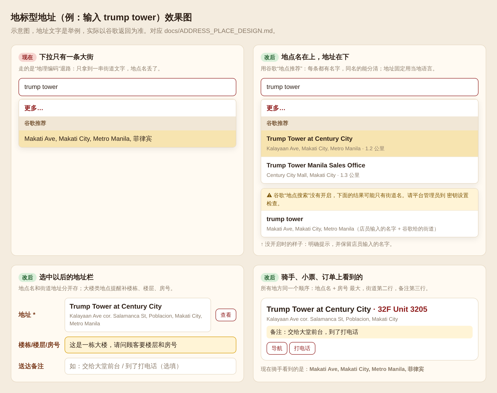

# 地标型地址优化方案（2026-11-28，v0.1，待 brian 确认）

brian 的问题：外卖代客下单（`/merchant/order/delivery`）地址框输入 `trump tower`，谷歌推荐只有一条“Makati Ave, Makati City, Metro Manila, 菲律宾”，没有地点名，也没有门牌号。点“查看”打开的经纬度却是对的 Trump Tower。这样的地址给骑手，骑手看不懂。

本文先说原因，再说业内怎么做，最后是优化方案和要 brian 决定的问题。**这次只有方案，没有改业务代码。**

效果图：`docs/address-place-screens/01-overview.png`（原型 `docs/address-place-prototype/index.html`）。

## 1. 原因

查了代码（`web/src/maps.ts` 的 `suggestPlaces`、`web/src/views/ManualOrderView.vue` 的 `useGoogle`），一共四个问题，第一个是这次截图的直接原因。

### 1.1 这次走的是“地理编码”退路，不是“地点推荐”

`suggestPlaces` 有两条路：

| | 正常路：Places API (New) 地点推荐 | 退路：Geocoding 地理编码 |
|---|---|---|
| 什么时候走 | 密钥开了 Places API (New) | 上面那条报错时，**不声不响**改走这条 |
| 拿到什么 | `mainText`（地点名，如 Trump Tower at Century City）+ `secondaryText`（所在街道、城市） | 只有 `formatted_address` 一整串 |
| 下拉怎么显示 | “地点名 · 地址”两段 | 只有一段地址 |

截图里那一行只有一段地址，没有“地点名 · ”这一截，所以是退路的样子。地理编码把 `trump tower` 认出来了（所以经纬度是对的），但它返回的 `formatted_address` 是这栋楼登记的街道地址“Makati Ave, Makati City…”，里面本来就不带楼名。brian 在谷歌地图上看到的那行地址也是同一串，谷歌地图是把楼名单独显示在标题上的。

谷歌官方文档也明说了：地理编码只适合**完整地址**；用户边打边搜、输入不完整或有歧义的，要用 Place Autocomplete（[Geocoding best practices](https://developers.google.com/maps/documentation/geocoding/best-practices)）。

最可能的原因是平台的谷歌密钥**没有启用 Places API (New)**，或者密钥的“API 限制”里没勾它（`docs/DEPLOY.md` 13.6 节有步骤）。11 月 22 日顾客端地址搜索的截图也是这个样子。**我没有真实密钥，这一点没法在这边实测**，需要 brian 在 Google Cloud 后台看一眼，或者等第一批做完后在“密钥设置”页点检测。

### 1.2 退路是静默的

Places 调不通时页面没有任何提示，店员和管理员都不知道现在拿到的是降级结果。

### 1.3 就算 Places 正常，现在的存法也不够

- 选中后把“地点名, 地址”拼成**一个字符串**塞进 `address_line`，地点名和街道地址分不开，也不存谷歌的地点 ID（`place_id`）。
- `secondaryText` 只是用来区分同名地点的“街道、城市”，**不保证有门牌号**。完整的街道地址（门牌、街道、Barangay）要在选中后另取 `formattedAddress` / `addressComponents`，现在选中后只取了经纬度（`fetchFields(['location'])`）。
- 地址文字跟着店员浏览器的语言走（截图里的“菲律宾”），菲律宾骑手看到中文国名没有用。
- 大楼类地点没有提醒店员补楼层、房号。

对比：顾客自己下单的地址表（`customer_addresses`）从一开始就是 `place_name`（地点名）+ `place_address`（地址）+ `unit`（房号）+ `note` 分开存的。代客下单、会员地址（`store_member_addresses`）、平台地址库（`address_book`）、订单（`orders.address_line`）都只有一串。

### 1.4 “打开谷歌地图”弹窗里的搜索也是地理编码

`maps.ts` 地图适配器的 `search()` 一直用地理编码，搜楼名同样只回街道。顾客端地图选点用的是同一段代码。

## 2. 业内怎么处理

| 谁 | 做法 | 来源 |
|---|---|---|
| Google 官方建议 | 地理编码只用于完整地址；用户输入用 Place Autocomplete，拿到 `place_id` 再取详情。最后一公里配送另有“楼栋入口、可导航点、附近地标”的接口 | [Geocoding best practices](https://developers.google.com/maps/documentation/geocoding/best-practices) |
| DoorDash（Drive 接口） | 送达地址之外有**单独的** `dropoff_business_name`（“骑手导航到送达点时要找的名字”）和 `dropoff_instructions`（怎么找到确切位置，例：坐电梯到 3 楼，放在铁架上） | [Ensure accurate pickup & dropoff](https://developer.doordash.com/docs/drive/how_to/pickup_dropoff_info) |
| Grab | 84% 的外卖单带顾客备注（入口、停车点、附近地标、房号）。Grab 用 AI 从备注里抽出楼名、地标、入口，骑手快到时在导航图钉上展开显示，配实景图。大型场所另外人工采集入口点 | [Grab：AI 生成配送指引](https://www.grab.com/sg/inside-grab/stories/ai-consumer-notes-food-delivery-instructions/)、[Grab：POI 入口](https://engineering.grab.com/poi-entrances-venues-door-to-door) |
| Uber Eats | 骑手到达后，App 显示顾客填的门禁、楼层等信息 | [Uber 配送指南](https://www.uber.com/en-NZ/drive/resources/guide-to-delivering-with-uber-eats) |
| 美团、饿了么、foodpanda | 没找到官方公开文章。按这些 App 的实际用法：先在地图/搜索里选一个**地点**（小区、大厦名），再单独填**门牌号**（楼栋、楼层、房号），门牌号必填。这一条是经验，不是引用 | 无 |

归纳成五条，业内基本一致：

1. **地点名是地址的第一要素。** 骑手找的是“Trump Tower”，不是“Makati Ave”。名字和街道地址分开存、分开显示，名字在前。
2. **选的是“地点”，不是“一串字”。** 用地点搜索（Autocomplete）让人选一个确定的地点，存它的 ID 和坐标。地理编码只用来处理已经写完整的地址。
3. **楼栋、楼层、房号单独一栏**，大楼类地点要主动问。
4. **备注是给骑手的最后 50 米指引**（哪个门、交给谁、到了打电话），单独一栏，显示得醒目。
5. **坐标管导航，文字管找人。** 两样都要，文字要用骑手看得懂的语言。

入口点采集、实景图、AI 整理备注这些是大平台自建地图才做得动的，我们不做（顾客端已有“门口照片”）。

## 3. 优化方案

分两批。第一批不动数据库，上线就能解决这次的问题；第二批把地点名分开存，并统一骑手看到的格式。

### 第一批：让谷歌推荐回到正确的路上

1. **检测并提示 Places 是否可用。**
   - 平台后台“密钥设置”页的谷歌地图密钥旁加“检测”按钮：分别试地图、地理编码、Places API (New)，哪项不通就写明，并给出开启步骤的链接。
   - 代客下单下拉里，如果这次走的是退路，在“谷歌推荐”下面显示一行黄色提示：“谷歌‘地点搜索’没有开启，结果可能只有街道名”。
2. **退路也不丢名字。** 退路结果的第一行用店员输入的原文（`trump tower`），第二行才是谷歌给的街道地址，选中后两样都保留。
3. **选中后多取两个字段。** `fetchFields` 从只取 `location` 改成 `location`、`formattedAddress`、`addressComponents`。地点名直接用推荐里的 `mainText`，不另取 `displayName`。
   - 费用：这三个字段都属于 Place Details **Essentials** 这一档，和现在只取 `location` 同档；`displayName` 属于更贵的 Pro 档，所以不取（[字段和计费档](https://developers.google.com/maps/documentation/places/web-service/data-fields)）。也就是**不增加谷歌费用档次**。具体单价我没有核实。
   - 第一批里先把它们拼成“地点名, 完整街道地址”写进现有的 `address_line`，比现在多了门牌和 Barangay。
4. **地址语言固定**，不跟店员浏览器走（见问题 Q3）。
5. **地图弹窗的搜索**（1.4）改成先用地点搜索，不通再退回地理编码。顾客端地图选点跟着一起好。
6. **“查看”链接带上地点 ID**（`query_place_id`），打开的是这个地点的页面，不是一个光秃秃的坐标点。不调 API，不花钱。

### 第二批：地点名分开存，骑手看到的格式统一

1. **数据**（一次迁移，老数据不动）：
   - `orders`、`store_member_addresses`、`address_book` 各加 `place_name`（地点名，可空）和 `place_id`（谷歌地点 ID，可空）。`address_line` 继续放街道地址。
   - 地址库去重：有 `place_id` 的按 `place_id`；没有的还是按现在的 `line_key`，键里加上地点名。
   - 顾客自己下的单：把已有的 `customer_addresses.place_name` / `place_address` 对应写到订单的这两栏，两种来源的订单从此是同一个结构。
2. **代客下单表单**：选中后地址栏显示成两行卡片（上面粗体地点名，下面街道地址），可以点开改字。手打的地址（没选推荐）照旧只有一行。
3. **楼栋/楼层/房号提醒**：选中的地点是大楼类（谷歌类型含 `premise`、`subpremise`、公寓、写字楼、酒店、商场等）而房号栏是空的，就把房号栏标黄并提示“这是一栋大楼，请问顾客要楼层和房号”（拦不拦下单见 Q2）。
4. **统一显示顺序**，骑手工作台、订单详情、后厨小票、发给顾客确认的话术都一样：
   - 第一行：**地点名 · 楼栋/楼层/房号**（最大）
   - 第二行：街道地址
   - 第三行：送达备注（黄底）
   - 没有地点名的老订单，第一行就是原来的地址，和现在一样。
5. **地址库**：搜索同时匹配地点名；后台 `/admin/addresses` 加“地点名”一列，可以改；“查看”带地点 ID。下拉推荐里地址库的条目也按“地点名 / 地址”两行显示。
6. **送餐地址统计、热力图**：按坐标算的，不受影响；列表里多显示地点名。

### 不涉及的

- **金额**：不改任何价格或订单金额。配送费、配送区一直按坐标算，这次不动坐标的取法。按规则不需要金额验算；如果实现时碰到算钱的代码，会按 `docs/PRICING_CHECK.md` 走。
- **余额**：不涉及。
- 顾客端仍然不出现配送区。

### 不做的（说明原因）

- 谷歌的“地址描述 / 附近地标”（Address Descriptors）：目前只有印度是正式版，其他地区是实验阶段（[覆盖范围](https://developers.google.com/maps/documentation/geocoding/address-descriptors/coverage)），先不用。
- 自己采集楼栋入口、实景图，AI 整理备注：投入大，现在的单量用不上。
- 给老订单、老地址批量补地点名：要按条调谷歌，花钱，而且老地址本来就是店员确认过的（见 Q5）。

## 4. 测试

- 模拟谷歌（`e2e/fake-google.js`）加一个“只有街道地址的地标”和“Places 不可用”两种情况，`e2e/addressbook.cjs` 覆盖：正常路显示两行、选中后带门牌、退路有黄色提示并保留输入的名字、大楼提醒、骑手端显示顺序。
- Go：地址库按 `place_id` 去重、老数据兼容、顾客单和代客单写入同样的结构。
- **真实密钥**下的效果这边测不了，第一批合并后请 brian 用真实密钥再搜一次 `trump tower` 看结果。

## 5. 需要 brian 决定的问题

| # | 问题 | 选项 | 推荐 |
|---|---|---|---|
| Q1 | 地点名和街道地址要不要分开存（第二批） | A 分开存；B 不分，只把名字拼在地址前面（只做第一批） | **A**。业内都是分开的，顾客端也已经是分开的；分开后骑手端才能把楼名放大显示，地址库也能按地点去重 |
| Q2 | 大楼类地点没填楼层房号时 | A 标黄提醒，不拦下单；B 必须填才能下单；C 不管 | **A**。店员是照微信抄的，有时顾客确实只说了楼名（公司前台、大堂取），拦住会卡单 |
| Q3 | 谷歌地址用什么语言 | A 门店所在国家的当地通用写法（菲律宾就是英文）；B 一律英文；C 跟店员界面语言（现在这样） | **A**。地址是给当地骑手看的；地点名本身谷歌一般给的就是招牌上的写法 |
| Q4 | Places 没开启时 | A 显示黄色提示，保留地理编码退路；B 直接不给谷歌推荐，只提示去开启 | **A**。有结果总比没有好，但要让人知道这是降级结果 |
| Q5 | 老订单、老地址 | A 不动；B 批量调谷歌补地点名 | **A**。B 要花谷歌调用费，补回来的名字也未必是顾客当时说的 |
| Q6 | 顾客端地图选点的搜索要不要一起改（第一批第 5 条） | A 一起改；B 只改代客下单 | **A**。是同一段代码，同一个毛病 |
| Q7 | 分批 | A 两批（先第一批，再第二批）；B 一次做完 | **A**。第一批小、不动数据库，能马上解决 trump tower 的问题 |

另外有一件事只有 brian 能做：到 Google Cloud 后台确认这把密钥已启用 **Places API (New)**，并且密钥的 API 限制里包含它（`docs/DEPLOY.md` 13.6）。只要这一步做了，现在的代码不改，`trump tower` 的下拉就会变成“Trump Tower at Century City · 街道”，能先缓解。

## 6. 没验证的地方

- 没有真实谷歌密钥，1.1 的原因是从代码和截图的样子推出来的，没有实测。
- `mainText` 对商家类地点返回的就是地点名，这是谷歌参考文档对该字段的定义（“地点的名称”），没有用真实请求验证 Trump Tower 这一条的实际返回。
- `addressComponents` 在菲律宾能不能稳定给出门牌号，要看谷歌的数据。Trump Tower 这栋楼谷歌登记的地址本身可能就没有门牌，这种情况只能靠地点名加坐标，所以地点名必须保住。
- 谷歌各档的单价没有核实，只核实了字段属于哪一档。
