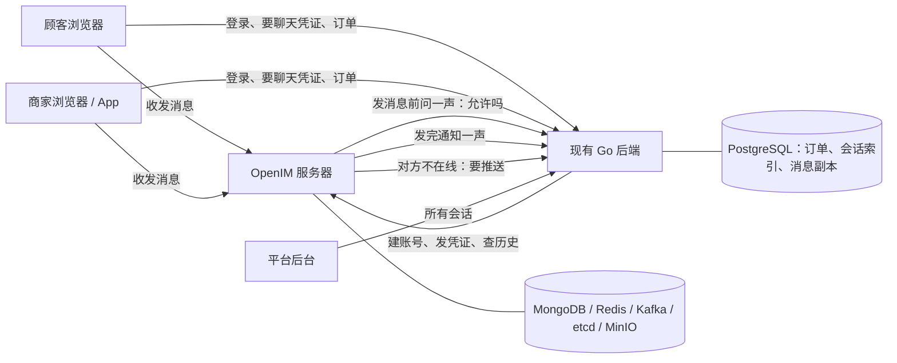
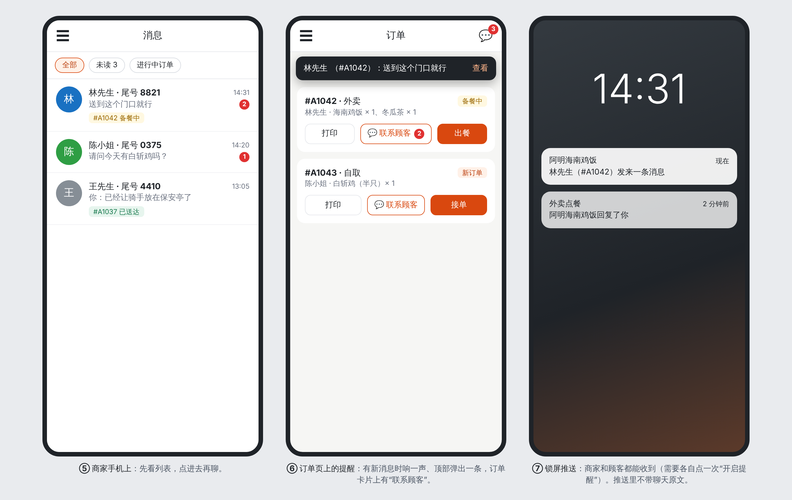
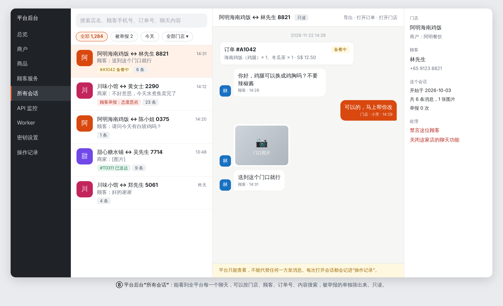

# 顾客和商家聊天消息 · 设计方案 v0.2（基于 OpenIM）

2026-11-23 · brian 已确认（第 14 节都按推荐），正在分批实现。实测结果和跟本稿不一样的地方记在第 16 节，以第 16 节为准。

v0.2 改动（按 brian 的要求）：
1. 聊天改成**基于 OpenIM 搭建**（v0.1 推荐的是自己写在现有后端里，那一版的比较表留在第 2 节备查）。
2. 平台管理员后台新增“**所有会话**”页面，能看到全平台每一个聊天，见第 6 节。v0.1 里“平台只能看被举报的聊天”这一条作废。

brian 最初的要求：外卖客户端和商家端各新增一个消息页面，顾客和商家可以在里面互相沟通，是一个简易的 IM 系统。

效果图在 [chat-screens/](chat-screens/)，可点开的 HTML 原型在 [chat-prototype/](chat-prototype/)（`index.html?s=customer｜merchant｜mphone｜admin`）。店名、人名、订单、金额都是示意数据。

## 1. OpenIM 是什么，用它意味着什么

OpenIM 是一套开源的聊天服务器（也是 Go 写的），装在自己的服务器上，聊天记录在自己手里，不按月收费。它负责“把消息实时送到、多台设备同步、离线后补收、存历史、存图片”这些聊天的基本功；我们的系统负责“谁能和谁聊、订单卡片、举报、平台查看、和订单页的联动”。

用它之前要先知道三件事（2026-11-22 查官方资料得到，出处见第 15 节）：

| 事情 | 情况 | 对我们的影响 |
|---|---|---|
| 要多装的东西 | 除了 OpenIM 本身，它还依赖 MongoDB、Redis、Kafka、etcd、MinIO 五个服务 | 现在的部署只有后端、PostgreSQL、Caddy 三样，会变成九样左右。都用 Docker Compose 一起启动，但备份、升级、出问题排查都更复杂 |
| 服务器要多大 | 官方给的参考配置是 8 核 CPU、16 GB 内存、1 TB 硬盘（按 10 万注册用户估的） | 我们量小，用不到这么多。我估计起步要 **4 核 8 GB**，这个数是估的，第一批会在云端实际装一遍量出来再定 |
| 授权条款 | 服务器是 Apache 2.0，可以免费商用。但浏览器用的官方网页 SDK（`@openim/wasm-client-sdk`）是 **AGPL-3.0 或者买商业授权** 二选一 | AGPL 的意思是：用了它的网页，源代码要对用户公开。这一条要 brian 决定怎么处理，见第 3 节和第 14 节问题 1 |

## 2. 和其它做法的比较（备查）

| | 基于 OpenIM（本稿） | 自己写在现有后端里（v0.1） | 第三方收费服务（腾讯云 IM、Sendbird 这类） |
|---|---|---|---|
| 费用 | 软件免费；服务器要升级；网页 SDK 可能要买授权 | 0 | 一般按每月活跃人数收费 |
| 要多装的服务 | 6 个（OpenIM 加 5 个依赖） | 0 | 0 |
| 聊天记录在哪 | 自己的服务器 | 自己的数据库 | 对方的服务器 |
| 多设备同步、离线补收、消息顺序 | 现成的，经过大量用户验证 | 自己写，够用但简单 | 现成的 |
| 以后加群聊、语音视频、撤回、正在输入 | 大部分现成，打开就能用 | 都要自己写 | 现成的 |
| 以后做 iPhone / 安卓原生 App | 有官方 SDK | 自己写 | 有官方 SDK |
| 开发量 | 中等偏多：聊天基本功不用写，但部署、账号同步、回调对接要写 | 中等 | 中等 |
| 运维难度 | 高 | 低 | 低 |

一句话：OpenIM 的好处在“以后”，功能上限高、换成原生 App 也接得上；代价在“现在”，服务器更大、部署更复杂。既然定了用 OpenIM，下面的设计尽量把这个代价压低：OpenIM 整套做成 Docker Compose 里的一个可选组，不开聊天的部署不受影响。

## 3. 接入方式

### 3.1 两种接法

| | 接法一：浏览器直接连 OpenIM（推荐） | 接法二：浏览器只连我们的后端，后端再转给 OpenIM |
|---|---|---|
| 做法 | 页面里用 OpenIM 的网页 SDK 登录、收发消息 | 页面还是调我们自己的接口，实时提醒用现有的 SSE；后端用 OpenIM 的服务端接口存取消息 |
| 用到 OpenIM 多少 | 全部：实时通道、多设备同步、离线补收、图片上传 | 只当它是存消息的地方，实时和同步其实还是我们自己做 |
| 授权问题 | 网页 SDK 是 AGPL 或商业授权，要处理 | 没有，只用到 Apache 2.0 的服务器 |
| 评价 | 这才是用 OpenIM 的本意 | 等于花了部署 OpenIM 的代价，却没用到它的长处 |

推荐接法一。授权有三种处理办法，由 brian 选（第 14 节问题 1）：

- **A. 前端代码按 AGPL 公开**。如果这个仓库本来就公开、也不介意别人看前端代码，这样最省事，不花钱。
- **B. 向 OpenIM 买商业授权**。价格要问他们，我查不到公开报价。
- **C. 不用官方网页 SDK，退到接法二**。不花钱也不用公开，但 OpenIM 的长处用不上。

法律条款我只能照官方写的转述，正式商用前建议让懂授权的人再看一眼。

### 3.2 整体结构

- **账号**：顾客登录我们系统后，后端在 OpenIM 里给他建一个对应账号（编号 `c_顾客编号`），并发一张有时效的聊天凭证，页面拿它登录 OpenIM。顾客不用另外注册，也感觉不到有两套系统。
- **门店**：每家门店在 OpenIM 里是一个账号（`b_门店编号`），店长和前台用同一个门店账号收发，所以是“一家店一个收件箱”。是谁回的，写在消息的附加字段里。
- **聊天**：一个顾客和一家店的聊天，就是 OpenIM 里这两个账号之间的单聊，天然只有一个。
- **规矩由我们的后端说了算**：OpenIM 每条消息发出前会先问我们的后端（回调）。拉黑、禁言、频率限制、“商家只能从 7 天内的订单主动找顾客”都在这里判断，不允许就拒掉。
- **消息副本**：每条消息发完后，OpenIM 通知我们的后端，后端在 PostgreSQL 里存一份副本和会话索引。平台后台的“所有会话”、举报时附带的聊天内容、订单页上的未读红点、短信兜底，都靠这份副本，不用去翻 OpenIM 的内部数据。
- **订单卡片**：用 OpenIM 的“自定义消息”，里面只放订单编号，显示时再向我们的后端取最新状态。
- **图片**：由网页 SDK 直接传到 MinIO（OpenIM 自带的文件存储），发之前在手机上压小。

## 4. 顾客端

效果图 [01-customer.png](chat-screens/01-customer.png)

### 4.1 消息页（和“我的消息”合并）

- 现在的“我的消息”页（`/me/messages`，PR #48）只有系统通知。改成两个标签：**聊天** 和 **通知**。通知就是原来的内容，一点不变。
- “聊天”标签列出我聊过的店：店铺头像、店名、最后一条消息、时间、未读数。按最后一条消息的时间排，最新的在上。
- **商城右上角的消息按钮**（商城方案 v0.3，PR #50）也打开这一页。按钮上的红点数字 = 未读聊天数 + 未读通知数，用同一个接口取，“我的”页里“我的消息”那一行的红点也用它。两边谁先做完都不冲突：聊天先上线时，商城做出来直接接这个接口；商城先上线时，按钮先只算通知。

### 4.2 从哪里开始聊

| 入口 | 行为 |
|---|---|
| 点餐页的店铺卡、“商家”标签页 | “联系商家”按钮，打开和这家店的聊天 |
| 订单详情页 | “联系商家”按钮，打开聊天并自动带上这张订单的卡片 |
| 消息页的聊天列表 | 继续以前的聊天 |

要先登录（短信验证码，已有）才能聊。没登录点“联系商家”先跳登录页，登录后回来。

### 4.3 聊天页

- **一个顾客和一家店只有一个聊天**，不按订单分开。问哪张订单，就在聊天里发一张订单卡片。这样顾客和商家的列表都不会被拆得很碎，商家也能看到这位顾客之前说过什么。
- 能发：**文字**（一条最多 1000 字）、**图片**（一次最多 9 张，发之前在手机上自动压小）、**订单卡片**（从“更多”里选我在这家店的订单）。
- 订单卡片上的状态是实时的（备餐中、配送中、已送达），点开是订单详情。
- 自己发的最后一条消息下面显示“已读”。
- 顶部显示店名、是否营业。打烊时发消息会收到一条自动回复（商家可以改文字，见 5.4）。
- 第一版不做：语音、视频、文件、表情包、撤回、“对方正在输入”。
- 消息里的网址只显示成普通文字，不能点，防止有人发钓鱼链接。

### 4.4 更多菜单

打电话给商家、发送我的订单、不再提醒这家店的消息、举报这个商家、删除这个聊天（只在我这边不显示，商家那边还在）。

## 5. 商家端

效果图 [02-merchant-pc.png](chat-screens/02-merchant-pc.png)、[03-merchant-phone.png](chat-screens/03-merchant-phone.png)

### 5.1 “消息”页

- 左侧菜单在“后厨”下面加一项“消息”，带未读数。
- 电脑和 iPad 上是三栏：聊天列表、聊天内容、这位顾客的订单。手机上先看列表，点进去再聊。
- 列表可以筛选“未读”和“进行中订单”（这位顾客有还没完成的订单），可以按顾客称呼、手机尾号、订单号搜索。
- 有进行中订单的聊天排在最前面，因为这些最急。

### 5.2 一家店一个收件箱

- 聊天属于门店，不属于某个员工。**店长和前台**都能看和回（和现在能看订单页的人一致），后厨和骑手看不到。
- 一个人看过就算这家店“已读”。
- 每条回复记下是谁发的，商家端在消息下面显示员工名字；顾客端只显示店名和店铺头像。

### 5.3 商家能不能主动找顾客

能，但只能从订单出发：在订单页的订单卡片上点“联系顾客”。条件是这位顾客**在本店下过单，并且订单在 7 天之内**。聊天已经存在的（顾客先找过来的），随时可以回。

这样商家可以问“这道菜卖完了，换一个可以吗”“骑手找不到门口”，但不能拿顾客名单群发广告。

商家看到的顾客信息：称呼（收货人姓名）和手机尾号 4 位。完整手机号还是只在订单详情里出现，和现在一样。

### 5.4 快捷回复和自动回复

- **快捷回复**：输入框上面一排常用句子，点一下就填进输入框。系统预置几句，商家可以自己增删改。
- **打烊自动回复**：店铺不在营业时间时，顾客发来的第一条消息会收到一条自动回复。默认文字是“我们已打烊，X 点营业后回复你”，商家可以改，也可以关掉。同一位顾客 6 小时内只自动回复一次。

### 5.5 订单页上的提醒

- 页面开着时，新消息会响一声（和新订单的声音不同），顶部弹出一条，点“查看”直接进聊天。
- 订单卡片上的“联系顾客”按钮带这位顾客的未读数。

## 6. 平台后台：所有会话

效果图 [04-admin.png](chat-screens/04-admin.png)

- 平台后台左侧菜单加一项“**所有会话**”（`/admin/chats`），只有平台管理员能进。
- 左边列出全平台所有聊天：哪家店和哪位顾客、最后一条消息、时间、消息条数、关联的进行中订单、有没有被举报。最新的在上。
- 可以搜索店名、顾客手机号、订单号、聊天内容；可以筛选“被举报”“今天”和某一家门店。
- 点开后中间是完整聊天内容（文字、图片、订单卡片），每条标明是顾客还是门店的哪位员工发的、什么时间。右边是门店、顾客、这个会话的统计。
- **只读**：平台不能代替任何一方发消息，也不能删改消息。
- 可以做的处理：禁言某位顾客（全平台不能发消息）、关闭某家店的聊天功能、导出这个会话（给纠纷处理留证据）、跳到对应的订单和门店。
- **每次打开一个会话都记进现有的“操作记录”**（谁、什么时候、看了哪个会话），防止滥用。
- 顾客和商家第一次进聊天页时，页面上有一行提示：“为了处理纠纷和保障安全，平台可以查看聊天内容。”各地的隐私法规一般要求这样事先告知，建议保留。
- 数据来自第 3.2 节说的消息副本，所以这个页面不受 OpenIM 接口的限制，搜索和筛选都在我们自己的数据库里做。

## 7. 未读数

- 每个聊天两边各记一个“读到哪一条”。未读数 = 对方在这之后发的条数。
- 打开聊天页并且页面在前台，就算读到最新一条。
- 顾客端总未读 = 所有聊天未读之和 + 未读通知数。商家端总未读 = 这家店所有聊天的未读之和。
- 自动回复和系统提示不算未读。

## 8. 提醒：怎么让对方知道有新消息

| 情况 | 顾客 | 商家 |
|---|---|---|
| 页面开着 | OpenIM 直接送到，聊天页出现新消息；别的页面上消息按钮出红点 | 响一声、顶部弹出、菜单和订单卡片上出红点 |
| 页面关了或锁屏 | 浏览器推送（要顾客点过一次“开启提醒”） | 浏览器推送；安卓 App 用 FCM |
| 推送也没开，而且有进行中的订单 | 3 分钟还没读，发一条短信：“XX 店给你发了消息，点这里查看” | 不发短信 |

- OpenIM 自带的离线推送支持 FCM（和国内的个推等），**不支持浏览器推送**。所以对方不在线时，OpenIM 通过回调告诉我们的后端，由后端用现有的浏览器推送和 FCM 通道去发。这样推送的密钥还是在平台后台“密钥设置”里那一套，不用在 OpenIM 里再配一遍。
- **顾客的浏览器推送是新增的**（现在只有员工有）。顾客发出第一条消息后，聊天页里出现一行“开启提醒，商家回复时通知你”，点了才问权限。iPhone 要 iOS 16.4 以上，并且先“添加到主屏幕”。
- **短信兜底**只在“商家发的、和进行中订单有关、顾客 3 分钟没读”时发，每张订单最多一条，门店可以关。
- 推送和短信里不带聊天原文。同一个聊天 1 分钟内连发多条只推送一次。顾客可以对某家店选“不再提醒”。

## 9. 保留多久

| 内容 | 保留 | 到期后 |
|---|---|---|
| 文字消息 | 180 天 | 自动删除 |
| 图片 | 90 天 | 图片删除，聊天里显示“图片已过期” |
| 被举报的聊天 | 到平台处理完，再加 90 天 | 自动删除 |

- OpenIM 那边的消息和 MinIO 里的图片各设过期时间；我们数据库里的副本由现有的定时任务（Worker）每天清一次。具体用 OpenIM 的哪个设置，实现时照官方文档核对。
- 顾客“删除聊天”只是自己这边不再显示。商家和平台仍看得到，直到到期。

## 10. 防骚扰、举报

- **频率限制**：一个顾客每分钟最多 20 条；每天最多主动找 20 家没聊过的店。商家对一个顾客每分钟最多 20 条。在发消息前的回调里判断。
- **图片**：只收 JPEG、PNG、WebP。
- **顾客举报商家**：聊天页“更多”里。选原因、可以补充说明，进平台后台，在“所有会话”里标红，也出现在“顾客服务”现有的举报列表。
- **商家拉黑顾客**：被拉黑的顾客不能再给这家店发消息，提示“暂时无法联系这家店，请打电话”。下单不受影响，可以随时取消。
- **商家举报顾客**：同样进平台后台。平台可以对严重的顾客全平台禁言。
- **敏感词过滤**第一版不做。以后要做，加在发消息前的回调里就行。

## 11. 部署

- OpenIM 和它的五个依赖写进 `docker-compose.yml`，放在一个可选组（profile `im`）里。不加这个组启动，系统和现在完全一样，只是没有聊天入口。
- 对外还是只有 Caddy 一个入口、一个域名、一张证书。Caddy 把三个路径转给 OpenIM：消息通道（WebSocket）、接口、图片文件。OpenIM 和依赖的端口都不直接对外。
- OpenIM 官方的 Docker 包里还带一个 `openim-chat`（它自己的注册登录和演示后台），我们不用，不装。
- OpenIM 的管理密钥只放在服务器上，和其它密钥一样在平台后台“密钥设置”里填。
- 备份多两样：MongoDB（聊天历史）和 MinIO（图片）。`docs/DEPLOY.md` 会加一节，把启动、备份、恢复、升级、常见问题都写上。
- 平台后台的总览页加 OpenIM 的健康状态（连不连得上、延迟）。OpenIM 挂了的时候，订单功能不受影响，聊天页提示“聊天暂时不可用，请打电话”。

## 12. 技术细节（给开发看的）

- **OpenIM 版本**：选当前稳定的 3.x 版，写死版本号，不跟最新。
- **账号映射**：顾客 `c_<id>`，门店 `b_<branch_id>`。后端用管理密钥建账号、发用户凭证。门店凭证只发给有店长或前台岗位的员工。
- **多设备**：一家店可能前台电脑、店长手机同时登录同一个门店账号。OpenIM 默认的多端登录规则可能把同类设备互相踢下线，要改成允许同时在线。**这是第一批要先验证的风险点。**
- **回调**（OpenIM 的 webhook，地址指向我们的后端，只在内网走）：
  - 发单聊消息之前：权限和频率判断，写入发送员工的名字。
  - 发单聊消息之后：写副本和会话索引，更新未读数，给订单页发 SSE 提示，排短信兜底任务。
  - 离线推送之前：改由我们的后端发浏览器推送或 FCM。
  - 后端短暂不可用时的策略：之前回调失败就拒发（宁可发不出，也不放过被拉黑的）；之后回调失败由定时任务按序号补拉。
- **我们这边新增的表**（一个迁移）：`chat_threads`（顾客、门店、最后一条、两边未读、是否被举报）、`chat_messages`（副本：谁发的、类型、正文、订单编号、图片地址、OpenIM 的消息编号用来去重）、`chat_blocks`、`chat_quick_replies`、`customer_devices`（顾客的推送订阅）。举报沿用 `store_reports`，加会话编号和举报方向。
- **我们这边新增的接口**：发聊天凭证、会话列表和未读数（`GET /customer/unread` 给商城消息按钮和“我的消息”用）、从订单发起聊天、举报、拉黑、快捷回复、平台后台的会话列表和详情、三个回调入口。
- **页面**：顾客 `/me/messages`（加标签）和 `/chat/:store`；商家 `/merchant/messages`；平台 `/admin/chats`。都按现有的自适应规则做（手机、iPad、电脑三档）。中英双语。
- **测试**：Go 测试覆盖回调里的权限、频率、拉黑、副本去重、到期清理；浏览器端到端新增 `e2e/chat.cjs`，在装了 OpenIM 的环境里跑（顾客发、商家收到并回复、未读数、图片、举报、平台后台能看到）。没装 OpenIM 的环境自动跳过这一条。
- 具体的 OpenIM 接口名和回调字段，实现时以官方文档当时的版本为准。本稿没有逐个核对，因为官方文档站最近改版，旧链接打不开。

## 13. 分批实现

| 批次 | 内容 |
|---|---|
| 第零批（先验证） | 在云端把 OpenIM 整套用 Docker 装起来，量出实际内存占用，验证多设备同时登录、回调、网页 SDK 能通。把结果告诉 brian，再定服务器要多大。如果这一步发现走不通，会停下来说明 |
| 第一批 | 文字聊天打通：部署配置、账号同步和凭证、顾客聊天页、顾客消息页加“聊天”标签、商家“消息”页、未读数和红点、消息副本、平台后台“所有会话” |
| 第二批 | 图片、订单卡片、商家从订单“联系顾客”、快捷回复、打烊自动回复、订单页上的声音和弹出提醒 |
| 第三批 | 顾客浏览器推送、前台和店长的推送、短信兜底、举报和拉黑、平台禁言、到期清理、部署教程、商城消息按钮接入 |

每一批写完、检查通过后自动合并（brian 已授权）。

## 14. 待确认的问题

| # | 问题 | 推荐 |
|---|---|---|
| 1 | 网页 SDK 的授权怎么处理（第 3.1 节） | 仓库如果是公开的，选 A（前端按 AGPL 公开）；如果是私有的、要保密，选 B（买授权）或 C（退到接法二） |
| 2 | 服务器要升级，接受吗 | 接受。起步按 4 核 8 GB 准备，第零批量出实际数字后再定 |
| 3 | 平台看所有会话时，要不要在聊天页提示“平台可以查看聊天内容” | 要，并且每次查看留记录 |
| 4 | 聊天按什么分 | 一个顾客和一家店一个聊天，订单用卡片带进来 |
| 5 | 第一版能发什么 | 文字、图片、订单卡片。语音、视频、撤回先不开 |
| 6 | 商家能不能主动找顾客 | 能，但只能从 7 天内的订单发起，不能群发 |
| 7 | 商家端谁能看和回 | 店长和前台共用一个收件箱，记下是谁回的 |
| 8 | 顾客没看到商家消息时要不要发短信 | 要，只限进行中的订单、3 分钟没读、每单最多一条，门店可以关 |
| 9 | 聊天记录保留多久 | 文字 180 天，图片 90 天 |
| 10 | 要不要显示“已读” | 要，两边都显示 |
| 11 | 顾客和骑手之间要不要也能聊 | 第一版不做，先打电话；以后在 OpenIM 上加很容易 |

## 15. 资料出处（2026-11-22 查）

- 服务器授权 Apache 2.0：<https://github.com/openimsdk/open-im-server>
- 依赖和参考配置（8 核 16 GB 1 TB，MongoDB、Redis、etcd、Kafka、MinIO）：<https://docs.openim.io/docs/guides/deployment/components>
- Docker 部署：<https://docs.openim.io/docs/guides/quick-deployment/docker>、<https://github.com/openimsdk/openim-docker>
- 网页 SDK 授权（AGPL-3.0 或商业授权）：<https://github.com/openimsdk/openim-sdk-js-wasm>
- 离线推送（FCM、个推）：<https://docs.openim.io/docs/guides/integration/offline-push>
- 回调说明：<https://docs.openim.io/platform-api/webhooks/overview>

没能核实的：另一个网页 SDK 包 `@openim/client-sdk` 的授权、手机原生 SDK 的授权、4 核 8 GB 够不够（我的估计）。

## 16. 实现记录（和上文不一样的地方以这里为准）

### 16.1 第零批实测（2026-11-23，云端容器）

- 版本：`openim-server v3.8.3-patch.18`，加 MongoDB 7.0、Redis 7.0、Kafka 3.5、etcd 3.5、MinIO。
- 内存：六个容器空载一共约 1.05 GB（OpenIM 350 MB、Kafka 390 MB、MongoDB 190 MB、MinIO 90 MB）。所以 4 核 8 GB 的服务器足够，不用按官方参考的 8 核 16 GB。
- 多设备：默认规则会把同一个账号的第二个网页踢下线。改成 `multiLogin.policy = 0` 后两台都在线、都收得到。已经写进 compose。
- 回调：发送前回调返回拒绝时，顾客页面拿到我们给的原因（比如“被禁言”）；发送后回调能拿到每一条消息。
- 网页 SDK：用 `@openim/client-sdk`（纯 JS，约 190 KB，**GPL-3.0**），不用 `@openim/wasm-client-sdk`（AGPL-3.0，资源 38 MB）。第 14 节问题 1 相应变成：前端按 GPL-3.0 公开（仓库本来就是公开的），说明在 `web/NOTICE.md`。

### 16.2 和上文不一样的做法

- **密钥放环境变量，不放“密钥设置”页**：`OPENIM_API_URL`、`OPENIM_SECRET`、`OPENIM_HOOK_KEY` 写在 `.env` 里，因为 OpenIM 容器自己也要读同一份。`OPENIM_API_URL` 留空就是没有聊天，所有入口都不出现。
- **入口是 Nginx（web 容器），不是另开端口**：`/im/ws` 是消息通道，`/im/api` 只放行网页 SDK 登录时要读的几个只读接口，其余一律 403。这样登录用户不能绕过页面去建群、加好友、改资料。建群、加好友的回调也打开并一律拒绝，双保险。
- **回调入口 `/im-hooks/<密钥>/<回调名>`** 只在 Docker 内网能访问，Nginx 对外返回 404。
- **“已读”由我们的后端通知 OpenIM**（`ReadChat` 调 OpenIM 的标记已读接口），不让浏览器直接标。原因：网页 SDK 对刚建的会话有时标不上；两个页面同时标还会让对方的 SDK 报错。
- **“已读”还有一条后路**：实测 OpenIM 的已读通知偶尔送不到对方页面（多见于会话刚建的头一条）。所以顾客的聊天页每 6 秒向我们的后端问一次对方读到哪了，商家页跟着门店的实时事件刷新。最坏情况“已读”晚几秒出现。
- **图片不经过 OpenIM 的文件存储**（第二批）：图片走我们现有的上传，消息里只放地址。MinIO 只是 OpenIM 启动必须有的依赖，不对外开放，也不用单独备份。
- **顾客在 OpenIM 里的昵称统一是 `customer`**：OpenIM 不接受空昵称，真实称呼只存在我们这边。
- **未读数的先后问题**：对方正开着聊天页时，“已读”可能比“发送后回调”先到。回调里比较已读时间，这种消息不算未读。

### 16.3 第二批的做法

- **图片和订单卡片都是 OpenIM 的“自定义消息”**（contentType 110），内容是我们自己的一小段 JSON：`{"t":"image","token":"…"}` 或 `{"t":"order","order":123}`。
- **图片**先传到我们的后端（表 `chat_images`，浏览器先缩到 1280 像素以内的 JPEG，不超过 1 MB），消息里只带编号。发送前回调检查这张图确实是这一方为这个会话传的。每个会话每方每小时最多 30 张。
- **订单卡片**只带订单编号，发送前回调检查订单属于这位顾客和这家店。卡片上的状态是打开聊天时从我们后端取的最新状态；顾客点开是订单页，商家点开是订单台。
- **联系顾客**：订单台的订单详情里有“联系顾客”，跳到消息页并打开和这位顾客的聊天。没登录账号下的单没有聊天对象，会提示改打电话。
- **快捷回复**：每家店最多 20 条，前台和店长都能增删，点一下填进输入框，可以改了再发。
- **打烊自动回复**：不在营业时间（或暂停接单）收到顾客消息时，后端以门店身份回一句，同一个会话 6 小时内只回一次。店长可以关掉或改内容。平台“所有会话”里显示为“自动回复”。
- **新消息提醒**：商家后台开着别的页面时，顶部出现“有新的顾客消息”提示条并响一声（订单提示音关掉时不响）。

### 16.4 第三批的做法

- **提醒都晚 20 秒再发**：一条消息让对方的未读从 0 变成 1 时，排一个 20 秒后的任务；到时候还没读才推送，读了就什么都不发。之后连着发的消息不再另外提醒。推送和短信都不带聊天原文。
- **商家的推送**：消息页左下角有“开启新消息提醒”，点了才问浏览器权限。提醒发给这家店所有开了提醒的前台、店长、老板（员工工作台里开过提醒的设备也算）。点通知会打开那位顾客的聊天。
- **顾客的推送**：顾客发过第一条消息后，输入框上方出现“开启提醒，商家回复时通知你”。需要平台后台“密钥设置”里配好浏览器推送密钥，没配就不出现这一行。
- **短信兜底**：商家发的消息 3 分钟还没读、顾客在这家店有进行中的订单、顾客没有开浏览器推送、门店开着“短信通知顾客”，四条都满足才发，每张订单最多一条。打烊自动回复不触发提醒。
- **顾客“更多”菜单**：打电话、不再提醒这家店的消息（可以恢复）、举报这个商家、删除这个聊天（只是自己这边不显示，对方再发消息会重新出现）。
- **商家拉黑顾客**：聊天顶部“拉黑这位顾客”，随时可以取消。被拉黑的顾客发消息会看到“暂时无法联系这家店，请打电话”，下单不受影响；商家仍然可以给顾客发消息。
- **举报**：两边都能举报，选原因加说明。同一方对同一个聊天只保留一条没处理的举报。平台“所有会话”多一个“被举报”筛选，会话上标红，右侧能看到举报内容并“标记为已处理”（记进操作记录）。顾客的举报同时进这家店原有的举报列表。
- **到期清理**：每天的清理任务删掉 180 天前的消息和 90 天前的图片（聊天里显示“图片已过期”），消息删完的旧会话一并删掉。有举报的会话保留到处理完再加 90 天。OpenIM 自己那份也设成保留 180 天（`IMENV_OPENIM_CRONTASK_RETAINCHATRECORDS`，按 OpenIM 的环境变量命名规则写的，这一项没有等满 180 天去实测）。
- **健康状态**：装了聊天的服务器，平台后台“总览”多一张“聊天服务”卡片，OpenIM 没应答时变红。
- **没做的**：安卓 App 给顾客推送（现在没有顾客 App）、敏感词过滤（方案里就定了第一版不做）。浏览器推送在云端测试环境里没法真的收到通知，这部分只有后端自动测试覆盖，上线后请用真手机试一次。

### 16.5 进度

| 批次 | 状态 |
|---|---|
| 第零批 | 完成，结果见 16.1 |
| 第一批 | 完成：文字聊天、顾客聊天页和“聊天”标签、商家“消息”页、未读数、已读、平台“所有会话”、禁言和关闭门店聊天、部署配置、`e2e/chat.cjs` |
| 第二批 | 完成：图片、订单卡片、订单页“联系顾客”、快捷回复、打烊自动回复、别的页面上的新消息提醒（顶部提示条加提示音） |
| 第三批 | 完成：商家和顾客的浏览器推送、短信兜底、顾客“更多”菜单、拉黑、举报和平台处理、到期清理、总览里的聊天服务状态 |
