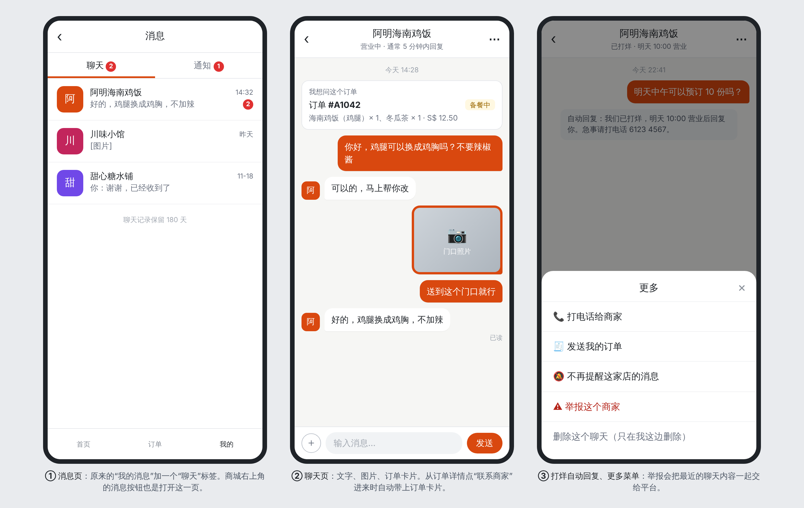
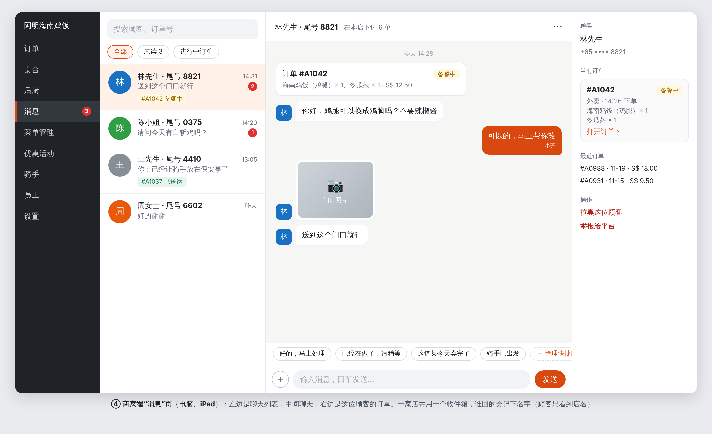
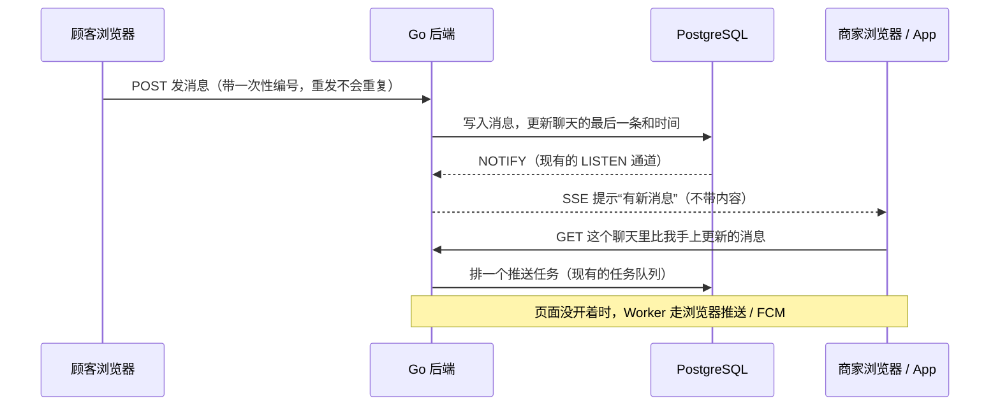

# 顾客和商家聊天消息 · 设计方案 v0.1

2026-11-22 · 等 brian 确认第 12 节的问题后再写代码。

brian 的要求：外卖客户端和商家端各新增一个消息页面，顾客和商家可以在里面互相沟通，是一个简易的 IM 系统。先看用什么方案比较好。

效果图在 [chat-screens/](chat-screens/)，可点开的 HTML 原型在 [chat-prototype/](chat-prototype/)（`index.html?s=customer｜merchant｜mphone`）。店名、人名、订单、金额都是示意数据。

## 1. 结论

**推荐自己做，直接做在现有的 Go 后端里**：消息存在现有的 PostgreSQL，实时提醒用系统里已经在用的 SSE（订单页实时刷新用的就是它），锁屏提醒用已经有的浏览器推送和安卓 FCM。

理由三条：

1. **不花钱、不用多装东西**。不新增服务器、不新增第三方账号，按 [DEPLOY.md](DEPLOY.md) 部署的那一套原样就能跑。
2. **零件都是现成的**。实时通道、推送、图片上传和类型检查、短信、举报、平台后台、定时清理任务，系统里都有，聊天只是把它们接起来。
3. **够用**。一家店一天的聊天量是几十到几百条，不是微信那种量级。一台普通服务器同时挂几千个聊天页面没有压力。

## 2. 几种方案的比较

| | A. 自己做：SSE + 数据库（推荐） | B. 自己做：WebSocket | C. 第三方 IM 服务（腾讯云 IM、融云、Sendbird、Stream 这类） | D. 不做，跳去 WhatsApp / LINE / Telegram |
|---|---|---|---|---|
| 费用 | 0 | 0 | 一般按每月活跃人数收费，有免费额度，超过后按月付费（具体价格以各家官网为准） | 0 |
| 部署 | 不变 | 基本不变，多一种长连接要维护 | 要注册账号、配密钥，顾客和员工账号要同步到对方系统 | 不变 |
| 开发量 | 中等，分三批 | 比 A 多一些（断线重连、心跳、多台服务器之间转发都要另写） | 界面可以用对方的组件，省一些；但账号同步、订单卡片、举报、和“我的消息”合并还是要自己写 | 几乎没有（PR #46 已经有联系方式） |
| 聊天记录在哪 | 自己的数据库 | 自己的数据库 | 对方的服务器，导出和保留时间受对方套餐限制 | 在别人的 App 里，平台看不到 |
| 能和订单关联 | 能 | 能 | 能，但要自己接 | 不能 |
| 出纠纷时平台能查 | 能 | 能 | 能，要通过对方的接口 | 不能 |
| 功能上限 | 文字、图片、订单卡片、已读。没有语音视频通话 | 同 A，另外容易做“对方正在输入” | 最全：语音视频、撤回、多端同步、敏感词都有现成的 | 看对方 App |
| 什么时候该选它 | 现在 | 以后要“正在输入”、很高频的互动时 | 以后要语音视频通话，或同时在线到几万人以上 | 只想要最省事 |

为什么 A 比 B 合适：聊天其实只有“服务器通知我有新消息”需要实时，这一半 SSE 已经在做；“我发一条消息”用普通的请求就行。WebSocket 的好处（双向、更省流量）在这个量级上感觉不出来，却要多维护一套东西。以后真要换，消息表和接口不用动，只换通知这一层。

为什么现在不选 C：钱和数据都交给别人，换来的主要是语音视频这类暂时不需要的功能。而且商户授权、账号同步都要时间。

D 不冲突：商家在店铺设置里勾选的 WhatsApp、LINE、Telegram 联系方式继续保留，聊天页的“更多”里也有“打电话给商家”。

## 3. 顾客端

效果图 [01-customer.png](chat-screens/01-customer.png)

### 3.1 消息页（和“我的消息”合并）

- 现在的“我的消息”页（`/me/messages`，PR #48）只有系统通知。改成两个标签：**聊天** 和 **通知**。通知就是原来的内容，一点不变。
- “聊天”标签列出我聊过的店：店铺头像、店名、最后一条消息、时间、未读数。按最后一条消息的时间排，最新的在上。
- **商城右上角的消息按钮**（商城方案 v0.3，PR #50）也打开这一页。按钮上的红点数字 = 未读聊天数 + 未读通知数，用同一个接口取，“我的”页里“我的消息”那一行的红点也用它。两边谁先做完都不冲突：聊天先上线时，商城做出来直接接这个接口；商城先上线时，按钮先只算通知。

### 3.2 从哪里开始聊

| 入口 | 行为 |
|---|---|
| 点餐页的店铺卡、“商家”标签页 | “联系商家”按钮，打开和这家店的聊天 |
| 订单详情页 | “联系商家”按钮，打开聊天并自动带上这张订单的卡片 |
| 消息页的聊天列表 | 继续以前的聊天 |

要先登录（短信验证码，已有）才能聊。没登录点“联系商家”先跳登录页，登录后回来。

### 3.3 聊天页

- **一个顾客和一家店只有一个聊天**，不按订单分开。问哪张订单，就在聊天里发一张订单卡片。这样顾客和商家的列表都不会被拆得很碎，商家也能看到这位顾客之前说过什么。
- 能发：**文字**（一条最多 1000 字）、**图片**（一次最多 9 张，发之前在手机上自动压小）、**订单卡片**（从“更多”里选我在这家店的订单）。
- 订单卡片上的状态是实时的（备餐中、配送中、已送达），点开是订单详情。
- 自己发的最后一条消息下面显示“已读”。
- 顶部显示店名、是否营业。打烊时发消息会收到一条自动回复（商家可以改文字，见 4.4）。
- 第一版不做：语音、视频、文件、表情包、撤回、“对方正在输入”。
- 消息里的网址只显示成普通文字，不能点，防止有人发钓鱼链接。

### 3.4 更多菜单

打电话给商家、发送我的订单、不再提醒这家店的消息、举报这个商家、删除这个聊天（只在我这边不显示，商家那边还在）。

## 4. 商家端

效果图 [02-merchant-pc.png](chat-screens/02-merchant-pc.png)、[03-merchant-phone.png](chat-screens/03-merchant-phone.png)

### 4.1 “消息”页

- 左侧菜单在“后厨”下面加一项“消息”，带未读数。
- 电脑和 iPad 上是三栏：聊天列表、聊天内容、这位顾客的订单。手机上先看列表，点进去再聊。
- 列表可以筛选“未读”和“进行中订单”（这位顾客有还没完成的订单），可以按顾客称呼、手机尾号、订单号搜索。
- 有进行中订单的聊天排在最前面，因为这些最急。

### 4.2 一家店一个收件箱

- 聊天属于门店，不属于某个员工。**店长和前台**都能看和回（和现在能看订单页的人一致），后厨和骑手看不到。
- 一个人看过就算这家店“已读”。
- 每条回复记下是谁发的，商家端在消息下面显示员工名字；顾客端只显示店名和店铺头像。

### 4.3 商家能不能主动找顾客

能，但只能从订单出发：在订单页的订单卡片上点“联系顾客”。条件是这位顾客**在本店下过单，并且订单在 7 天之内**。聊天已经存在的（顾客先找过来的），随时可以回。

这样商家可以问“这道菜卖完了，换一个可以吗”“骑手找不到门口”，但不能拿顾客名单群发广告。

商家看到的顾客信息：称呼（收货人姓名）和手机尾号 4 位。完整手机号还是只在订单详情里出现，和现在一样。

### 4.4 快捷回复和自动回复

- **快捷回复**：输入框上面一排常用句子，点一下就填进输入框。系统预置几句，商家可以自己增删改。
- **打烊自动回复**：店铺不在营业时间时，顾客发来的第一条消息会收到一条自动回复。默认文字是“我们已打烊，X 点营业后回复你”，商家可以改，也可以关掉。同一位顾客 6 小时内只自动回复一次。

### 4.5 订单页上的提醒

- 页面开着时，新消息会响一声（和新订单的声音不同），顶部弹出一条，点“查看”直接进聊天。
- 订单卡片上的“联系顾客”按钮带这位顾客的未读数。

## 5. 未读数

- 每个聊天两边各记一个“读到哪一条”。未读数 = 对方在这之后发的条数。
- 打开聊天页并且页面在前台，就算读到最新一条。
- 顾客端总未读 = 所有聊天未读之和 + 未读通知数。商家端总未读 = 这家店所有聊天的未读之和。
- 自动回复和系统提示不算未读。

## 6. 提醒：怎么让对方知道有新消息

分三层，前一层没送到才靠后一层。

| 情况 | 顾客 | 商家 |
|---|---|---|
| 页面开着 | 聊天页直接出现新消息；别的页面上消息按钮出红点 | 响一声、顶部弹出、菜单和订单卡片上出红点 |
| 页面关了或锁屏 | 浏览器推送（要顾客点过一次“开启提醒”） | 浏览器推送；安卓 App 用 FCM（都是现有通道） |
| 推送也没开，而且有进行中的订单 | 3 分钟还没读，发一条短信：“XX 店给你发了消息，点这里查看” | 不发短信 |

说明：

- **顾客的浏览器推送是新增的**（现在只有员工有）。不会一进页面就弹“是否允许通知”，而是顾客发出第一条消息后，在聊天页里出现一行“开启提醒，商家回复时通知你”，点了才问。iPhone 的限制和员工端一样：iOS 16.4 以上，并且要先“添加到主屏幕”。
- **短信兜底**只在“商家发的、和进行中订单有关、顾客 3 分钟没读”时发，每张订单最多一条。它解决的是“菜卖完了要换菜，顾客却没看到”这种最要紧的情况。短信要花钱，所以门店可以在设置里关掉；门店没开短信功能的就不发。
- 推送和短信里**不带聊天原文**，只说“XX 发来一条消息”，避免锁屏泄露内容。
- 同一个聊天 1 分钟内连发多条，只推送一次。
- 顾客可以对某家店选“不再提醒”（消息照收，只是不推送、不发短信）。

## 7. 保留多久

| 内容 | 保留 | 到期后 |
|---|---|---|
| 文字消息 | 180 天 | 自动删除 |
| 图片 | 90 天 | 图片删除，聊天里显示“图片已过期” |
| 被举报的聊天 | 到平台处理完，再加 90 天 | 自动删除 |

- 用现有的后台定时任务（Worker）每天清一次，在平台后台的 Worker 页能看到。
- 顾客“删除聊天”只是自己这边不再显示。对方和平台处理纠纷时仍看得到，直到到期。
- 图片和现有的菜品图、宣传物料一样存在数据库里，备份和恢复不用改。发送前压到最长边 1600 像素，一张通常 200 到 400 KB。按一家店每天 30 张算，90 天大约 1 GB。门店多了以后可以改存对象存储，接口不变。

## 8. 防骚扰、举报、平台查看

- **频率限制**：一个顾客每分钟最多 20 条；每天最多主动找 20 家没聊过的店。商家对一个顾客每分钟最多 20 条。
- **图片检查**：只收 JPEG、PNG、WebP，按文件内容判断类型而不是看扩展名（复用现有的检查）。
- **顾客举报商家**：聊天页“更多”里。选原因、可以补充说明，系统把最近 50 条聊天内容一起附上，进平台后台“顾客服务”里现有的举报列表。
- **商家拉黑顾客**：被拉黑的顾客不能再给这家店发消息，发送时提示“暂时无法联系这家店，请打电话”。下单不受影响。可以随时取消拉黑。
- **商家举报顾客**：同样附上最近 50 条，进平台后台。平台可以对严重的顾客全平台禁言。
- **平台什么时候能看聊天内容**：只有被举报的聊天、或者处理这位顾客的反馈和退款纠纷时才能打开，并且每次打开都记进操作记录。平台不能随便翻所有聊天。
- **敏感词过滤**第一版不做，先靠举报。以后需要再加一个平台级的词表。

## 9. 技术做法（给开发看的）

- **表**（一个迁移 `00031_chat.sql`，编号以合并时为准）：
  - `chat_threads`：`customer_id`、`branch_id`（唯一）、最后一条消息摘要和时间、两边各自的“读到哪条”、顾客是否隐藏、是否静音。
  - `chat_messages`：`thread_id`、发送方（顾客 / 门店 / 系统）、员工 `user_id`、类型（文字 / 图片 / 订单卡片 / 系统）、正文、`order_id`、`image_id`、`client_id`（去重用）、时间。
  - `chat_images`：内容、缩略图、类型、大小、不可猜的 token。
  - `chat_blocks`、`chat_quick_replies`、`customer_devices`（顾客的推送订阅，结构照 `rider_devices`）。
  - 举报沿用 `store_reports`，加上聊天编号和举报方向。
- **实时**：`internal/httpapi/sse.go` 的 Hub 现在按门店、订单、骑手订阅，加一种“按顾客”订阅。门店那边直接复用现有的门店通道。提示不带内容，丢了也没关系：聊天页另外每 15 秒查一次，回到前台时也查一次。
- **推送**：`PushMessage`、`WebPush`、`FCM` 和任务队列原样用。前台和店长的设备登记沿用员工工作台那套。
- **接口**（都在 `/api/v1` 下）：
  - 顾客：`GET /customer/chats`、`GET /customer/chats/:store/messages?after=`、`POST /customer/chats/:store/messages`、`POST .../read`、`POST .../report`、`GET /customer/unread`。
  - 商家：`GET /merchant/branches/:id/chats`、`GET|POST .../chats/:thread/messages`、`POST .../read`、`POST .../block`、`POST .../report`、`POST /merchant/branches/:id/orders/:order/chat`（从订单发起）、快捷回复的增删改。
- **权限**：顾客只能读写自己的聊天；员工只能读写自己门店的，并且要有店长或前台岗位；图片地址带不可猜的 token，同时校验身份。
- **页面**：顾客 `/me/messages`（加标签）和 `/chat/:store`；商家 `/merchant/messages`。都按现有的自适应规则做（手机、iPad、电脑三档）。中英双语。
- **测试**：Go 测试覆盖权限、未读数、去重、频率限制、拉黑、到期清理；浏览器端到端新增 `e2e/chat.cjs`（顾客发、商家收到并回复、未读数变化、图片、举报），进 `make e2e`。

## 10. 什么时候这套做法会不够

- 同时在线聊天的人到几万以上，或者后端要拆成很多台：把通知这一层换成 Redis 或专门的消息服务，表和接口不动。
- 要语音、视频通话：接第三方（方案 C），文字聊天可以继续用自己的。
- 图片总量到几十 GB：图片改存对象存储。

这三种情况离现在都很远，到时候再换不用推倒重来。

## 11. 分批实现

| 批次 | 内容 |
|---|---|
| 第一批 | 文字聊天打通：表、接口、SSE 实时、顾客消息页加“聊天”标签、顾客聊天页、商家“消息”页、未读数和红点、点餐页和订单详情的入口 |
| 第二批 | 图片、订单卡片、商家从订单“联系顾客”、快捷回复、打烊自动回复、订单页上的声音和弹出提醒 |
| 第三批 | 顾客浏览器推送、前台和店长的推送、短信兜底、举报和拉黑、平台后台查看被举报的聊天、到期清理、商城消息按钮接入 |

每一批写完、检查通过后自动合并（brian 已授权）。

## 12. 待确认的问题

| # | 问题 | 推荐 |
|---|---|---|
| 1 | 用哪种方案 | A：自己做，SSE + 现有数据库 |
| 2 | 聊天按什么分 | 一个顾客和一家店一个聊天，订单用卡片带进来（不是每张订单一个聊天） |
| 3 | 第一版能发什么 | 文字、图片、订单卡片。不做语音、视频、撤回 |
| 4 | 商家能不能主动找顾客 | 能，但只能从 7 天内的订单发起，不能群发 |
| 5 | 商家端谁能看和回 | 店长和前台共用一个收件箱，记下是谁回的 |
| 6 | 顾客没看到商家消息时要不要发短信 | 要，只限进行中的订单、3 分钟没读、每单最多一条，门店可以关 |
| 7 | 聊天记录保留多久 | 文字 180 天，图片 90 天 |
| 8 | 平台能不能看聊天内容 | 只能看被举报的或有纠纷的，每次查看都留记录 |
| 9 | 要不要显示“已读” | 要，两边都显示 |
| 10 | 顾客和骑手之间要不要也能聊 | 第一版不做，先打电话；以后在同一套上加 |
