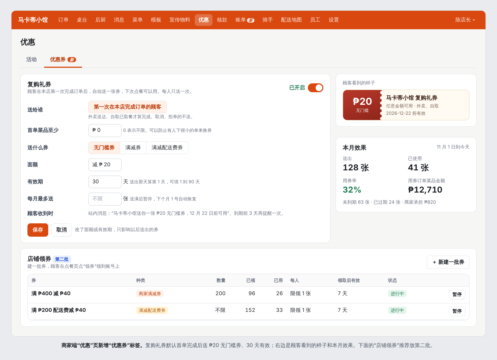
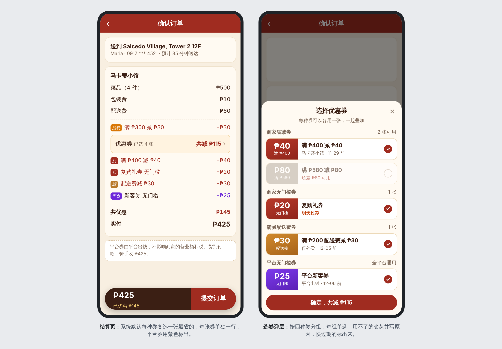
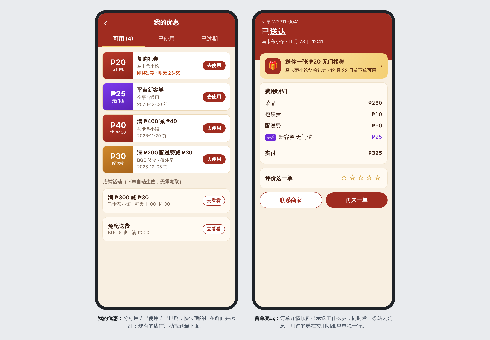
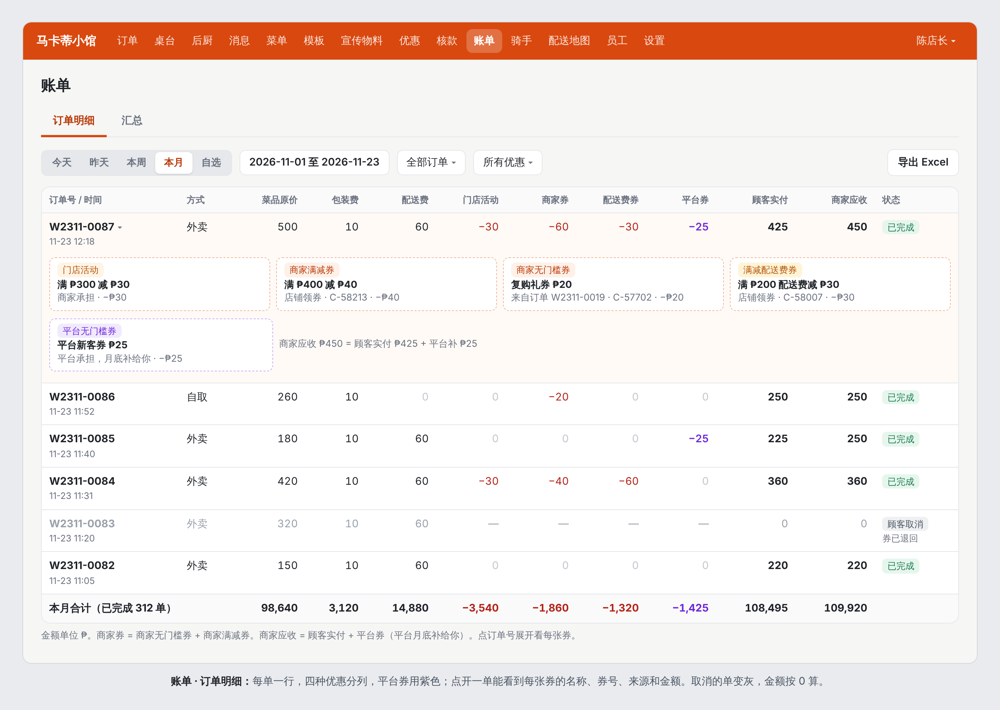
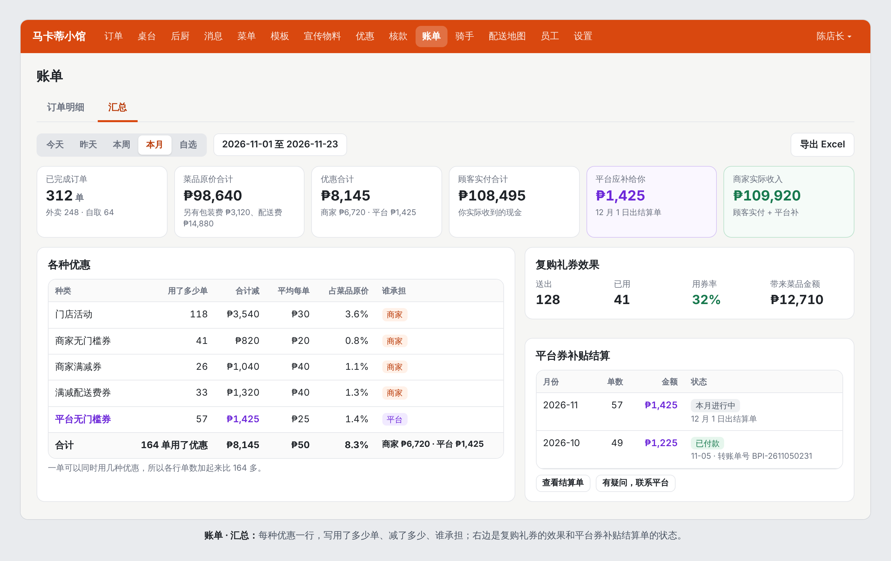
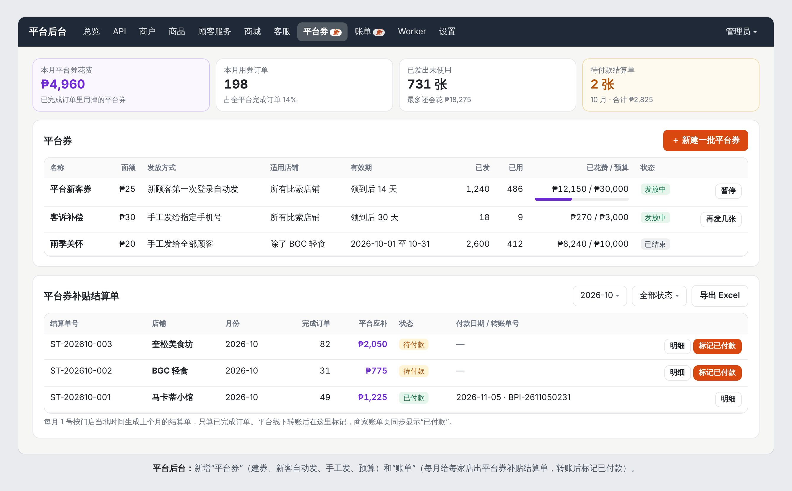

# 复购优惠券和券账单 · 设计方案 v0.1

2026-11-23 · brian 已确认，第 12 节的问题全部按推荐做法，分三批实现。

本稿是 [DESIGN.md](DESIGN.md) 第 13 节“活动”的延伸，讲三件事：

1. 商家在“优惠”里新增**复购礼券**：顾客在本店第一次下单完成后，自动送一张券（默认无门槛，1 个月内有效），下次点餐可以用。
2. 优惠券分四种：**商家无门槛券、商家满减券、满减配送费券、平台无门槛券**。不同种类的券可以在同一单里叠加使用。
3. 新增**账单**页面（商家端和平台后台）：每一单用了哪些券、各减多少；按天 / 按月汇总时，看到每种券分别用了多少张、减了多少钱、谁承担；平台券的钱由平台补给商家，按月结算。

效果图在 [coupon-screens/](coupon-screens/)，可点开的 HTML 原型在 [coupon-prototype/index.html](coupon-prototype/index.html)。店名、手机号、金额都是示意数据。

## 1. 现状和要做的事

| 现状 | 位置 |
|---|---|
| 门店有“优惠活动”：满减、折扣、免配送费。系统自动选一个最省的，一单只用一个，不叠加 | `promotions`、`promos.go`，DESIGN.md §13 |
| 顾客“我的优惠”页只列门店正在进行的活动，写着“下单自动生效，无需领取”，没有券 | `MeOffers.vue` |
| 订单只存了一个优惠金额 `discount` 和活动名，分不出是哪种优惠 | `orders`、`pricing.go` |
| 付款只有货到付款、到店付款、堂食收银，钱都是商家自己收；没有线上支付，平台不经手钱 | `orders.payment_method` |
| 商家端只有“核款”（骑手交回的现金），没有账单和对账 | `CashView.vue` |
| 平台没有抽成，也没有和商家之间的结算 | ADMIN_DESIGN.md 第 1 节 |
| 下单必须登录（短信验证码），顾客有账号 | CUSTOMER_LOGIN_ADDRESS_DESIGN.md |

| 你要的功能 | 本稿对应 | 效果图 |
|---|---|---|
| 商家设置复购优惠：首单后送一张无门槛券，1 个月过期 | 第 3.1 到 3.3 节 | [01-merchant-coupons.png](coupon-screens/01-merchant-coupons.png) |
| 四种券，可以叠加使用 | 第 2、4、5 节 | [02-checkout.png](coupon-screens/02-checkout.png) |
| 顾客下次点餐时用券 | 第 5、6 节 | [03-my-coupons.png](coupon-screens/03-my-coupons.png) |
| 账单里看每一单用了哪些券 | 第 8 节 | [04-bill-orders.png](coupon-screens/04-bill-orders.png) |
| 汇总时看到每种券分别用了多少 | 第 8 节 | [05-bill-summary.png](coupon-screens/05-bill-summary.png) |
| （补充）平台券谁出钱、怎么和商家结算 | 第 7、9 节 | [06-admin.png](coupon-screens/06-admin.png) |

## 2. 四种券

| 种类 | 谁发 | 谁出钱 | 怎么减 | 举例 |
|---|---|---|---|---|
| 商家无门槛券 | 商家 | 商家 | 直接减菜品金额，没有门槛 | 无门槛减 ₱20 |
| 商家满减券 | 商家 | 商家 | 菜品满多少减多少 | 满 ₱400 减 ₱40 |
| 满减配送费券 | 商家 | 商家 | 菜品满多少，配送费减多少（或全免）。只能用在外卖 | 满 ₱200 配送费减 ₱30 |
| 平台无门槛券 | 平台 | **平台** | 直接减顾客要付的钱，没有门槛。平台把这笔钱补给商家 | 无门槛减 ₱25 |

几条共同规则：

- **券是发到顾客账号上的**，一张券只能用一次。顾客在“我的优惠”里能看到自己有哪些券。
- **商家的券只能在发券的那家店用**；平台券在所有参加的店都能用（第 7.2 节）。
- 券有到期时间，到期作废。
- 券减的钱不会超过它能减的部分：菜品券最多把菜品减到 0，配送费券最多把配送费减到 0，平台券最多把顾客要付的钱减到 0。多出来的部分作废，不找零、不退回。
- 首版只用在外卖和自取，**堂食不能用券**（堂食没有顾客账号）。
- 和现有的“优惠活动”不是一回事：活动不用领、谁都能享受，系统自动选；券是发给某个顾客的。

## 3. 复购礼券（商家设置）

位置：商家端“优惠”页，上面分成两个标签“**活动**”（现有的，不变）和“**优惠券**”（新增）。“优惠券”标签里第一块就是复购礼券。

### 3.1 商家能设置什么

| 项目 | 说明 | 默认 |
|---|---|---|
| 开关 | 打开后才会送券 | 关 |
| 送给谁 | 顾客在本店**第一次完成订单**后送（外卖送达、自取已取餐） | 首单 |
| 订单最低金额 | 首单菜品金额达到多少才送，防止有人下一单很小的单来换券。0 表示不限 | ₱0 |
| 送什么券 | 无门槛券 / 满减券 / 满减配送费券，三选一 | 无门槛券 |
| 面额和门槛 | 例如无门槛减 ₱20；满减券还要填“满多少” | 减 ₱20 |
| 有效期 | 送出后多少天内有效，1 到 90 天 | 30 天 |
| 每月最多送 | 这个月送满了就暂停，下个月 1 号自动恢复。空着表示不限 | 不限 |

右边有一张预览券，顾客看到的就是这个样子。下面是效果统计：本月送出多少张、已用多少张、用券率、用券订单带来的菜品金额，让商家知道这个活动值不值。

### 3.2 送券的时机和规则

- **订单完成时送**，不在下单时送。这样下单后取消、拒单的不会拿到券。
- 判断“第一次”：这个顾客账号在本店**之前没有完成过的外卖或自取订单**。按顾客账号（手机号）算，换地址、换设备都不算新客。
- 每个顾客在每家店只会收到一次复购礼券，就算商家关掉再打开也不会重复送。
- 商家改了券的面额或有效期，只影响以后送出的券，已经送出的不变。
- 送出后顾客会收到一条站内消息“马卡蒂小馆送你一张 ₱20 无门槛券，12 月 23 日前可用”，订单详情页也会显示（第 6 节）。不发短信，因为短信按条收费。
- 到期前 3 天还没用，再发一条站内消息提醒。

### 3.3 有效期怎么算

送出那天算第 1 天，到第 30 天（按门店当地时间）的 23:59 过期。例如 11 月 23 日送出，12 月 22 日 23:59 过期。

### 3.4 以后可以加的玩法（首版不做）

“每完成 N 单送一张”“满 ₱X 送券”“生日券”“分享给朋友”。这些用同一套券的底层就能加，只是多几种送券条件。首版只做你要的首单复购。

### 3.5 店铺领券（商家的第二种发券方式）

只有复购礼券的话，一个顾客在一家店最多只有一张商家券，四种券叠加就很少用得上。所以“优惠券”标签下面还有“**店铺领券**”：商家建一批券（三种商家券任选，例如“满 ₱400 减 ₱40，共 200 张，每人限领 1 张，领取后 7 天有效”），顾客在点餐页店铺卡下面看到“领券”条，点一下就领到账号上。商家可以暂停、结束，能看到已领、已用多少。

推荐放在第二批做（第 12 节问题 9）。

## 4. 叠加规则和计算顺序

一单最多可以同时用：**1 个门店活动 + 每种券各 1 张**（商家无门槛、商家满减、满减配送费、平台无门槛各一张，最多 4 张）。同一种券不能用两张。

计算顺序（门槛都按**菜品原价**算，第 12 节问题 3）：

1. 门店活动（现有规则，系统自动选最省的那个）。
2. 商家满减券：菜品原价达到门槛才能用，减菜品金额。
3. 商家无门槛券：减菜品金额。
4. 满减配送费券：菜品原价达到门槛才能用，减配送费。如果活动已经免了配送费，这张券就不需要用，系统不会自动选它。
5. 按减完后的菜品金额算服务费和税（和现在一样）。
6. 平台无门槛券：最后减，减的是顾客要付的钱。

**为什么平台券最后减、而且不改税：** 平台券的钱是平台替顾客付的，不是商家打折。商家这一单的营业额不变，只是其中一部分钱由平台来付。这样商家的税、服务费都不受平台券影响，平台补的钱就是商家少收的钱，账最清楚。

### 4.1 算一个例子

菜品原价 ₱500，包装费 ₱10，配送费 ₱60，税价内含 12%。

| 步骤 | 减多少 | 谁出钱 |
|---|---|---|
| 门店活动：满 ₱300 减 ₱30 | −₱30 | 商家 |
| 商家满减券：满 ₱400 减 ₱40 | −₱40 | 商家 |
| 商家无门槛券（复购礼券） | −₱20 | 商家 |
| 满减配送费券：满 ₱200 配送费减 ₱30 | −₱30 | 商家 |
| 订单金额 | ₱500 + ₱10 + ₱60 − ₱120 = **₱450** | |
| 平台无门槛券 | −₱25 | 平台 |
| **顾客实付** | **₱425**（骑手或门店现收） | |
| 平台补给商家 | ₱25（月底结算） | |
| **商家这一单实际收入** | ₱425 + ₱25 = **₱450** | |

税按 ₱410 菜品 + ₱10 包装费算，和没有平台券时一样。

### 4.2 防止并发和滥用

- 报价时只读判断，不占用券。下单事务里用带条件的更新把券从“未使用”改成“已使用”，同时锁住这张券，所以同一张券在两个手机上同时下单只有一单能用上。用不上的那单返回“金额有变化”，顾客看到新金额再确认（和现有活动的做法一样）。
- 一张券在下单时就记为“已使用”，绑定这张订单。

### 4.3 订单取消时券怎么办

| 情况 | 券 |
|---|---|
| 商家拒单、顾客取消、接单超时 | 退回给顾客，到期时间不变。如果已经过了到期时间，退回后就是“已过期” |
| 配送异常后结束订单（餐已做） | 不退回，和现有活动一致。这一单没收到钱，平台也不补（第 7.3 节） |
| 已完成订单走售后退款 | 不退回。售后是商家线下处理的，平台已补的钱照补 |

## 5. 顾客结算页

- 金额明细里新增一行“**优惠券**”，写“已选 4 张，共减 ₱115”，点开是选券的弹层。
- 系统**默认帮顾客选好**：每种券各选一张省得最多的，省得一样就选最快过期的。顾客可以换或者不用。
- 弹层按四种券分组，每组单选。用不了的券变灰，写原因：“还差 ₱80 可用”“仅外卖可用”“明天过期”这类。
- 金额明细里每张券单独一行，商家券和平台券分开写，最后一行写“共优惠 ₱145”。
- 顾客从“我的优惠”点某张券的“去使用”，进到那家店；平台券进商城首页。
- 店铺点餐页的店铺卡上，如果顾客在这家店有能用的券，显示一个小标签“你有 2 张券”。

## 6. 顾客“我的优惠”和订单详情

- “我的优惠”页改成三个标签：**可用（数量）/ 已使用 / 已过期**。可用的按到期时间排序，快过期的在前，3 天内过期的标红“即将过期”。
- 每张券写：减多少、门槛、哪家店能用（平台券写“全平台通用”）、到期日、“去使用”。
- 现有的“门店活动”列表放到“可用”标签最下面，标题“店铺活动（下单自动生效，无需领取）”。
- 订单完成后，订单详情页顶部显示“送你一张 ₱20 无门槛券”，点一下进“我的优惠”。
- 订单详情的金额明细里，每张用过的券单独一行。

## 7. 平台无门槛券

### 7.1 平台怎么发

在平台后台新增“**平台券**”页面（效果图左边），管理员可以建一批券，每批有：名称、面额、货币、有效天数、总预算（最多送多少张或多少钱）、发放方式。发放方式首版两种：

- **新客券**：顾客第一次登录时自动发一张。每个手机号只发一次。
- **手工发**：发给全部顾客，或者粘贴一串手机号只发给这些人（例如客诉补偿）。

每批券能看到已发多少、已用多少、平台已经花了多少钱、还剩多少预算。预算花完自动停止发放，已经发出的券照常能用。

### 7.2 哪些店能用

- 默认：和券同一种货币的所有店都能用（例如比索的券只能在菲律宾的店用）。
- 管理员建券时可以改成“只限这几家店”，或者“除了这几家店”。
- 商家不能自己退出平台券，因为钱是平台出的，商家没有损失（第 12 节问题 6）。

### 7.3 平台出钱，怎么到商家手里

现在钱全部由商家收（货到付款、到店付款），平台不经手钱。所以平台券的结算是：

1. 顾客少付的那部分（平台券金额），记为“**平台应补给商家**”。
2. 只算**已完成**的订单（送达、已取餐）。取消的订单券已退回，配送异常结束的订单没收到钱，都不算。
3. 每月 1 号，系统按门店当地时间为每家店生成上个月的“**平台券补贴结算单**”：多少单、合计多少钱，附订单明细。
4. 平台管理员线下转账给商家，在后台点“标记已付款”，填付款日期和转账单号。商家在自己的账单页看到状态变成“已付款”。
5. 商家对金额有疑问，点结算单上的“有疑问”，直接打开平台客服对话（现有功能），带上结算单号。

以后接了线上支付，平台先收到钱，平台券补贴就可以从平台代收的钱里直接抵扣，到时候结算单改成“平台应付 = 代收货款 − 抽成 + 平台券补贴”。首版不做这些。

## 8. 账单（商家端）

商家端导航新增“**账单**”，放在“核款”旁边。只有店主和店长能看。分两个标签，都可以选日期范围（今天 / 昨天 / 本周 / 本月 / 自选），都能导出 Excel。

### 8.1 订单明细

每单一行，列：

| 订单号 / 时间 | 方式 | 菜品原价 | 配送费 | 活动 | 商家券 | 配送费券 | 平台券 | 顾客实付 | 商家应收 | 状态 |
|---|---|---|---|---|---|---|---|---|---|---|

- 商家应收 = 顾客实付 + 平台券。
- 用了券的单，点开这一行看每张券的名称、种类、券号、减了多少、来源（复购礼券 / 平台新客券……）。
- 可以按“用了券的单 / 某一种券 / 没用券的单”筛选。
- 取消的单也列出来（灰色），金额按 0 算，方便对账时找得到。
- 表格最下面一行是这段时间的合计。

### 8.2 汇总

- 顶部卡片：完成订单数、菜品原价合计、优惠合计（商家承担 + 平台承担）、顾客实付合计、平台应补、商家实际收入。
- “**各种优惠**”表：门店活动、商家无门槛券、商家满减券、满减配送费券、平台无门槛券，每行写**用了多少单、合计减了多少、平均每单减多少、谁承担**，最后是合计行。
- “**复购礼券效果**”：这段时间送出多少张、用了多少张、用券率、用券订单的菜品金额。
- “**平台券补贴结算**”：每个月一行，结算单的金额和状态（待付款 / 已付款，付款日期、转账单号）。
- 按天看的时候是每天一行的趋势表，按月看是每月一行。

### 8.3 金额口径

| 名称 | 算法 |
|---|---|
| 菜品原价 | 菜品单价 × 数量，减任何优惠之前 |
| 商家承担的优惠 | 门店活动 + 商家无门槛券 + 商家满减券 + 满减配送费券 |
| 平台承担的优惠 | 平台无门槛券 |
| 顾客实付 | 订单金额 − 平台券 |
| 商家实际收入 | 顾客实付 + 平台券，也等于订单金额 |
| 平台应补 | 已完成订单里的平台券合计 |

汇总只算已完成的订单。

## 9. 平台后台

- “**平台券**”页面：第 7.1 节说的建券、发券、预算。
- “**账单**”页面：
  - 每家店一行：完成订单数、菜品原价、商家承担的优惠、平台承担的优惠、顾客实付。可以点进去看那家店的账单（和商家看到的一样）。
  - “平台券补贴结算”标签：所有结算单，按状态筛选，“标记已付款”填日期和转账单号。顶部写本月平台券一共花了多少。
- 管理员“进入门店”（现有的只读模式）也能看商家的账单页。

## 10. 数据怎么存

新增的表（迁移编号到实现时再定，先问清别的线程占了哪些号）：

- `coupon_batches`：一批券的设置。谁发（门店 / 平台）、种类、面额、门槛、货币、有效天数、适用店铺、预算、发放方式、状态。复购礼券也是一批，发放方式是“首单完成”。
- `customer_coupons`：发到顾客账号上的每一张券。存发券时的面额、门槛、种类、适用店铺的**快照**，所以商家后来改设置不影响已发的券。状态：未使用 / 已使用 / 已过期 / 作废。用了的记订单号。来源订单（复购礼券是哪一单送的）也记下来。
- `order_discounts`：每单的每一项优惠一行（活动一行，每张券一行），写种类、名称快照、金额、谁承担。账单的明细和汇总都从这张表查，不用去拆订单金额。
- `platform_settlements`：平台券补贴结算单，每家店每月一张，带状态、付款日期、转账单号、操作人。

订单表新增两列：`merchant_discount`（商家承担的优惠合计）和 `platform_subsidy`（平台券金额），现有的 `discount` 继续表示优惠合计，老订单的数据不用改。现有活动的数据（`promotion_redemptions`）继续用，同时往 `order_discounts` 里写一行，老订单的活动也补写进去，这样账单能看到历史。

过期处理：后台任务每小时把过期的券标成“已过期”，并发到期提醒。用的是现有的任务表和 Worker。

## 11. 分批实现

| 批次 | 内容 |
|---|---|
| 第一批 | 券的表和下单计算、叠加、并发；商家复购礼券设置；结算页选券；“我的优惠”三个标签；订单详情显示送券和用券；到期提醒 |
| 第二批 | 店铺领券（第 3.5 节）；平台券：后台建券、新客券、手工发券、预算、适用店铺 |
| 第三批 | 商家端账单（明细、汇总、导出 Excel）；平台后台账单；平台券补贴结算单和标记付款 |

每批都带 Go 测试和浏览器测试，手机、iPad、电脑三种宽度都截图检查。

## 12. 需要你确认的问题

| # | 问题 | 推荐 | 其他选择 |
|---|---|---|---|
| 1 | 复购礼券什么时候送 | 首单**完成后**送（送达或已取餐） | 下单就送（取消了也送出去了，容易被刷） |
| 2 | 只送首单，还是每单都送 | 只送首单，每人每店一次 | 每完成一单都送一张（成本高，可以以后加） |
| 3 | 满减门槛按什么金额算 | 按菜品原价算（顾客好理解，“满 400”看菜单就知道） | 按减完活动后的金额算（商家少让利，但顾客容易算错） |
| 4 | 门店活动能不能和券一起用 | 能，活动 + 每种券各一张 | 用券就不享受活动 |
| 5 | 平台券算平台替顾客付钱，不改商家的税和营业额 | 是 | 当作折扣，减税基（商家营业额变少，账更乱） |
| 6 | 商家能不能拒绝平台券 | 不能，平台出钱商家没有损失；平台建券时可以排除个别店 | 商家可以在设置里退出 |
| 7 | 平台券补贴怎么结算 | 每月 1 号出上月结算单，平台线下转账后在后台标记 | 每周结算 |
| 8 | 订单取消，券退不退 | 退回，到期时间不变 | 退回并顺延几天 |
| 9 | 要不要做“店铺领券”（第 3.5 节） | 做，放第二批。没有它，满减券和配送费券只能靠复购礼券送，叠加很少用得上 | 不做，只有复购礼券 |
| 10 | 平台券的发放方式 | 新客自动发 + 后台手工发 | 再加一个公开的“领券中心” |
| 11 | 堂食能不能用券 | 不能（堂食没有顾客账号） | 堂食扫码时也要求登录 |
| 12 | 到期提醒 | 到期前 3 天发站内消息，不发短信 | 也发短信（按条收费） |
| 13 | 平台券能不能把顾客要付的钱减到 0 | 能，最多减到 0，多出部分作废 | 至少要付 ₱1 |

## 13. 实现记录

### 13.1 第一批（券底层、复购礼券、结算页用券）

- 迁移 `00038_coupons.sql`：`coupon_batches`、`customer_coupons`、`order_discounts`，订单加 `merchant_discount`、`platform_subsidy`。老订单的活动优惠已补写进 `order_discounts`。
- 订单的 `total` 仍是顾客要付的钱（骑手按它收现金），`discount` 是全部优惠之和。商家这一单的实际收入是 `total + platform_subsidy`。
- 报价接口多了 `coupon_ids`：不传由系统选最省的组合，传空数组表示不用券。报价结果里有 `coupons`（用了哪些）和 `coupon_choices`（这家店能看到的所有券、能不能用、为什么）。下单时按报价里定下的券重算一次，券被别的单用掉就返回“金额有变化”。
- 复购礼券在订单完成的同一个事务里发（`fulfil.go` 的自取交付和骑手送达），每人每店一张由唯一索引保证。
- 到期提醒放在 Worker 的定时清理里（每 10 分钟），每张券只提醒一次。
- 商家端“活动”导航改名为“优惠”，页面分“活动”“优惠券”两个标签（`/merchant/promos?tab=coupons`）。
- 测试：`internal/app/coupon_test.go`，浏览器测试 `e2e/coupons.cjs`。

### 13.2 第二批（店铺领券、平台券、新人券）

- 店铺领券：商家在“优惠 → 优惠券”页面下方的“领券活动”里新建，选券种、门槛、面额、领取后有效天数、总张数、每人限领。店铺页面在活动标签下面显示一排可领的券，没登录先去登录，领过的显示“已领取”，领完的显示“已领完”。暂停或结束后顾客看不到，已领的券到期前照样能用。
- 平台券（管理员端“平台优惠券”页面 `/admin/coupons`）：按 brian 的补充要求，**每张平台券属于一个国家，可以再限到一个省份（不选就是全国）**。只有这个国家（省份）的店铺结算时才会出现和使用。金额单位跟着这个国家店铺的货币走，后台不用手填货币；还没有店铺的国家不能选。
- 新人券：新顾客第一次用手机号登录时自动发，只发给手机号区号属于该国家的人。预算用完就不再发。
- 手动发放：按手机号一行一个发，或者“发给该国家所有顾客”（按手机号区号）。领过的人跳过，找不到的号码列出来。
- 迁移 `00041_coupon_region.sql`：券批次和顾客券加 `country_code`、`country`、`province`。
- 管理员页面顶部按货币分开汇总本月平台已出的钱和还没用的券，不把不同货币加在一起。
- 测试：`internal/app/coupon_batch_test.go`，浏览器测试 `e2e/coupon_batches.cjs`（跑完会把自己建的券结束掉，不影响其它测试）。

### 13.3 第三批（账单、平台券结算单）

- 商家端导航“账单”（`/merchant/bills`，店主和店长能看，平台管理员“进入门店”也能只读查看），在“核款”下面。两个标签：
  - **订单明细**：外卖和自取订单，按下单日期；今天 / 昨天 / 近 7 天 / 本月 / 上月 / 自选。列：菜品原价、配送费、活动、商家券、配送费券、平台券、顾客实付、商家应收、状态。点一行展开每一项优惠（种类、名称、券号、来源、谁承担）。可按“用了券的单 / 没有优惠的单 / 某一种优惠”筛选。取消和配送异常的单列出来，金额按 0 算，不进合计。最下面是合计行。导出 Excel（订单明细、汇总两张表）。
  - **汇总**：完成订单、菜品原价、优惠合计（商家 / 平台）、顾客实付、平台应补、商家实际收入；“各种优惠”表（每种用了多少单、合计、平均每单、谁承担）；复购礼券效果；平台券补贴结算单（可看订单，“有疑问”打开平台客服）；按天的表。
- 平台后台“账单”（`/admin/bills`）：各店账单（按货币分别合计，可“看账单”进入那家店的账单页）；平台券结算单（待付款 / 已付款 / 全部，看订单，“标记已付款”填付款日期和转账单号）。
- 结算单由 Worker 的定时清理生成：每家店当地时间进入新的一个月后，按上个月**完成时间**在上月的订单出一张，按店铺 + 月份 + 货币唯一，重复运行不会多出。
- 迁移 `00042_platform_settlements.sql`。
- 测试：`internal/app/bill_test.go`，浏览器测试 `e2e/bills.cjs`。
