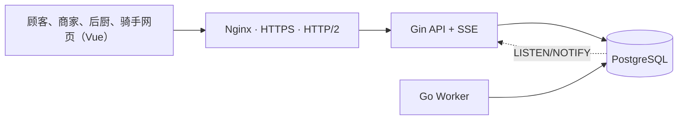

# 外卖点餐系统 · 首版设计稿（外卖优先）v1.1

2026-11-21 · 基于 Codex《Restaurant Claude Development Pack v1.0》修订

原始资料保存在 [docs/reference/codex-pack-v1.0](reference/codex-pack-v1.0/)。本稿是首版开发的唯一依据；两者冲突时以本稿为准。标注 **【假设】** 的地方是业务默认值，已由 brian 于 2026-11-21 全部确认（见第 11 节），全部做成门店级配置或集中在一处，便于调整。

## 1. 已定决策与首版范围

| 决策 | 结论 |
|---|---|
| 首版方向 | 先做自营外卖和自取，堂食（扫码、iPad、桌次）后置 |
| 后端 | Go + Gin + PostgreSQL（pgx/v5），API 与 Worker 两个进程共用一个 Go 模块 |
| 前端 | Vue 3 + TypeScript + Vite，一个工程内分顾客、商家、后厨、骑手、平台管理五个入口 |
| 收款 | 首版只做货到付款（外卖）和到店付款（自取），线上支付后置 |
| 语言 | 界面和菜名中英双语，默认简体中文 |

### 首版包含

| 端 | 能力 | 对应原稿页面 |
|---|---|---|
| 顾客 | 门店链接点菜、门店信息、配送区与地址、规格和套餐选择、购物车、手机验证、结账、订单进度、待接单时取消 | C01–C08 |
| 商家 | 订单工作台、订单详情、接单／拒单／取消、指派与改派骑手、自取交付、菜单与规格管理、售罄与限量、配送区、门店设置、员工、现金核款 | M01、M02、M05、M07 |
| 后厨 | 总览（按订单看制作项，逐项开始／备好）、打包台（齐菜后核对袋数）、交接 | K01、K03、K04 |
| 骑手 | 我的任务、取餐、到达、送达与代收、配送异常 | R01–R03 |
| 平台 | 创建商户、门店和店主账号 | 原稿缺失，本稿新增 |

### 后置

- **第二阶段：** 自定义工作台分单（M12、M13、K02，已实现，见第 12 节）、活动（M09–M11，已实现，见第 13 节）、Excel 导入（M06）、多套模板（M08）、预约单、顾客消息通知、数据库行级权限（RLS）作为租户隔离的第二道防线。
- **第三阶段：** 堂食整块（C09–C13、M03、M04）。
- **第四阶段：** 线上支付、GrabFood、foodpanda。

为了后续加堂食不改表，订单从一开始就保留 `channel` 和 `order_batches`。外卖单固定只有一个批次。

## 2. 相对原稿的修订（评审项落实）

| # | 评审问题 | 本稿做法 |
|---|---|---|
| 1 | 金额模型没有税和服务费 | 门店配置 `tax_rate_bp`、`tax_inclusive`、`service_charge_bp`、`packaging_fee`。报价和订单分列菜品小计、包装费、配送费、服务费、税额、优惠、应付。见 4.2 |
| 2 | 匿名下单无防滥用 | 下单前必须完成手机验证码验证；公开写接口按 IP 限流；验证码按手机号限次。见 6.2 |
| 3 | 缺状态流转表和超时 | 第 5 节给出四个维度的流转表、取消矩阵和对外展示状态的推导规则。待接单超时由 Worker 自动取消 |
| 4 | 打印和新单提醒 | 商家工作台新单响铃。提供浏览器可打印的小票页。**【假设】** 首版不接后厨小票机，后厨用屏幕 |
| 5 | 只有简体中文 | 菜名、分类、规格、配送区都有 `name` 与 `name_en`。前端内置中英文案，可切换 |
| 6 | 账号体系空白 | 用户名加密码登录，bcrypt 存储，服务端会话 Cookie。角色见 6.1。平台管理员创建商户 |
| 7 | 只有售罄开关 | 菜品可设 `stock_qty`（空表示不限量），下单事务内条件更新扣减，取消和拒单返还 |
| 8 | 配送区未定 | **【假设】** 首版用“区域名 + 固定配送费 + 可选起送价”，顾客从列表选择区域，不依赖地图 |
| 9 | 实时通道的坑 | LISTEN 使用独立直连（`DIRECT_DATABASE_URL` 可单独配置，绕开事务级连接池）。Nginx 启用 HTTP/2 并对 SSE 关闭缓冲 |
| 10 | 幂等细节 | 先插入占位行抢占键，同键并发的后到者等待先到者提交后读原结果。记录保留 48 小时由 Worker 清理 |

## 3. 架构



| 层 | 实现 |
|---|---|
| API | `cmd/api`。Gin 提供 `/api/v1` 下的 JSON 接口和 SSE。HTTP 层只做认证、参数绑定和错误映射，业务规则在 `internal/app` |
| Worker | `cmd/worker`。待接单超时取消、幂等记录和过期会话清理。开发时可用 `EMBED_WORKER=true` 让 API 进程内嵌运行 |
| 存储 | PostgreSQL 16 及以上。迁移用 Goose（SQL 文件内嵌进二进制，`cmd/migrate` 执行）。查询用 pgx 手写 SQL。**与原稿差异：** 首版不引入 sqlc，查询量上来后再评估 |
| 实时 | 事务提交时 `NOTIFY waimai_events`，载荷只有门店 ID、订单 ID、骑手 ID。API 监听后向有权限的 SSE 连接发“刷新”提示，页面重新拉取快照。断线后前端降级为轮询 |
| 部署 | Docker Compose：`nginx`、`api`、`worker`、开发用 `postgres`。生产优先托管数据库 |

目录：

```
cmd/api  cmd/worker  cmd/migrate  cmd/seed
internal/config   环境变量
internal/db       连接池、迁移（内嵌 SQL）
internal/app      业务用例：报价、下单、接单、后厨、打包、配送、核款、菜单、账号
internal/httpapi  路由、中间件、SSE、限流、错误结构
web/              Vue 前端
deploy/           Nginx 配置
```

## 4. 数据模型

所有业务表带 `branch_id`（订单另带 `merchant_id`），每条查询都带门店范围条件。金额一律是币种最小单位的整数（如 centavo）。时间用 `timestamptz`，营业时段按门店时区解释。

| 数据域 | 表 | 要点 |
|---|---|---|
| 商户与门店 | `merchants`、`branches` | 门店有 `slug`（分享链接）、时区、币种、税费配置、起送价、接单超时分钟数、外卖／自取开关、暂停接单开关、营业时段 |
| 账号 | `users`、`user_branch_roles`、`sessions` | 用户名全局唯一。一个用户可在多个门店有不同角色。会话只存令牌哈希 |
| 顾客验证 | `phone_verifications`、`customer_sessions` | 验证码只存哈希，5 分钟有效，最多试 5 次。验证成功后签发顾客会话 Cookie |
| 配送区 | `delivery_zones` | 名称、英文名、配送费、起送价、启用状态 |
| 菜单 | `menu_categories`、`menu_items`、`option_groups`、`options` | 菜品有 `published`（草稿／已发布）、`sold_out`、`stock_qty`、`needs_prep`、外卖／自取是否可售。规格组有最少／最多可选数。**【假设】** 套餐用“菜品 + 规格组”表达（例如“任选两款炸物”是一个最少 2 最多 2 的规格组），首版不单独建套餐子项表 |
| 报价 | `quotes` | 保存完整计算结果快照、10 分钟有效期、绑定的订单。一份报价只能用于一张订单 |
| 订单 | `orders`、`order_batches`、`order_items` | 订单保存金额分项快照、地址快照、四个状态维度、`version`、`manifest_version`、袋数。订单项保存菜名、规格、单价快照和制作状态 |
| 配送与收款 | `delivery_tasks`、`cash_collections` | 每单至多一个配送任务，`assignment_version` 在改派时递增。每单至多一条代收记录，含应收、实收、核款状态 |
| 幂等与审计 | `idempotency_records`、`audit_logs` | 幂等键主键为（范围，键）。审计记录操作者、动作和前后状态 |

### 4.1 订单号与访问凭证

- `public_no` 用于展示和电话沟通，形如 `W-0108`，门店内按日递增。
- 顾客跟单使用随机 `access_token`（32 字节，数据库只存 SHA-256）。知道订单号不能查看订单。
- 自取凭取餐号核对，取餐号是 `public_no` 的数字部分。

### 4.2 金额计算

报价由服务端统一计算，前端只展示。

```
菜品小计   = Σ (单价 + 规格加价) × 数量
包装费     = 门店配置的每单固定值                        【假设】按单收，不按件
配送费     = 配送区费用（自取为 0）
服务费     = 菜品小计 × service_charge_bp ÷ 10000        【假设】默认 0，只按菜品小计计
计税基数   = 菜品小计 + 包装费 + 服务费                  【假设】配送费不计税
税额       = 含税价：基数 × 税率 ÷ (1 + 税率)，只展示，不加到应付
             不含税价：基数 × 税率，加到应付
应付       = 菜品小计 + 包装费 + 配送费 + 服务费 + (不含税时的税额) − 优惠
```

舍入：每一项单独四舍五入到最小货币单位。优惠字段首版恒为 0，为第二阶段的活动预留。

**【假设】** 菲律宾门店默认 `tax_rate_bp = 1200`、`tax_inclusive = true`。老人和残障人士的法定折扣、正式收据格式需要当地会计确认，首版不实现。

## 5. 订单状态

订单有四个独立维度，分别存储，互不覆盖。

### 5.1 流转表

**受理 `acceptance_status`**

| 从 | 到 | 触发者 | 条件 |
|---|---|---|---|
| — | `pending` | 顾客下单 | 报价有效、手机已验证 |
| `pending` | `accepted` | 店长／收银 | 同一事务生成制作任务并初始化打包状态 |
| `pending` | `rejected` | 店长／收银 | 必填原因，返还库存 |
| `pending` | `cancelled` | 顾客；Worker 超时 | 返还库存 |
| `accepted` | `cancelled` | 店长／收银 | 必填原因；仅在未交接前；返还库存；通知后厨和骑手 |

**单项制作 `order_items.prep_status`**：`pending → preparing → ready`，订单取消时全部置 `cancelled`。`needs_prep = false` 的商品在接单时直接是 `ready`。备好后可撤回到 `preparing`，但仅在订单未打包时。

**打包 `packing_status`**

| 从 | 到 | 条件 |
|---|---|---|
| `none` | `waiting_items` | 接单 |
| `waiting_items` | `ready_to_pack` | 所有有效制作项 `ready`（自动推导） |
| `ready_to_pack` | `waiting_items` | 有制作项被撤回 |
| `ready_to_pack` | `packed` | 打包员确认，提交袋数（≥1）和当前 `manifest_version` |

**履约 `fulfillment_status`**

| 服务方式 | 流转 | 触发者 |
|---|---|---|
| 外卖 | `none → awaiting_handoff`（打包完成）`→ out_for_delivery`（实际交接）`→ arrived → delivered` | 交接由门店或当前指派骑手确认，首次有效确认生效，另一侧重复确认返回原结果。到达、送达由骑手确认 |
| 外卖异常 | `out_for_delivery／arrived → delivery_failed` | 骑手，必填原因。门店随后处理 |
| 自取 | `none → awaiting_pickup`（打包完成）`→ picked_up` | 门店核对取餐号后确认 |

**收款 `payment_status`**：`unpaid → paid`。外卖在骑手确认送达并录入实收时变为 `paid`（实收等于应收）或保持 `unpaid` 并在代收记录里留差额。自取在门店确认交付并收款时变为 `paid`。

**代收核款 `cash_collections.reconcile_status`**：`pending → reconciled`（门店确认交回金额等于实收）或 `discrepancy`（不等，记录差额）。

### 5.2 取消矩阵

| 当前情况 | 顾客可取消 | 门店可取消 | 处理 |
|---|---|---|---|
| 待接单 | 是 | 可拒单 | 返还库存 |
| 已接单，未交接 | 否，联系门店 | 是 | 返还库存，制作项置取消，后厨和骑手屏幕显示“已取消”提示而不是直接消失 |
| 已交接或已取餐 | 否 | 否 | 走售后，首版由门店线下处理 |

### 5.3 对外展示状态

顾客进度由四个维度推导，后端统一计算 `display_status`，前端不自己拼：

| 条件（自上而下，先匹配先得） | `display_status` |
|---|---|
| 受理 = rejected | `rejected` |
| 受理 = cancelled | `cancelled` |
| 受理 = pending | `pending_acceptance` |
| 履约 = delivered | `delivered` |
| 履约 = picked_up | `picked_up` |
| 履约 = delivery_failed | `delivery_failed` |
| 履约 = arrived | `rider_arrived` |
| 履约 = out_for_delivery | `out_for_delivery` |
| 履约 = awaiting_pickup | `ready_for_pickup` |
| 履约 = awaiting_handoff | `awaiting_rider` |
| 其他 | `preparing` |

“已打包但未交给骑手”显示为等待骑手取餐，不会提前显示配送中。

### 5.4 超时

| 情况 | 处理 |
|---|---|
| 待接单超过门店配置的 `accept_timeout_minutes`（默认 10） | Worker 自动取消，原因记为 `accept_timeout`，返还库存 |
| 报价超过 10 分钟 | 下单时返回 `QUOTE_EXPIRED`，前端重新报价 |
| 骑手长时间未取餐 | **【假设】** 首版只在商家工作台按等待时长高亮，不自动处理 |

## 6. 权限与安全

### 6.1 角色

| 角色 | 范围 |
|---|---|
| `platform_admin` | 平台后台：商户、门店、账号、商品的增删改查，监控，只读查看任一门店后台。见 [ADMIN_DESIGN.md](ADMIN_DESIGN.md) |
| `owner`、`manager` | 本店全部操作，包括菜单、配送区、设置、员工、核款 |
| `cashier` | 订单工作台、接拒单、指派骑手、自取交付 |
| `kitchen` | 后厨总览、制作项状态、打包、交接 |
| `rider` | 只能看和操作当前指派给自己的任务 |

所有员工接口先校验会话，再校验该用户在目标门店的角色。按 ID 取订单时同时带门店范围，跨门店资源一律返回 404。骑手改派后，旧骑手的写入因 `assignment_version` 不匹配而被拒绝。

### 6.2 防滥用与会话

- **手机验证：** 顾客下单前请求验证码。验证码 6 位，哈希存储，5 分钟有效，每个号码每 60 秒只能请求一次，最多试错 5 次。短信发送是一个接口，首版自带“日志输出”实现；`OTP_DEV_ECHO=true` 时接口直接返回验证码，仅用于开发和演示。**【假设】** 正式短信服务商待定。
- **限流：** 公开写接口（验证码、报价、下单）按 IP 做令牌桶限流，登录接口按 IP 限流。首版是单实例内存实现，多实例时换成共享存储。
- **员工会话：** `HttpOnly`、`SameSite=Lax` 的 Cookie，生产环境加 `Secure`。写接口要求自定义请求头 `X-Requested-With`，跨站表单无法携带。
- **密码：** bcrypt。登录失败不区分“用户不存在”和“密码错误”。
- **日志：** 不输出完整手机号、地址、令牌。

## 7. 写入、并发与幂等

| 情景 | 规则 |
|---|---|
| 顾客双击或超时重试 | 下单、取餐、送达等命令带 `Idempotency-Key`。事务开头向 `idempotency_records` 插入（范围，键）占位。插入成功则执行并在同一事务保存响应；键已存在且请求摘要相同则返回原响应；摘要不同返回 `IDEMPOTENCY_CONFLICT` |
| 两个店员同时接单 | `SELECT … FOR UPDATE` 锁订单，校验状态和 `expected_version`。后到者得到 `VERSION_CONFLICT` 或 `INVALID_STATE` |
| 限量库存 | `UPDATE menu_items SET stock_qty = stock_qty - n WHERE id = … AND stock_qty >= n`，影响 0 行即售罄，整单回滚并返回不可售项 |
| 打包与撤回并发 | 打包确认和制作项状态变更都先锁订单行。打包提交必须带当前 `manifest_version`，不匹配返回 `MANIFEST_CHANGED` |
| 交接两侧确认 | 门店和骑手都调用同一用例，订单已是 `out_for_delivery` 时直接返回当前状态 |
| 送达与代收 | 送达命令在一个事务里写履约状态和代收记录，`cash_collections.order_id` 唯一，重复提交不多记 |

加锁顺序固定为：订单 → 订单项 → 配送任务 → 菜品库存行（按菜品 ID 升序）。

## 8. 接口

前缀 `/api/v1`。错误统一为 `{"error": {"code", "message", "request_id", "details"}}`。

| 调用方 | 接口 |
|---|---|
| 顾客 | `GET /stores/{slug}` · `POST /otp/request` · `POST /otp/verify` · `POST /stores/{slug}/quotes` · `POST /stores/{slug}/orders` · `GET /customer/orders/{token}` · `POST /customer/orders/{token}/cancel` · `GET /customer/orders/{token}/events` |
| 登录 | `POST /auth/login` · `POST /auth/logout` · `GET /auth/me` |
| 商家订单 | `GET /merchant/branches/{bid}/orders` · `GET /merchant/orders/{id}` · `POST /merchant/orders/{id}/accept｜reject｜cancel｜assign-rider｜handoff` · `GET /merchant/branches/{bid}/events` |
| 商家配置 | `GET /merchant/branches/{bid}/menu` · 分类、菜品、配送区的增改 · `PUT /merchant/branches/{bid}/settings` · `GET｜POST /merchant/branches/{bid}/staff` · `GET /merchant/branches/{bid}/cash-collections` · `POST /merchant/cash-collections/{id}/reconcile` |
| 后厨 | `GET /kitchen/branches/{bid}/board` · `POST /kitchen/items/{id}/start｜ready｜undo` · `POST /kitchen/orders/{id}/pack` |
| 骑手 | `GET /rider/tasks` · `POST /rider/tasks/{id}/pickup｜arrive｜deliver｜fail` · `GET /rider/events` |
| 平台 | `GET｜POST /admin/merchants` |

主要错误码：`QUOTE_CHANGED`、`QUOTE_EXPIRED`、`ITEM_UNAVAILABLE`、`OUT_OF_ZONE`、`BELOW_MINIMUM`、`STORE_CLOSED`、`PHONE_NOT_VERIFIED`、`VERSION_CONFLICT`、`INVALID_STATE`、`MANIFEST_CHANGED`、`ITEMS_NOT_READY`、`NOT_ASSIGNED`、`IDEMPOTENCY_CONFLICT`、`RATE_LIMITED`。

## 9. 部署与运维

- `docker compose up` 启动 PostgreSQL、迁移、API、Worker 和 Nginx。`.env.example` 说明全部环境变量。
- 迁移由独立的一次性进程执行，API 和 Worker 启动时不抢着迁移。
- Nginx：HTTP/2、SSE 路径关闭 `proxy_buffering`、读超时大于心跳间隔（心跳 20 秒）。
- 生产数据库开启自动备份和时间点恢复，上线前做一次恢复演练。
- 健康检查 `GET /healthz`（进程）和 `GET /readyz`（数据库可用）。

## 10. 验收

| 类别 | 场景 |
|---|---|
| 金额 | 含税与不含税两种门店的报价分项正确；换配送区后配送费变化，旧报价下单返回 `QUOTE_CHANGED` 或需重新报价 |
| 幂等 | 同一幂等键并发下单只生成一张订单 |
| 并发 | 两个店员同时接单只成功一次；限量 1 份的菜两人同时下单只成功一单 |
| 打包 | 有制作项未备好时不能打包；备好后撤回，旧 `manifest_version` 不能打包 |
| 配送 | 改派后旧骑手无法确认取餐；重复送达只记一笔代收；实收不等于应收时留差额 |
| 权限 | 两个商户互相看不到订单、菜单和 SSE；骑手看不到未指派订单 |
| 超时 | 待接单超时后自动取消并返还库存 |
| 防滥用 | 未验证手机不能下单；验证码错误 5 次后作废 |

## 11. 业务假设汇总

brian 已于 2026-11-21 确认按以下默认值实现。它们仍然都是门店级配置或集中在一处，之后可以调整。

1. 税费口径：默认 12% 含税价，配送费不计税，服务费默认 0。老人和残障折扣、正式收据未实现。
2. 配送区用区域名加固定费用，不做地图和距离计费。
3. 包装费按单固定收取。
4. 首版不接小票打印机，只有屏幕、响铃和浏览器打印。
5. 短信服务商未定。已内置 Twilio 和通用 webhook 两种发送方式（见第 12 节），由部署时的环境变量选择，默认只写日志。
6. 套餐用规格组表达，整份套餐归一个工作台，不按子项分台。
7. 骑手未取餐不自动超时，只高亮提醒。

第 12 到 16 节里后续批次的业务前提（配送失败结束订单不计损耗、Excel 导入和预约单的口径、堂食 15.7 节、模板 16.4 节），brian 也已于 2026-11-21 确认按推荐做法实现，文中标为 **【已确认 2026-11-21】**。目前设计稿里没有待确认的业务假设。

## 12. 第二批补充（已实现）

### 12.1 后厨工作台分单

- 门店自定义工作台（`kitchen_stations`），菜品可归属一个工作台（`menu_items.station_id`）。只有店主和店长能改。
- 接单时在同一事务里把每个制作项的工作台 id 和名称快照到 `order_items`。之后改菜品归属只影响新接的单。
- 需要制作但没有归属的菜进入“未分台”，后厨总览显示警告，并且照常计入齐菜判定，不会被漏掉。
- 在制的菜可以在后厨屏改派到另一个启用的工作台，改派写审计记录（原工作台、新工作台、操作人）。
- 停用的工作台不再接收新任务和改派，已有任务仍可在该工作台处理完。
- 后厨屏按工作台筛选，选择记在设备本地，一块屏固定看一个工作台。打包台仍按整单核对。

### 12.2 配送异常处理

骑手上报异常后订单停在 `delivery_failed`，由门店二选一：

| 操作 | 流转 | 说明 |
|---|---|---|
| 重新配送 | `delivery_failed → awaiting_handoff` | 可换骑手，指派版本加一，原骑手不能再写回。之后照常交接、送达 |
| 结束订单 | `acceptance_status → cancelled`，必填原因 | 餐已制作，限量库存不返还，不记收款 |

**【已确认 2026-11-21】** 结束订单时不向顾客收费也不记损耗金额，损耗统计留到报表阶段。

### 12.3 顾客通知和任务表

- 门店可开关“订单状态短信”（`branches.notify_sms`，默认关，因为短信按条计费）。触发点：已接单、拒单或取消、外卖已交给骑手、自取可取餐。顾客自己取消不发。
- 通知在业务事务里写入 `jobs` 表，事务回滚则不发。Worker 用租约领取任务，在事务外调用短信服务，失败按 30 秒起指数退避重试，最多 5 次，之后标记失败并保留错误信息。
- 这是“至少一次”投递：极端情况下（发送成功但回写前进程崩溃）顾客可能收到重复短信。
- 短信发送方式：`log`（默认）、`webhook`（把 `{to, message}` POST 到自有网关）、`twilio`。验证码和状态通知共用同一个发送接口。

## 13. 活动（第三批，已实现）

### 13.1 规则

- 三种类型：满减（`amount_off`）、折扣（`percent_off`，可设封顶）、免配送费（`free_delivery`）。都可以设菜品门槛、适用外卖或自取、起止日期、每天时段、总名额和每个手机号限用次数。
- **一张订单只用一个活动，不叠加。** 系统在所有适用的活动里选对顾客省得最多的那个，金额相同选最早创建的。**【已确认 2026-11-21】** 不做叠加和互斥组，等门店有明确需求再加。
- 每天时段按门店当地时间判断。开始和结束相同表示全天，结束早于开始表示跨午夜（例如 22:00 到 02:00）。
- 状态：草稿 → 进行中 ⇄ 已暂停，任何状态都可以结束，结束后不能再启用。只有店主和店长能管理。

### 13.2 金额口径

- 满减和折扣减的是菜品金额。服务费和税按减后的菜品金额计算。
- 免配送费只减配送费，不影响服务费和税（配送费本来不计税）。
- 优惠不会超过它所作用的金额。

### 13.3 名额与并发

- 报价时只读判断，不占名额。下单事务里用带条件的 `UPDATE promotions SET used_count = used_count + 1` 占用名额，这条语句同时锁住活动行，所以并发下单逐个计数，总名额和每人次数都不会超。
- 占用失败（名额刚好用完、活动被暂停、该手机号已达上限）时整笔下单回滚并返回 `QUOTE_CHANGED`，顾客看到新金额后再确认。
- 报价接口在顾客已验证手机时带上手机号，这样达到次数上限的顾客直接看到原价。未验证时报价显示优惠，下单时再校验一次。
- 订单被拒单、取消或接单超时，名额退回（`promotion_redemptions.status = released`）。配送异常后结束的订单不退回，因为餐已制作。

### 13.4 历史与试算

- 订单保存活动 id、名称和优惠金额的快照。之后修改或结束活动，不改变已有订单。
- 总名额不能改到低于已用数量。
- 试算：输入菜品金额、配送费和取餐方式，列出每个活动能减多少或为什么不适用，并标出会采用的那个。草稿和已暂停的活动也参与试算，方便发布前检查。

## 14. Excel 菜单导入和预约单（第四批，已实现）

### 14.1 Excel 菜单导入

- 流程：下载模板 → 上传 `.xlsx`（不超过 2 MB、2000 行）→ 后台任务解析 → 查看逐行结果 → 确认导入。确认之前菜单不变。
- 列：分类、菜名、价格必填。英文名、描述、工作台、需要制作、限量库存、外卖、自取可选。表头中英文都认，顺序不限。
- 行级错误：缺分类或菜名、价格格式不对、工作台不存在或已停用、是否列填写不对、库存格式不对、和前面某行重复。有错误的行跳过，其余行照常导入。
- 确认时按当时的菜单重新判断每一行：同分类同名的菜品更新（保留发布状态，空白单元格保留原值），其余新建为**草稿**，不存在的分类自动创建。新菜品要在菜单页发布后顾客才看得到。
- 一次导入只能确认一次。导入写审计记录。文件解析完即从数据库删除。
- **【已确认 2026-11-21】** 规格组不通过 Excel 导入，导入后在菜品里编辑。更新已有菜品时价格立即生效，预览里会显示原价和新价。

### 14.2 预约单

- 门店设置里开启“接受预约单”并设置备餐提前量（默认 30 分钟）。
- 顾客在结账页选“尽快”或一个时间。可选时间每 15 分钟一个，从“现在加备餐提前量”到明天结束，只包含营业时间内的时刻。门店休息时也可以预约之后的营业时间。
- 服务端校验：时间不能早于“现在加备餐提前量”（放宽一个报价有效期，避免顾客确认时刚好过期），不能晚于明天结束，必须在营业时间内。
- 订单记录 `scheduled_for` 和 `release_at`（预约时间减备餐提前量）。接单流程和超时规则不变。接单后到 `release_at` 之前，顾客看到“已接单，会按预约时间准备”，订单工作台可见，后厨屏不显示。到时间后后厨屏出现，Worker 推一次刷新。后厨屏按时间过滤，所以即使 Worker 没运行，订单也只是晚刷新，不会丢。
- 所有界面按门店时区显示预约时间。
- **【已确认 2026-11-21】** 活动按下单时刻判断，不按预约时刻。预约单不限制每个时段的单量。

## 15. 堂食（第五批，已实现）

### 15.1 范围

店员开台，顾客用手机扫桌码或用桌上的平板点菜，店员也可以代点。同一桌的所有入口写同一张账单，每次下单是一个独立批次。后厨按工作台制作，备好后上桌，柜台收款后关台。

### 15.2 数据

- `dining_tables`：桌台。每张桌有一个固定的 `qr_token`，印在桌码里。同一门店内启用的桌号不重复。
- `dining_sessions`：桌次，一次开台到关台。每张桌同时最多一个未关闭的桌次（数据库唯一索引保证）。桌次对应一张 `service_type = dine_in` 的订单，开台时创建，状态直接是已接单，单号以 `D` 开头。
- `table_devices`：配对的平板，绑定到桌台而不是桌次。
- `order_batches.source` 记录批次来源（手机扫码、平板、店员）。`order_items.served_at` 记录上桌时间，`void_reason` 记录退菜原因。
- 订单增加 `session_id`、`table_name`、`amount_received`、`payment_note`。履约状态增加 `dined`，支付方式增加 `pay_at_counter`。

### 15.3 凭证和权限

- 手机：扫码后用桌码换取**当前桌次**的凭证（HttpOnly Cookie）。凭证绑定桌次，关台即失效。没开台时扫码会被拒绝，并提示找店员。
- 平板：店员在桌台页生成 8 位配对码（10 分钟有效，只能用一次），平板在 `/ipad` 输入后得到长期设备凭证。设备绑定桌台，自动跟随这张桌的当前桌次。没开台时显示欢迎页。店员可以随时解绑，解绑立即生效。
- 顾客只能读写自己桌次的账单。推送只发“有更新”的提示，页面收到后重新读取自己有权看的内容。
- 店员：桌台和平板的维护需要店长或老板。开台、代点、退菜、收款关台需要收银及以上。上桌确认后厨和收银都可以做。其他商户访问一律返回“不存在”。
- 数据库只保存凭证和配对码的哈希。

### 15.4 下单和加菜

- 每次提交带幂等键，在一个事务里完成：锁桌次和订单，按当前菜单重新计价，校验规格、售罄和库存，扣限量库存，写入新批次，按当前配置把每道菜派给工作台，重算账单。
- 同一个幂等键重复提交只生成一个批次，并返回当前账单。即使桌次已经关闭，原来的键仍能查回结果。页面把购物车和幂等键存在本机，断网后重试用的是同一个键。
- 客户端同时提交它展示的金额。服务端算出的金额不一样时返回“价格有变化”，不下单，顾客核对后再提交。
- 已送厨的批次不能修改，只能再加新批次或由店员退菜。
- 堂食不收包装费。服务费和税按门店设置计算。

### 15.5 后厨和上桌

- 堂食的菜和外卖共用工作台和后厨屏。后厨屏上堂食的票显示桌号和批次，已上桌的菜不再显示。
- 后厨屏增加“上菜”页，列出已备好还没上桌的堂食菜，点“上桌”确认。只有已备好的菜可以上桌，已上桌的菜不能撤回到制作中。
- 退菜必须填原因，退掉的菜释放限量库存，金额从账单里减掉，账单的清单版本加一。

### 15.6 收款和关台

- 收银在账单上点“结账关台”，输入实收金额，系统算找零。请求带上收银看到的清单版本。
- 如果这期间有人加菜或退菜，版本对不上，关台被拒绝，页面刷新出最新金额后再确认。加菜和关台锁同一个桌次，所以不会出现“钱收了但新加的菜没算进去”，也不会重复入账。
- 还有菜在制作时不能关台，要先做完或退菜。已备好但没点“上桌”的菜在关台时按已上桌处理。
- 实收不能少于应付。关台后订单变为已完成和已付款，桌次关闭，手机凭证失效，平板回到欢迎页。重复提交关台只返回最终账单。
- 关台后这张桌可以再次开台，新桌次是一张空账单。

### 15.7 业务前提（已确认）

brian 于 2026-11-21 确认按以下推荐做法实现。

- **【已确认 2026-11-21】** 必须店员开台后顾客才能点菜，顾客不能自己开台。这样可以避免有人拿着桌码照片在店外下单。
- **【已确认 2026-11-21】** 桌码是固定的。风险是用餐期间拿到桌码的人都能往这张桌加菜，店员在上菜和收款时核对。如果需要更严格，可以改成每次开台打印一次性桌码。
- **【已确认 2026-11-21】** 堂食不参加优惠活动，先吃后付，只在柜台收款，一桌一张账单，不支持分单和转桌。
- **【已确认 2026-11-21】** 收款方式只记录金额和备注，不区分现金、刷卡和转账。

## 16. 入口模板和主题（第六批，已实现）

### 16.1 范围

外卖和自取、扫码堂食、平板堂食三个入口各有一套外观，分开保存和发布。模板只决定菜单怎么排和用什么颜色，不改菜单、价格、购物车、下单流程、桌码和分享链接。

### 16.2 三种布局

- **左栏列表**：左边是分类栏，右边每行一道菜。适合菜多的门店。
- **招牌推荐**：顶部用大卡片展示第一个分类里可点的前四道菜，下面是完整菜单。
- **双列商品**：图片在上的卡片，按列排开。适合有菜品照片的门店和平板。

三种布局由同一个菜单组件渲染，只是排列不同。加菜、选规格、购物车、报价和下单走的是同一份代码，所以换模板不会改变业务行为。

每个入口还可以设置主题色、店标图片和封面图片。图片只接受 https 链接，目前不提供上传。

### 16.3 草稿、预览和发布

- `channel_templates` 表按“门店加入口”存一行，包含线上版本和草稿。从没保存过的入口用默认模板（外卖和扫码是左栏列表，平板是双列商品）。
- 店长或老板在模板页选入口，改布局和主题，右边用本店已发布的菜单实时预览（外卖和扫码是手机尺寸，平板是横屏）。
- 保存草稿不影响顾客。发布只把这一个入口的草稿变成线上版本，其他入口不动。可以放弃草稿。发布写审计记录。
- 顾客端从门店信息接口拿到各入口的线上模板。外卖页下次打开时生效。平板在 20 秒内、扫码手机在 1 分钟内自动换成新模板，购物车里已选的菜保留。
- 收银、后厨、骑手不能改模板，其他商户访问返回“不存在”。

### 16.4 业务前提（已确认）

brian 于 2026-11-21 确认按以下推荐做法实现。

- **【已确认 2026-11-21】** 模板是三种固定布局加主题色，不支持自由拖拽排版。
- **【已确认 2026-11-21】** 店标和封面先用图片链接，不做图片上传和存储。
- **【已确认 2026-11-21】** “招牌推荐”取第一个分类的前四道菜，不单独维护推荐列表。把想推荐的菜放在第一个分类即可。
