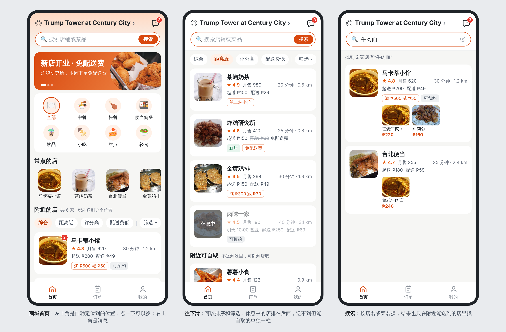
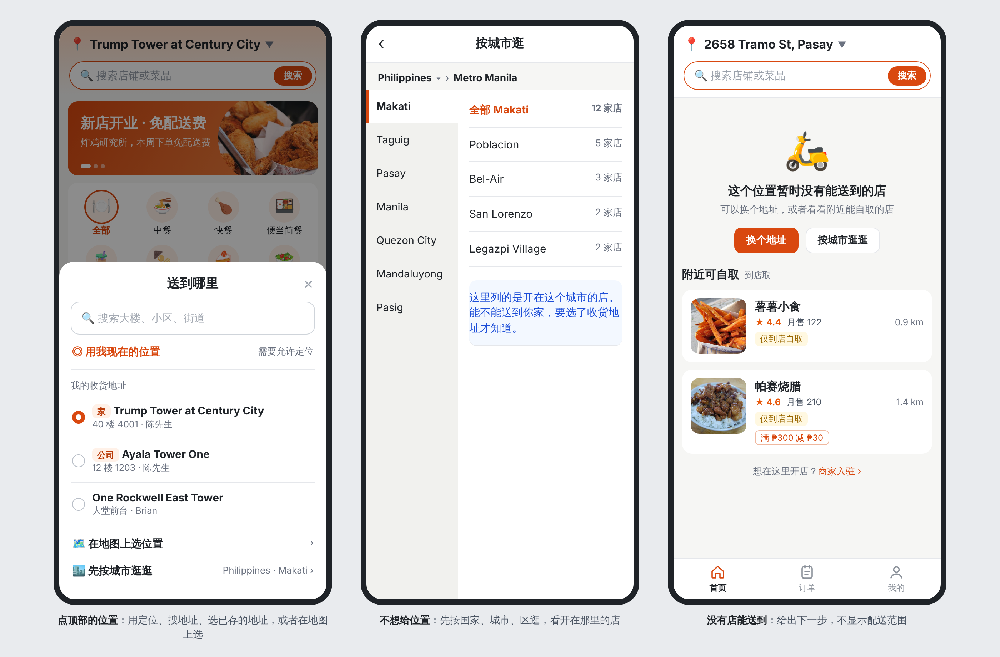
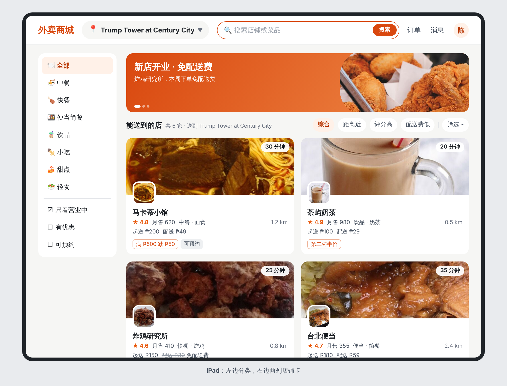
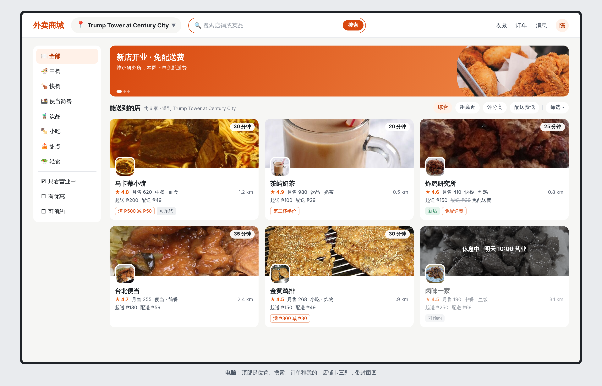
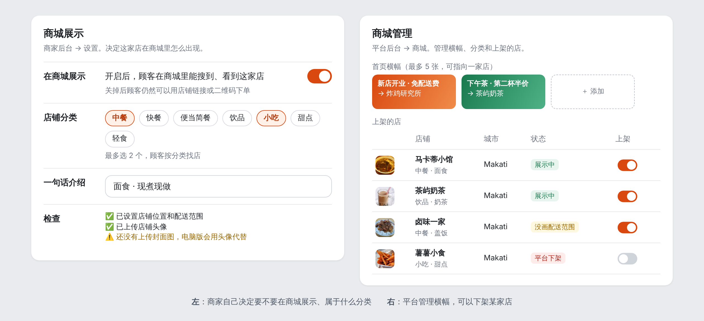

# 外卖商城页面 · 设计方案 v0.3

2026-11-22 · brian 已确认，第 11 节的问题全部按推荐做法，已实现（实现时的几处调整见文末第 12 节）。

v0.3 改动：按 brian 的要求，恢复顶部的地址功能，布局改成左上角是位置、右上角是消息按钮，下面是搜索框。位置默认自动定位，点一下可以换。见第 2、4、6、11 节。（v0.2 曾去掉顶部地址，只靠自动定位，已作废。）

本稿是 [DESIGN.md](DESIGN.md)、[MAP_ZONES_DESIGN.md](MAP_ZONES_DESIGN.md)、[CUSTOMER_LOGIN_ADDRESS_DESIGN.md](CUSTOMER_LOGIN_ADDRESS_DESIGN.md) 的补充，讲一个新页面：顾客打开商城，系统自动定位（也可以自己换地址），列出能送到那里的所有商家，点进去就是每家店现有的点餐页。

效果图在 [mall-screens/](mall-screens/)，可点开的 HTML 原型在 [mall-prototype/](mall-prototype/)（`index.html?s=home｜location｜ipad｜pc｜manage`）。店名、菜品、地址、金额、评分都是示意数据。

## 1. 现状和要做的事

| 现状 | 位置 |
|---|---|
| 顾客只能通过店铺链接或二维码进某一家店（`/s/<店铺>`），没有一个能看到所有店的地方 | `router.ts` |
| 网站根地址 `/` 现在直接跳到商家登录页 | `router.ts` |
| 底部导航“首页”回到这台设备上次看的店，没有就去“我的收藏” | `me.ts` 的 `homePath` |
| 每家店有位置（经纬度）、国家 / 省 / 城市 / 区，和商家在地图上画的配送区（每区有配送费、起送金额、预计时间） | `branches`、`delivery_zones` |
| 判断一个位置能不能送，已经有现成的算法 | `geo.go` 的 `matchZone` |
| 店铺没有“分类”（中餐、饮品这些），也没有“要不要在商城展示”的开关 | 无 |

| 你要的功能 | 本稿对应 | 效果图 |
|---|---|---|
| 一个外卖商城页面 | 第 2、3 节 | [01-home.png](mall-screens/01-home.png) |
| 根据顾客所在的区域自动展示商家 | 第 4、5 节 | [02-location.png](mall-screens/02-location.png) |
| 从这个页面进每家店的点餐页下单 | 第 6 节 | |
| （补充）iPad 和电脑上的样子 | 第 7 节 | [03-ipad.png](mall-screens/03-ipad.png)、[04-pc.png](mall-screens/04-pc.png) |
| （补充）商家和平台怎么管理 | 第 8 节 | [05-manage.png](mall-screens/05-manage.png) |

## 2. 商城首页长什么样

从上到下：

1. **顶部**：左上角是当前位置的名字，默认是自动定位到的地方，点一下可以换（第 4 节）。右上角是消息按钮，有未读消息时带红色数字，点进去是现有的“我的消息”页。没登录时点消息先去登录。
2. **搜索框**：按店名或菜名搜。结果只在附近能送到的店里找，菜名命中的店会带出命中的菜和价格。
3. **横幅**：平台在后台上传，最多 5 张，可以指向某一家店。没有上传就不显示这一块。
4. **分类**：全部、中餐、快餐、便当简餐、饮品、小吃、甜点、轻食。点一个只看这一类。
5. **常点的店**：登录的顾客，显示下过单或收藏过、并且现在能送到的店。没登录或没有就不显示。
6. **附近的店**：能送到顶部这个位置的店，店铺卡列表，带排序和筛选。
7. **附近可自取**：送不到这个位置、但开了到店自取、离得不远（5 公里内）的店，单独放在列表最后。
8. **底部导航**：首页 / 订单 / 我的。和现在一样，只是“首页”改成指向商城。

### 2.1 店铺卡上显示什么

- 店铺头像、店名。
- 评分和月售（最近 30 天完成的订单数）。评价少于 5 条时不显示评分，写“新店”。
- 预计送达时间、离你多远（店铺到你的直线距离）。
- 起送金额、配送费。数字来自顶部这个位置对应的收费，顾客看不到是哪个配送区。
- 优惠标签：这家店正在进行的优惠活动（现有的“优惠活动”功能），最多显示 2 个。
- 状态：休息中的店变灰，写上“休息中，明天 10:00 营业”，排在营业中的店后面。支持预约的写“可预约”，仍然可以点进去下预约单。商家点了“暂停接单”的店同样变灰，写“暂停接单”。
- 购物车里还有这家店东西的，头像右上角有件数角标。

### 2.2 排序和筛选

- 排序：综合（默认）、距离近、评分高、配送费低。
- 综合排序的规则：营业中的在前，然后按距离从近到远。首版没有付费排名，也没有人工置顶。
- 筛选：只看营业中、有优惠、可预约、可自取。

### 2.3 各种金额用哪国货币

每家店按自己的货币显示（店铺已有 `currency`）。同一个位置能送到的店几乎都是同一种货币，不做换算。

## 3. 网址和底部导航

- 商城的地址是网站根地址 `/`。顾客打开你的域名就是商城。
- 商家和员工的登录页仍然是 `/login`，不变。商城页最底下放一行小字“商家登录”和“商家入驻”。
- 底部导航“首页”改成去商城。在某家店的点餐页里，左上角加一个返回，回到商城。
- 手机上，点餐页现在也挂着底部导航，保持不变。
- “我的收藏”里的店、订单里的“再来一单”都不变，仍然直接进那家店。
- 店铺链接和二维码照常能用，商家贴在店里的码不受影响。

## 4. 顶部的位置

### 4.1 默认：自动定位

- 打开商城，浏览器会问一次“能不能使用你的位置”。这一步是浏览器的规定，绕不开，每个顾客只问一次。
- 顾客允许后，左上角显示定位到的地方的名字（大楼或街道名），列表是能送到这里的店。系统同时知道了顾客在哪个国家和地区。
- 每次打开商城都自动重新定位。如果顾客上次手动换过地址，就保持他选的那个，不被定位覆盖，直到他点“重新定位”。

### 4.2 点左上角换位置

从下面弹出“送到哪里”：

- **当前位置（自动定位）**：带“重新定位”按钮。
- **搜索**：搜大楼、小区、街道，用现有的地址搜索。
- **我的收货地址**：登录的顾客，列出地址簿里的地址，点一个就行。
- **在地图上选位置**：用现有的地图选点页。
- **按城市逛**：按国家、城市、区看开在那里的店（4.4）。

选好后记在这台设备上。

### 4.3 顾客不允许定位，或者定位失败

- 登录过、有默认收货地址的顾客：直接用默认收货地址，左上角显示它。
- 其他顾客：自动弹出“送到哪里”，提示“没有拿到你的定位”，让顾客搜索地址、在地图上选，或者按城市逛。

### 4.4 按城市逛

- 可选的国家、城市、区来自所有店铺的所在地，只会出现有店的地方，每个后面写着有几家店。
- 这时列出的是开在那个城市的店。店铺卡不显示配送费和送达时间，改成显示“起送 ₱100 起”和店铺所在的区，页面顶部有一句：“这里列的是开在这个城市的店。能不能送到你家，要选了收货地址才知道。”
- 平台没有配置地图密钥时，搜索和地图选点用不了，只剩自动定位和按城市逛。

### 4.5 没有店能送到

显示“这个位置暂时没有能送到的店”，给两个按钮“换个地址”“按城市逛逛”，下面列出附近能自取的店，最后是“商家入驻”入口。

## 5. “能送到”是怎么算的

- 服务器拿顶部这个位置，和每家店画的配送区比对，用的是结算时同一套算法和同一个容差（`matchZone`），所以收货地址就是这个位置的话，商城里说能送的店结算时也一定能送。
- 先按距离粗筛（店铺 30 公里以内，这是画配送区时允许的最远距离），再逐家精确比对。店铺数量在几千家以内都不需要额外的地理数据库。
- 进商城列表的条件：商户状态正常、店铺开了配送或自取、设置了位置、“在商城展示”开着、没有被平台下架。配送区一个都没画的店，只可能出现在“附近可自取”和按城市看的列表里。
- 预计送达时间用配送区上填的时间。没填的不显示时间，只显示距离。

### 5.1 顾客看不到配送区

这是之前定下的硬性要求，商城继续守住：

- 页面上不画配送范围，不显示配送区的名字，不显示“离配送范围还有多远”。
- 商城接口只返回每家店“配送费、起送金额、预计时间、距离”这几个数，不返回配送区的编号、名字、图形。送不到的店直接不出现在配送列表里。
- 自动化测试里会加一条检查：商城接口和页面里不能出现配送区的信息。

## 6. 进店下单

- 点店铺卡进入这家店现有的点餐页 `/s/<店铺>`，点餐、购物车、结算、订单全部沿用现有流程，不改。
- 顶部的位置会带进店：
  - 位置来自地址簿里的地址：结算页默认选中这个地址。
  - 位置是定位、搜索或地图选的：结算页点“新增收货地址”时，地图直接定在这个位置，顾客只要补门牌号和联系人。
- 购物车仍然是每家店一个，互不影响。在 A 店加了东西再去 B 店，A 店的购物车还在。一次结算只结一家店。
- 按城市看时进店的，结算时发现送不到，沿用现在的提示（不在配送范围，可以改自取）。

## 7. iPad 和电脑

断点沿用全站的规则：手机 <768，平板 768 到 1023，电脑 ≥1024。

- **手机**：一列店铺卡，头像在左。底部导航。
- **平板**：顶部一条，左边是商城名和位置，中间是搜索，右边是订单、消息按钮和头像，左边分类和筛选，右边两列带封面图的店铺卡。没有底部导航。
- **电脑**：和平板同样的结构，店铺卡三列，内容区最宽 1320。
- “送到哪里”在平板和电脑上是居中的弹窗，不是底部弹层。
- 封面图用商家已经上传的店铺封面图，没有就用头像放大做底。

## 8. 商家和平台怎么管理

### 8.1 商家后台（设置页新增“商城展示”一栏）

- **在商城展示**：开关，默认开。关掉后商城里搜不到这家店，但店铺链接和二维码照常能下单。
- **店铺分类**：从平台定好的分类里最多选 2 个。没选的店只出现在“全部”里。
- **一句话介绍**：选填，显示在电脑版店铺卡上。
- **检查**：提醒商家还缺什么（没设位置、没画配送范围、没传头像或封面图）。

### 8.2 平台后台（新增“商城”页）

- **横幅**：上传图片，填标题，可以指向一家店或一个网址，排顺序，最多 5 张。上传和裁剪复用现有的图片上传。
- **上架的店**：所有店的列表，显示城市和状态（展示中 / 商家自己关了 / 没画配送范围 / 平台下架），平台可以下架某家店。
- **分类**：首版固定 7 个分类，平台后台可以改名字和顺序，不能让商家自己造分类。
- **商城名字**：默认“外卖商城”，在平台信息里改，显示在电脑版左上角和浏览器标题上。

## 9. 首版不做的

- 付费排名、人工置顶、广告位竞价。
- 跨店购物车、一次结算多家店。
- 平台统一的优惠券、红包、满减（各店自己的优惠活动照常显示）。
- “猜你喜欢”这类个性化推荐。
- 按菜系以外的维度分类（人均价格、品牌馆）。
- 商城里直接显示地图和店铺在地图上的位置。

## 10. 技术做法和分批

### 10.1 数据

- `branches` 加三列：`mall_listed`（商家开关，默认开）、`mall_hidden`（平台下架，默认否）、`tagline`（一句话介绍）。
- 新表 `store_categories`（分类：名字中英文、图标、顺序）和 `branch_categories`（店铺属于哪些分类）。
- 新表 `mall_banners`（图片、标题、指向、顺序、是否启用）。
- 月售不存，查询时按最近 30 天完成的订单数现算，结果缓存 10 分钟。
- 迁移编号写代码前先问清其他线程占了哪些。

### 10.2 接口（都不需要登录）

- `GET /api/v1/mall/stores?lat=&lng=&category=&q=&sort=&filter=`：返回能送到的店和附近可自取的店。每家店只带：店铺链接名、店名、头像、封面、分类、评分、月售、营业状态、下次营业时间、配送费、起送金额、预计时间、距离、优惠标签。
- `GET /api/v1/mall/stores?country=&city=&district=`：按城市逛，不带配送费和时间。
- `GET /api/v1/mall/regions`：有店的国家、城市、区和各自的店数。
- `GET /api/v1/mall/home`：横幅、分类、商城名字。
- 登录的顾客多返回“常点的店”。
- 接口带限速，位置坐标不写进访问日志的明细里。

### 10.3 页面

- 新页面 `web/src/views/mall/`：`MallHome.vue`（首页）、`MallLocation.vue`（送到哪里）、`MallRegions.vue`（按城市逛）、`StoreCard.vue`。
- 定位用浏览器自带的定位功能，位置的名字用现有的地图适配器 `maps.ts` 反查。没有地图密钥时，名字用最近的店铺所在的城市和区代替。
- 搜索地址和地图选点复用现有功能，搜索范围限定在定位到的国家，没定位时不限定。
- 消息按钮的未读数用现有的 `me.profile.unread`。
- `homePath()` 改成返回 `/`，点餐页加“返回商城”。
- 中英文两套文字都要有。

### 10.4 分批

| 批次 | 内容 |
|---|---|
| 第一批 | 数据表、商城接口、手机版商城首页、自动定位、换位置（送到哪里）、消息按钮、进店带位置、底部导航和根地址改动 |
| 第二批 | 搜索（店名和菜名）、排序筛选、分类、按城市逛、没有店能送到的页面、iPad 和电脑版 |
| 第三批 | 商家“商城展示”设置、平台“商城”管理页（横幅、上下架、分类）、部署教程补充 |

每批都带自动化测试（Go 测试和浏览器端到端），并加进 `make e2e`。演示数据会多加几家店，方便看效果。

## 11. 待确认的问题

每条都有推荐做法。回复“全部按推荐”就可以开工，也可以单独改某几条。

| # | 问题 | 推荐 | 另一种做法 |
|---|---|---|---|
| 1 | 商城放在哪个网址 | 网站根地址 `/`，打开域名就是商城，商家登录仍是 `/login` | 放在 `/mall`，根地址保持跳商家登录 |
| 2 | 打开商城时默认用哪个位置 | 自动定位。定位不了时，登录的顾客用默认收货地址，其他人弹出“送到哪里”自己选 | 登录的顾客优先用默认收货地址，没登录才自动定位 |
| 3 | 送不到这个位置的店要不要显示 | 不显示在“附近的店”里。能自取且在 5 公里内的，放在最后的“附近可自取” | 完全不显示 |
| 4 | 新店要不要自动进商城 | 自动进，商家可以自己关，平台可以下架 | 平台逐家审核后才上架 |
| 5 | 店铺分类 | 平台定 7 个固定分类，商家最多选 2 个 | 首版不做分类 |
| 6 | 店铺卡上显示月售 | 显示评分和月售 | 只显示评分，不让同行看到销量 |
| 7 | 首页横幅 | 做，平台后台上传，放在第三批 | 首版不做横幅 |
| 8 | 默认排序 | 营业中在前，再按距离近到远，没有付费排名 | 按评分或销量排 |

## 12. 实现时的调整

- 月售直接按近 30 天已接单的订单数现算，没有做 10 分钟缓存。店多了以后再加。
- 评分要有 5 条以上评价才显示；没有评分也没有销量的店显示“新店”。
- 商家的商城设置是单独的接口（`/merchant/branches/:bid/mall`），页面在商家后台“设置”里的“商城展示”。
- 自动定位到的位置，名字取地图上那个点的街道名；没有地图密钥时显示地区名。
- 顾客自己选过的位置（地址、搜索、地图选点、城市）会记在这台设备上，下次打开还是它；点“重新定位”才回到自动定位。
- 按城市逛的时候可以多筛一项“可自取”，排序只有综合和评分。
- 活动图的图片上传时在浏览器里缩到 1280 像素以内，没有做裁剪。
- 浏览器测试在 `e2e/mall.cjs`，接口测试在 `internal/httpapi/mall_test.go`。
- 2026-11-23 按 brian 的效果图换了外观（只改样式，不改功能）：深红顶栏、米色底、金色强调；顶栏左上“配送至 + 位置”，活动图在手机上通栏显示（标题大字、副标题在金色飘带上、下面是所链接店铺的店名）；分类用大图标；“附近可自取”改成短行。订单列表页（/orders）用同一套颜色。颜色变量在 `web/src/styles.css` 的 `.warm`。
- 同一天“我的”页面（/me）、“我的优惠”（/me/coupons）和“我的”下面各子页面的顶栏也换成这套外观。
- 之后“我的”下面的子页面（收藏、我的评价、我的消息、收货地址、关于我们、意见反馈、账号疑问、商家入驻、我的客服）都按“我的优惠”的样子做：红色顶栏延伸成弧形，下面一张说明卡片（`web/src/views/me/MeIntro.vue`）。收货地址从弹层改成独立页面 `/me/addresses`，编辑仍然在弹层里。
- 2026-11-23 brian 改了第 3 项决定：送不到顾客所在位置的店完全不显示，“附近可自取”这一块去掉了（接口不再返回 `pickup`）。按城市逛时仍列出这个城市的全部店，也仍可筛“可自取”。同时点餐页去掉了“看看能不能送到我这里”，收货位置只在结算页选；点餐页的起送价按购物车里存的位置，没有就按商城定的位置算。
- 2026-11-23 brian 又改了第 3 项：前期一个地区商家少，“综合”列表在能配送的店后面，再列 50 公里内送不到的店（接口里 `no_delivery: true`，没有配送费）。这些店置灰，图片上标“暂不配送”，单独一段“附近暂不配送的店”；店铺支持自取时标“可到店自取”，点进去购物车默认选自取。顶部计数仍只数能配送的店。
- 同一天顶部改版：搜索栏不再固定在顶部；地址栏改成一行（“配送至”+ 地址，手机 11 号字），英文长地址只显示前两段（如 “2015 Donada, Manila”），完整地址在悬停提示里；消息按钮缩小；活动图变矮（手机 150、电脑 180）且没有圆角；手机分类栏图标和字缩小。顾客端所有红色顶栏（商城、订单、我的、我的子页面）换成带金色七宝纹的背景，变量 `--red-bg` / `--motif` 在 `.warm` 里。
