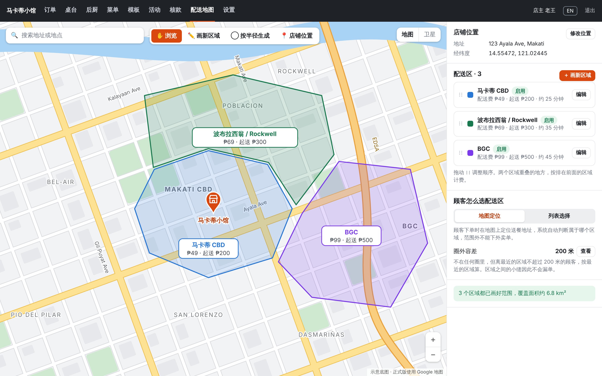
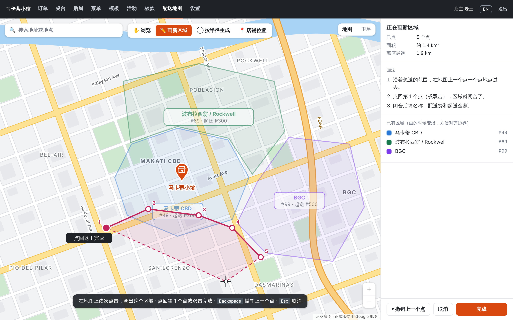
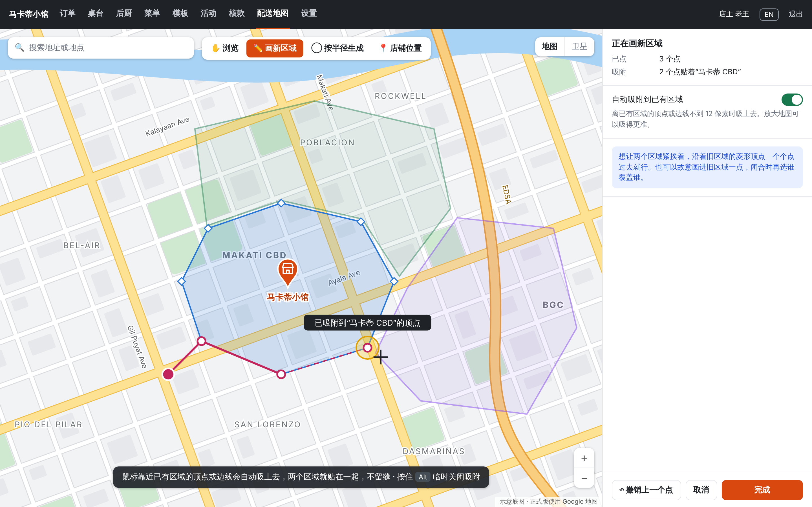
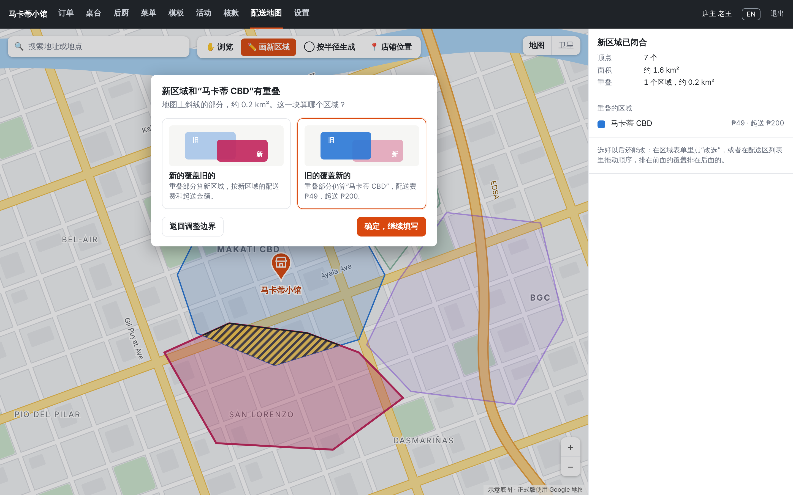
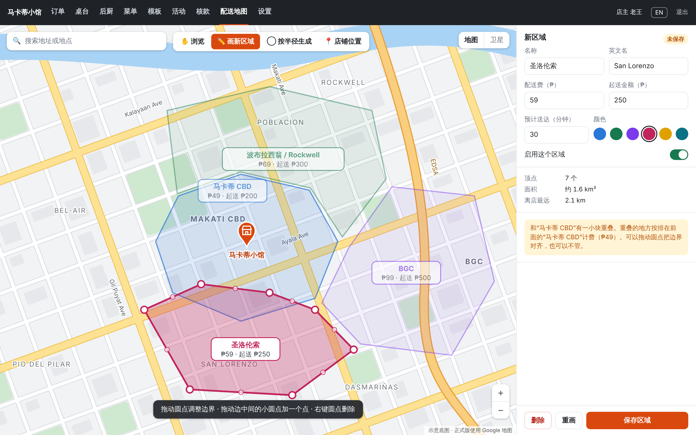
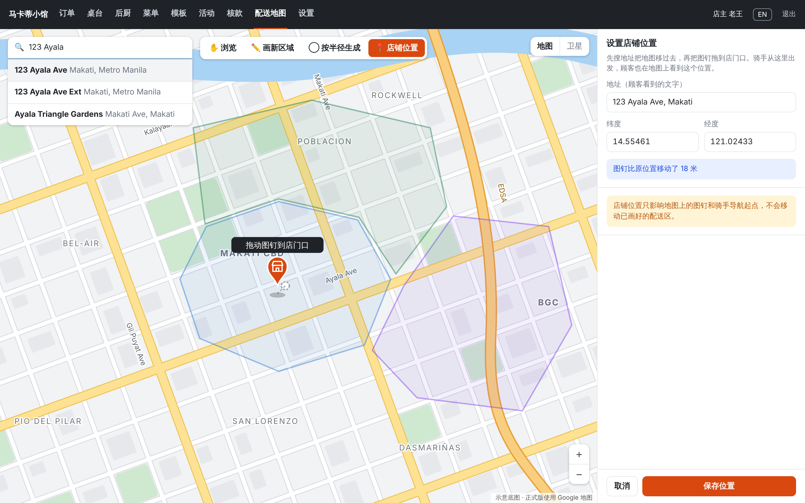
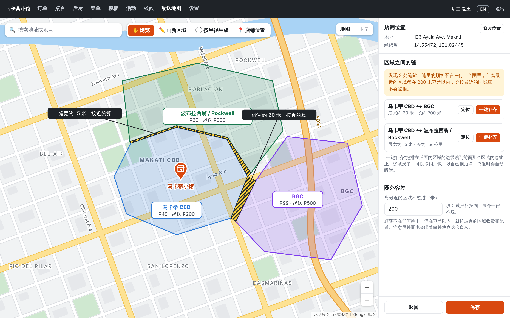
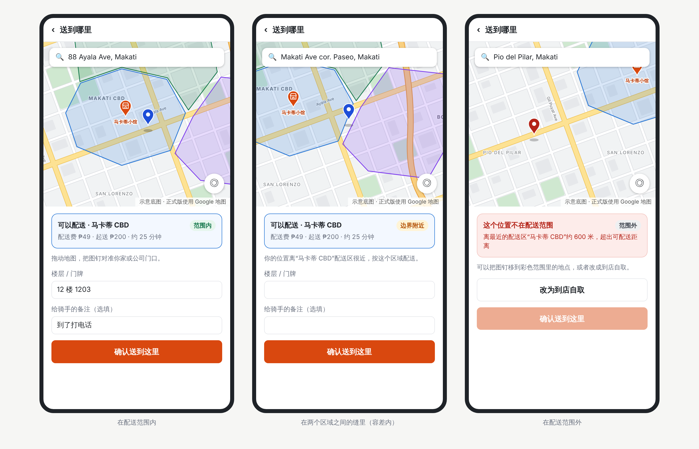

# 商家配送地图 · 设计方案 v0.3

2026-11-21 · 待 brian 确认。确认前不写代码。

v0.2 改动：重叠规则按 brian 的要求改为“闭合后马上检测，有重叠就让商家选谁覆盖谁”，见 2.3 和 4.2。

v0.3 改动：处理区域之间的缝。画的时候自动吸附防缝，保存后检查缝隙并可一键补齐，下单时加 200 米圈外容差兜底。brian 已同意这两种方法，见 2.2、2.6、4.3。

本稿是 [DESIGN.md](DESIGN.md) 的补充，讲商家端新增的“配送地图”页面：在 Google 地图上设置店铺位置，用连续点击的方式圈出配送区，并给每个区设置名称、配送费、起送金额。

效果图在 [map-screens/](map-screens/)，可点开的 HTML 原型在 [map-prototype/](map-prototype/)（`index.html?s=overview｜draw｜snap｜overlap｜form｜gap｜location` 和 `customer.html`）。效果图里的底图是示意图，不是真的 Google 地图，正式版会换成 Google 地图。图里的区域、金额、地址都是示意数据。

## 1. 现状和要改的地方

现在系统里已经有配送区，但只有文字，没有地图：

| 现状 | 位置 |
|---|---|
| 配送区只有名称、英文名、配送费、起送金额、启用、排序 | 表 `delivery_zones` |
| 商家在“设置”页底部的一张小表里增改配送区，不能删除 | `web/src/views/SettingsView.vue` |
| 顾客下单时从下拉列表里自己选区域 | `web/src/views/StoreView.vue` |
| 门店只有文字地址，没有经纬度 | 表 `branches.address` |
| 订单只记区域名和文字地址，没有经纬度 | 表 `orders` |

DESIGN.md 第 46 行和第 274 行当时的决定是“首版不依赖地图”。本稿把这条升级为：配送区可以在地图上画范围，顾客在地图上定位，系统自动判断属于哪个区。

| 你要的功能 | 本稿对应 | 效果图 |
|---|---|---|
| 商家端的 Google 地图页面 | 新页面“配送地图”，顶部导航加一项 | [01-overview.png](map-screens/01-overview.png) |
| 设置店铺位置 | 搜地址，再把图钉拖到店门口 | [04-store-location.png](map-screens/04-store-location.png) |
| 连点画圈划分区域 | 在地图上逐点点击，点回起点闭合 | [02-drawing.png](map-screens/02-drawing.png) |
| （你补充的）重叠时选谁覆盖谁 | 闭合后马上检测，有重叠就弹出选择 | [06-overlap-choice.png](map-screens/06-overlap-choice.png) |
| （你补充的）区域之间有缝怎么办 | 画时自动吸附，缝隙检查和一键补齐，下单时圈外容差兜底 | [07-snap.png](map-screens/07-snap.png) · [08-gaps.png](map-screens/08-gaps.png) |
| 每个区设名称、配送费、起送金额等 | 画完后右侧出表单 | [03-zone-form.png](map-screens/03-zone-form.png) |
| （补充）顾客在地图上定位送餐地址 | 自动判断区域，范围外不能下外卖单 | [05-customer.png](map-screens/05-customer.png) |
| （补充）骑手一键导航 | 订单带经纬度后，骑手页加“导航”按钮 | 无图 |

不在本稿范围：按距离阶梯计费、按时段调整配送费、骑手实时位置、路线规划和预计到达时间的自动计算。

## 2. 商家端页面

路径 `/merchant/delivery-map`，顶部导航在“核款”和“设置”之间加“配送地图”。只有 `owner` 和 `manager` 能进。平台管理员以只读方式进入门店时能看不能改。“设置”页里原来的配送区小表去掉，换成一个跳到本页的链接。

页面左边是地图，右边是 372px 宽的侧栏。页面以电脑和平板为主，手机上侧栏折到地图下方，只能看和改文字，不能画。

### 2.1 总览（[01-overview.png](map-screens/01-overview.png)）

- 地图上显示店铺图钉和所有配送区。每个区一种颜色，中间的标签写名称、配送费、起送金额。
- 地图左上角是地址搜索，中间是工具条（浏览、画新区域、按半径生成、店铺位置），右上角切换地图和卫星图。
- 侧栏依次是：店铺位置、配送区列表、顾客怎么选配送区、整体提示。
- 配送区列表可以拖动排序。点一行，地图会移到那个区并选中它，点“编辑”进入 2.4 的表单。
- “顾客怎么选配送区”有两个选项：地图定位、列表选择。列表选择就是现在的做法。见 4.1。

### 2.2 画新区域（[02-drawing.png](map-screens/02-drawing.png)）

1. 点“画新区域”，鼠标变成十字，已有的区域变淡。
2. 在地图上依次点击，每点一下加一个顶点，顶点之间自动连线。最后一个点到鼠标之间有一条虚线，能看出闭合后的形状。
3. 点回第 1 个点，或者双击，区域闭合。至少要 3 个点。闭合后马上检测重叠，见 2.3。
4. `Backspace` 撤销上一个点，`Esc` 取消。侧栏底部也有对应按钮，平板上没有键盘时用。
5. 画的过程中侧栏实时显示点数、面积、离店最远距离。

“按半径生成”是快捷方式：输入 1、2、3 公里这样的半径，系统以店铺为中心生成一个 24 边形，之后和手画的区域一样可以拖动调整。

**自动吸附（[07-snap.png](map-screens/07-snap.png)）**

手画两个相邻的区域，边线不可能正好对上，中间会留一条缝。所以画的时候加吸附：

- 画新区域时，已有区域的顶点显示成小菱形。
- 鼠标离已有区域的顶点或边线不到 12 像素时，新的点自动吸到那个顶点或边线上，并提示吸到了哪个区域。吸附按屏幕像素算，放大地图就能吸得更准。
- 沿着旧区域的顶点一个个点过去，两个区域就共用同一条边，不留缝。
- 编辑已有区域、拖动顶点时同样吸附。
- 按住 `Alt` 临时关闭吸附，侧栏里也有开关。

### 2.3 闭合后检测重叠（[06-overlap-choice.png](map-screens/06-overlap-choice.png)）

区域一闭合，系统马上检查它和已有区域有没有重叠。停用的区域也算在内，因为以后可能再启用。

- 没有重叠：直接进入 2.4 的表单。
- 有重叠：地图上用斜线标出重叠的部分，弹出选择框，必须选一个才能继续。

| 选项 | 结果 |
|---|---|
| 新的覆盖旧的 | 重叠部分算新区域，按新区域的配送费和起送金额 |
| 旧的覆盖新的 | 重叠部分仍算原来的区域，费用不变 |
| 返回调整边界 | 不选，回去拖动顶点把重叠去掉 |

- 新区域同时和几个旧区域重叠时，选择框里列出这几个区域，一次选择对它们都生效。想对不同的旧区域做不同处理，保存后在配送区列表里拖动顺序。
- 选好以后还能改：表单里的提示条有“改选”。
- 编辑已有区域时，拖动顶点后如果出现了新的重叠（之前没和那个区域重叠），保存时弹同样的选择框，这时“新的”指正在编辑的这个区域。
- “按半径生成”的区域同样会检测。

### 2.4 区域表单和调整边界（[03-zone-form.png](map-screens/03-zone-form.png)）

区域闭合后，或者点已有区域的“编辑”，侧栏变成表单：

| 字段 | 说明 |
|---|---|
| 名称、英文名 | 沿用现有字段。名称必填 |
| 配送费 | 沿用现有字段，可以是 0 |
| 起送金额 | 沿用现有字段。和门店统一起送价取较大的那个，规则不变 |
| 预计送达（分钟） | 新增，选填。顾客定位后看到“约 25 分钟” |
| 颜色 | 新增，6 种预设色，新区域自动选一个没用过的 |
| 启用 | 沿用现有字段 |

同时地图上这个区域进入可编辑状态：

- 拖动顶点调整边界。
- 每条边中间有一个半透明小圆点，拖它就在那里加一个顶点。
- 右键顶点删除（平板上长按），少于 3 个点时不让删。
- “重画”清掉形状重新点。“删除”删掉整个区域，要二次确认。

有重叠时，表单里的黄色提示条写明你在 2.3 选的是哪一种、重叠部分按谁计费，旁边有“改选”。

### 2.5 设置店铺位置（[04-store-location.png](map-screens/04-store-location.png)）

1. 在搜索框输入地址，从下拉结果里选一条，地图移过去，图钉落在那里。
2. 把图钉拖到店门口。搜索结果常常落在楼的中心或路中间，所以一定要能手动拖。
3. 侧栏显示地址文字和经纬度。地址文字就是现有的 `branches.address`，顾客在门店页看到的那一行，可以手改。
4. 保存。

第一次进本页而店铺还没有位置时，直接进入这一步，设好位置才能画区域。之后再改店铺位置不会移动已画好的区域，只影响图钉和骑手导航的起点。

### 2.6 缝隙检查和一键补齐（[08-gaps.png](map-screens/08-gaps.png)）

吸附只能管以后新画的，已经画好的区域之间可能还有缝。所以每次保存区域后，以及从总览点“查看”时，系统检查区域之间的缝：

- 两个区域的边线之间距离很近（不超过圈外容差）但没贴上，中间这一条就算缝。地图上用斜线标出，侧栏列出每条缝在哪两个区域之间、最宽多少米。
- 提示里写清楚后果：缝在容差以内，缝里的顾客会按最近的区域算，不会被拒（见 4.3）。所以缝不补也不会漏单，补了更干净。
- “一键补齐”把排在后面的那个区域的边线贴到前面那个区域的边线上，缝消失，前面那个区域的形状不变。可以撤销。
- 形状太复杂、自动补不好的时候，提示改用手动拖顶点（会自动吸附）。
- 这里也能改圈外容差的米数。

## 3. 顾客端和骑手端的配套改动

只画区域而顾客端不改，画出来的范围就只是摆设。所以配套改这两处，放在第二批做。

### 3.1 顾客定位送餐地址（[05-customer.png](map-screens/05-customer.png)）

门店开了“地图定位”后，顾客选外卖时，原来的区域下拉框换成“送到哪里”：

1. 搜索地址，或者点右下角的定位按钮用手机当前位置（要顾客同意）。
2. 拖动地图，把图钉对准门口。地图上用颜色显示各配送区，顾客能看出自己在不在范围里。
3. 图钉停下后，下方卡片马上显示结果：属于哪个区、配送费、起送金额、预计送达。
4. 图钉不在任何圈里，但在圈外容差以内（比如正好在两个区域之间的缝里），照样可以配送，卡片写明按哪个区域算，见效果图中间那一张。
5. 超出容差才算范围外：显示红色卡片，“确认”按钮不可点，同时给出“改为到店自取”。
6. 楼层门牌和给骑手的备注照旧手填。

区域由服务器判定，不信任浏览器传来的区域编号。报价和下单时都会重新判定一次，商家在这中间改了区域，沿用现有的 `QUOTE_CHANGED` 流程让顾客重新确认。

### 3.2 骑手导航

订单有了经纬度后，骑手页的配送单上加“导航”按钮，打开手机上的 Google 地图直接导航到送餐点。这是一个普通链接，不产生地图费用。没有经纬度的老订单不显示这个按钮。

## 4. 规则

### 4.1 两种判定方式

每个门店有一个开关 `zone_mode`：

| 方式 | 顾客怎么选 | 什么时候用 |
|---|---|---|
| `list` 列表选择 | 从下拉列表选区域（现在的做法） | 默认值。没配 Google 密钥，或者区域还没画好 |
| `map` 地图定位 | 在地图上定位，系统自动判断 | 店铺位置已设，且至少有一个启用的区域画了范围 |

- 现有的区域升级后都还在，在列表里标“未画范围”，带一个“去画”按钮。
- 切到地图定位后，没画范围的区域顾客选不到，列表里会用黄色标出来提醒补画。
- 随时可以切回列表选择，画好的范围不会丢。

### 4.2 重叠

- 允许重叠，但谁覆盖谁由商家在闭合时明确选择（2.3），系统不替商家默认。
- 实现方式是优先顺序，不是把形状切掉。配送区列表的顺序就是优先顺序，排在前面的覆盖排在后面的：
  - 选“新的覆盖旧的”，新区域排到所有和它重叠的区域前面。
  - 选“旧的覆盖新的”，新区域排到所有和它重叠的区域后面。
- 顾客的位置落在多个区域里时，取排在最前面的那个启用的区域。停用的区域不参与，所以停用上面的区域后，下面的区域会在重叠部分自动接手。
- 不切形状的好处：两个区域的边界都保持商家画的样子，以后改选或者删掉其中一个，另一个不用重画。切形状还可能把一个区域切成两块或者挖出洞，不好编辑。
- 地图上重叠的部分显示覆盖方的颜色，一眼能看出这一块归谁。
- 可以画“大圈套小圈”：先画外面的大圈，再画里面的小圈，选“新的覆盖旧的”。
- 在列表里拖动顺序等于改覆盖关系，拖动后地图上的颜色跟着变。
- 点正好在边线上算在区域内。
- 重叠检测在浏览器里做（判断两个多边形的边有没有相交，或者一个完全在另一个里面）。服务器保存时只管顺序，判定顾客位置时按顺序取第一个。

### 4.3 圈外容差

解决的问题：顾客的地址正好落在两个圈中间的缝里，或者定位偏了几十米落在圈外。

- 每个门店有一个“圈外容差”，默认 200 米，商家可以改，范围 0 到 500 米。填 0 就是严格按圈。
- 判定顺序：
  1. 顾客的位置在某个启用的区域里，按 4.2 取排在最前面的那个。
  2. 不在任何区域里，就找离它最近的启用区域（算到边线的最短距离）。距离不超过容差，按这个区域收配送费、起送金额和预计送达。
  3. 超过容差，返回 `OUT_OF_ZONE`，不能下外卖单。
- 离两个区域一样近时，取排在前面的那个。
- 订单上照常记区域名，另外记一个“按容差归入”的标记，商家在订单详情里能看到“圈外约 40 米”，方便判断要不要调整范围。
- 需要知道的副作用：容差对所有边线都生效，所以最外圈也等于向外放宽了 200 米。如果外圈是沿着河或者快速路画的，对面 200 米内的顾客也能下单。不想要这个效果的话有两个办法：把容差调小，或者改成“只补两个区域中间的缝，外圈不放宽”的算法，见第 9 节第 12 条。

### 4.4 保存时的校验

| 检查 | 不通过时 |
|---|---|
| 顶点 3 到 200 个 | 不能保存 |
| 边线不能自己和自己交叉（画成 8 字形） | 不能保存，地图上把交叉的两条边标红 |
| 所有顶点离店铺不超过 30 公里 | 不能保存，防止误点到很远的地方 |
| 面积小于 0.01 km² | 提示可能画错了，可以继续保存 |
| 店铺不在任何一个区域里 | 提示，可以继续保存 |

校验在浏览器和服务器各做一遍。

### 4.5 删除

区域可以删除。历史订单里存的是当时的区域名和金额，不受影响。正在进行的促销活动不引用区域，也不受影响。

## 5. 数据

新增一个迁移 `00010_map_zones.sql`，只加列，不改已有数据：

| 表 | 新增列 | 说明 |
|---|---|---|
| `branches` | `lat`、`lng`（`DOUBLE PRECISION`，可空） | 店铺位置 |
| `branches` | `zone_mode`（`TEXT`，默认 `'list'`） | 见 4.1 |
| `branches` | `zone_tolerance_m`（`INT`，默认 200） | 圈外容差，见 4.3 |
| `delivery_zones` | `polygon`（`JSONB`，可空） | 顶点数组 `[[纬度, 经度], …]`，不重复首尾点。空表示没画范围 |
| `delivery_zones` | `color`（`TEXT`，默认 `''`） | 预设色之一 |
| `delivery_zones` | `eta_minutes`（`INT`，可空） | 预计送达分钟数 |
| `orders` | `dest_lat`、`dest_lng`（`DOUBLE PRECISION`，可空） | 顾客定位的送餐点 |
| `orders` | `zone_distance_m`（`INT`，可空） | 按容差归入时离区域边线的米数。在圈内为空 |

不装 PostGIS。一家店最多几十个区域，每个区域最多 200 个点，判断“点在不在多边形里”在 Go 里用射线法算就够了，一次不到一毫秒。这样托管数据库（[DEPLOY.md](DEPLOY.md) 第 10 节）不需要额外的扩展。城市范围内把经纬度当平面坐标算，误差可以忽略。面积和距离的显示值用球面公式算。

## 6. 接口

沿用现有的 `/api/v1` 前缀和权限检查。

| 接口 | 说明 |
|---|---|
| `GET /merchant/branches/{bid}/menu` | 已有。返回的 `zones` 多带 `polygon`、`color`、`eta_minutes`，`branch` 多带 `lat`、`lng`、`zone_mode` |
| `POST /merchant/branches/{bid}/zones` · `PUT …/zones/{id}` | 已有。请求体多收 `polygon`、`color`、`eta_minutes`，按 4.4 校验 |
| `DELETE /merchant/branches/{bid}/zones/{id}` | 新增 |
| `PUT /merchant/branches/{bid}/zones/order` | 新增。`{ids: […]}`，一次保存拖动后的顺序 |
| `PUT /merchant/branches/{bid}/location` | 新增。`{lat, lng, address}` |
| `PUT /merchant/branches/{bid}/settings` | 已有。多收 `zone_mode` 和 `zone_tolerance_m`，切到 `map` 时检查 4.1 的前提 |
| `GET /stores/{slug}` | 已有。地图定位的门店多返回店铺经纬度和各区域的范围，用来在顾客地图上着色 |
| `POST /stores/{slug}/locate` | 新增。`{lat, lng}`，返回所属区域和归入方式（在圈内，或按容差归入及距离），或者“范围外”和最近区域的距离。只读，有限流 |
| 报价和下单 | 已有。地图定位的门店改收 `lat`、`lng`，服务器自己判定区域，忽略传来的 `zone_id`。范围外仍然返回 `OUT_OF_ZONE` |
| `GET /config` | 新增或并入现有的公开配置。返回浏览器用的 Google 地图密钥，没配时返回空 |

## 7. Google 地图接入

- 用 Google Maps Platform 的两项服务：Maps JavaScript API（显示地图、图钉、多边形）和 Places API（地址搜索的下拉结果）。
- 画多边形的交互自己实现（监听地图点击，用可编辑的多边形显示）。Google 官方的绘图组件 Drawing Library 已经宣布停用，不能依赖。写代码前我会再核对一次当前可用的接口。
- 平台统一用一个密钥，放在环境变量 `GOOGLE_MAPS_API_KEY`，商户不用自己申请。密钥会出现在浏览器里，这是 Google 地图的正常用法，要在 Google 后台限制“只允许你的域名使用”和“只允许这两项服务”。[DEPLOY.md](DEPLOY.md) 会加一节申请和限制密钥的步骤。
- 没配密钥时：商家端的配送地图页显示一条说明，配送区退回文字表单，顾客端保持列表选择。系统其他部分不受影响。
- 费用：Google 地图需要一个绑定了付款方式的 Google Cloud 账号，每月有免费额度，超出后按用量收费。商家端用量很小。主要用量在顾客端，所以顾客端只在点开“送到哪里”时才加载地图，地址搜索用会话计费的方式。具体单价以 Google 当时的价目表为准，我没有在本稿里写数字。
- Google 地图在中国大陆不能正常访问。现在的门店都在菲律宾，不受影响。
- 自动化测试里没有 Google 密钥，也不该调用真实服务。前端把地图封装成一层接口，测试时换成一个假地图，照样能测“点 5 下、闭合、填表、保存”的整个流程。

## 8. 落地顺序和测试

| 批次 | 内容 |
|---|---|
| 第一批 | 数据迁移。商家端配送地图页：店铺位置、画区域、编辑、排序、删除、按半径生成。没配密钥时的退回。DEPLOY.md 加密钥一节 |
| 第二批 | 判定方式开关。顾客端地图定位。报价和下单按经纬度判定。骑手导航按钮 |

测试：

| 范围 | 用例 |
|---|---|
| 判定 | 点在区域内、区域外、边线上、凹多边形的凹口里。重叠时取排在前面的。停用的区域不参与 |
| 重叠 | 闭合后检测到重叠并弹出选择。选“新的覆盖旧的”后重叠处判给新区域，选“旧的覆盖新的”后判给旧区域。拖动顺序后判定跟着变 |
| 容差 | 缝里的点归入最近的区域。圈外 199 米归入，201 米拒绝。容差为 0 时圈外一律拒绝。离两个区域一样近时取排在前面的 |
| 吸附和补齐 | 吸附后的顶点和旧区域的顶点坐标完全相同。一键补齐后缝隙检查不再报这条缝，前面那个区域的形状没变 |
| 校验 | 少于 3 个点、自交叉、离店太远都被拒绝 |
| 接口 | 只有店主和店长能改。平台管理员只读。地图定位的门店不接受浏览器传来的区域编号 |
| 金额 | 定位到不同区域时配送费和起送金额跟着变。商家改了区域后旧报价返回 `QUOTE_CHANGED` |
| 兼容 | 列表选择的门店行为和现在完全一样。现有三条浏览器测试继续通过 |
| 浏览器 | 新增 `e2e/mapzones.cjs`：设店铺位置、画一个区域、再画一个重叠的区域并选择覆盖方式、保存、顾客定位到区域内下单、定位到区域外被拦 |

真实 Google 地图上的效果要等拿到密钥后，由我在浏览器里实测一遍并截图给你看。

## 9. 需要你确认的地方

每条都给了推荐做法。回复“确认”就全部按推荐做。

| # | 问题 | 推荐 |
|---|---|---|
| 1 | 顾客端要不要一起改成地图定位 | 要，放第二批。不改的话顾客还是自己从列表选区域，画的范围起不到作用 |
| 2 | 两个区域重叠了怎么算 | **已按你的要求改**：闭合后马上检测，有重叠就让商家选“新的覆盖旧的”或“旧的覆盖新的”。待你确认的细节：用排列顺序实现而不切形状；同时和几个旧区域重叠时一次选择对它们都生效（见 4.2） |
| 3 | 顾客在所有区域之外 | 不能下外卖单，提示改为到店自取。不做“范围外加价配送” |
| 4 | 每个区域除了名称、配送费、起送金额，还要什么 | 加“预计送达分钟数”和“颜色”。不加按距离计费和分时段运费，以后需要再说 |
| 5 | Google 地图密钥谁出 | 平台统一一个密钥，由你用自己的 Google Cloud 账号申请（需要绑付款方式），商户不用管。我在部署教程里写清楚步骤 |
| 6 | 现有的没画范围的区域 | 保留。门店默认还是列表选择，画好范围后由商家自己切到地图定位 |
| 7 | 要不要“按半径生成”圆形区域 | 要。很多店就是按 1、2、3 公里收费，生成后还能拖动微调 |
| 8 | 骑手页要不要加导航按钮 | 要。成本很低，对骑手很有用 |
| 9 | 区域能不能删除 | 能，要二次确认。历史订单保留当时的区域名和金额 |
| 10 | 手机上能不能画区域 | 不能，手机上只能看和改名称金额。画区域在电脑或平板上做，手指在小屏幕上点不准 |
| 11 | 区域之间有缝 | **你已同意**：画时自动吸附；保存后检查缝隙，可一键补齐；下单时圈外容差兜底，默认 200 米，商家可调 |
| 12 | 容差要不要连最外圈一起放宽 | 按你同意的做法，容差对所有边线生效，最外圈也向外放宽 200 米，规则简单好讲。如果你不想外圈放宽，可以改成只补两个区域中间的缝，告诉我就行 |
