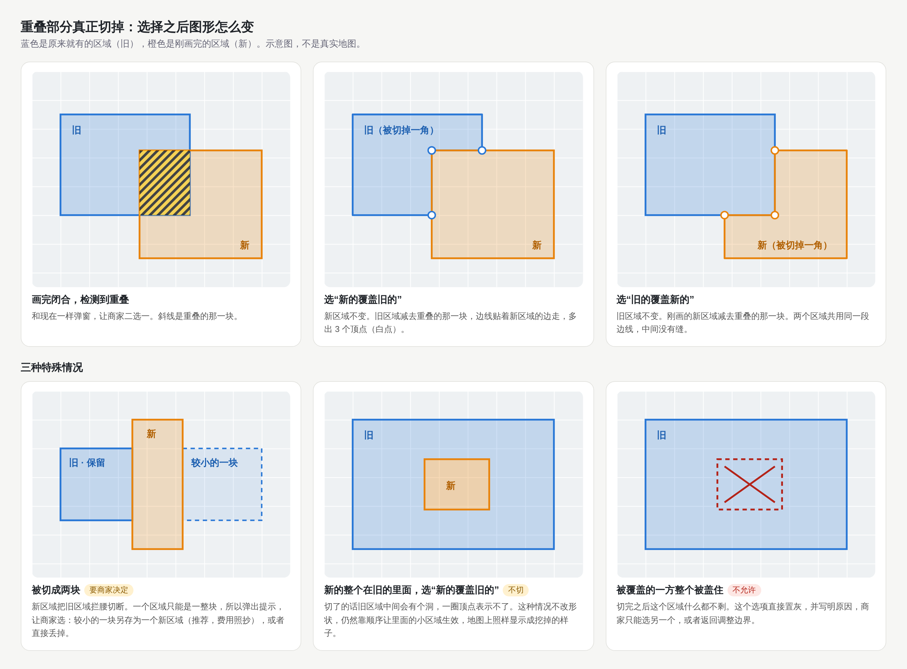

# 商家配送地图 · 优化方案 v0.1

2026-11-22 · 待 brian 确认。确认前不写代码。

本稿是 [MAP_ZONES_DESIGN.md](MAP_ZONES_DESIGN.md) 的补充，处理 brian 在真实 Google 地图上试用后提的三个问题：

| # | 问题 | 结论 |
|---|---|---|
| 1 | 选了“新的覆盖旧的”或“旧的覆盖新的”之后，重叠的部分应该真的切掉，被覆盖的那个圈要重新调整形状 | 改。保存时把重叠部分从被覆盖的区域里减掉，见第 1 节 |
| 2 | 点“画新区域”后，鼠标在地图上还是一只手掌，应该是一支笔 | 改。原因和做法见第 2 节 |
| 3 | 缩放地图时，圈、标签、店铺图标有明显滞后，像浮在地图上 | 改。把我们的图层放进 Google 地图自己的图层里，见第 3 节 |

## 1. 重叠部分真正切掉

### 1.1 现在是怎么做的，为什么要改

现在两个区域重叠时，形状都不动，只是调整列表里的先后顺序，重叠的地方按排在前面的区域算。这样做判定结果是对的，但地图上两个圈仍然叠在一起，商家看不出“这一块到底归谁”，也和“覆盖”这个词给人的预期不一样。

### 1.2 改成什么样

1. 画完闭合，检测到重叠，弹窗二选一。这一步和现在一样。
2. 选完之后，地图上马上预览切割后的样子：被覆盖的一方减去重叠的那一块，新的边线贴着对方的边线走。
3. 商家填完表单点保存，两个区域的新形状一起保存。要么都成功，要么都不变。
4. 保存前可以点“重新选择”换另一个选项，或者返回调整边界。保存后提供一次“撤销”，恢复两个区域切割前的形状。

被切的一方和对方共用同一段边线，顶点坐标完全相同，所以切完不会留缝。

一次重叠了多个旧区域时，一个选择对它们全部生效：选“新的覆盖旧的”，每个旧区域都减去新区域；选“旧的覆盖新的”，新区域依次减去每个旧区域。

拖动顶点修改一个已有区域、拖出了新的重叠时，同样弹窗、同样切割。

### 1.3 三种特殊情况

| 情况 | 做法 |
|---|---|
| 被切的一方被切成两块或更多 | 一个区域只能是一整块。弹出提示让商家选：保留最大的一块，其余每块另存为一个新区域，名称加“-2”，费用照抄（推荐）；或者只保留最大的一块，其余丢掉。面积很小的碎片（小于 500 平方米）直接丢掉，不问 |
| 小的整个在大的里面，而且小的要覆盖大的 | 切了的话大区域中间会出现一个洞，一圈顶点表示不了。这种情况不改形状，仍然用现在的办法：小区域排在前面，按顺序生效。地图上照样显示成挖掉的样子 |
| 被覆盖的一方整个被盖住 | 切完什么都不剩。这个选项置灰并写明原因，商家只能选另一个，或者返回调整边界 |

### 1.4 切割带来的影响

这些是改成真切割之后会有的后果，需要你知道：

- **切掉的部分不会自己长回来。** 以后删除或者缩小了当初“赢”的那个区域，被切的区域不会恢复原状，那一块会变成没人送的空白。应对：删除区域时，如果它和别的区域共用边线，删除确认里会提醒“删除后这一块没有区域覆盖”；保存后的缝隙检查也会报出来；商家可以拖顶点或者用“一键补齐”补上。
- **顶点会变多。** 被切的区域会多出对方边线上的顶点。按半径生成的圆有几十个顶点，被圆切过的区域也会多几十个。现在每个区域最多 200 个顶点，切割后超过时拒绝保存并提示先简化。
- **先后顺序还保留，但基本用不上了。** 列表里的 ▲▼ 和拖动排序继续保留，作为兜底：上表第二种情况靠它，计算误差留下的极细重叠也靠它。正常情况下区域之间不再重叠，顺序不影响结果。
- **顾客端、报价、下单的判定逻辑不用改。** 服务器仍然是“点在哪个圈里就算哪个区，都不在就看容差”。

### 1.5 已经画好的重叠区域

你截图里的“111”和“222”现在就是叠着的。上线后不会自动去改已有的形状。在侧栏的整体提示里加一条“发现 N 处重叠”，点开后逐个处理：地图上标出重叠部分，仍然是二选一，然后按上面的规则切。

### 1.6 实现要点

- 多边形相减在浏览器里算，这样选完马上能预览。相减是容易出错的几何运算，我打算用成熟的开源库来做，不自己写。写代码前会核对库的许可和体积，候选是 `polygon-clipping`。
- 新增一个接口，一次保存多个区域的形状，放在一个数据库事务里。服务器对每个形状照旧做全部校验（至少 3 个点、不自交、离店不超过 30 公里、面积不为零）。
- 测试：切一角、切成两块、洞、整个被盖住、一次切多个、切完和邻居顶点完全重合、撤销后恢复原样。浏览器测试 `e2e/mapzones.cjs` 加上切割后核对两个区域形状的步骤。

## 2. 画区域时鼠标变成一支笔

### 2.1 原因

鼠标样式是 Google 地图自己设置的，默认是手掌（表示可以拖动地图）。我之前只给不联网的测试底图设了十字光标，真实的 Google 地图上没有生效。这是我测试覆盖不到的地方：当时没有密钥，真地图没跑过。

### 2.2 做法

进入“画新区域”后，通过 Google 地图的光标设置把鼠标换成一支笔，退出后换回手掌。

- 笔的图标自己画一个小图，笔尖就是点击落点，这样点哪里、顶点就落在哪里。浏览器不支持自定义图标时退回十字光标。
- 鼠标移到第一个点上、可以闭合时，换成手指，配合现有的“点这里闭合”提示。
- 画的过程中仍然可以按住拖动地图，拖动时显示抓手，松开后变回笔。
- 设置店铺位置时同样处理：地图上显示图钉样式的光标。
- 测试底图用同一套光标，这样自动化测试能覆盖到。

## 3. 圈、标签、店铺图标跟着地图一起动

### 3.1 原因

现在圈、标签、图钉画在我们自己的一个图层上，这个图层盖在 Google 地图上面，和地图是两样东西。地图每动一下，Google 通知我们“视野变了”，我们再把所有图形重新算一遍位置。问题有两个：

- 这个通知不是每一帧都发。缩放动画的过程中，Google 自己的底图在平滑放大，我们的图层要等通知来了才跳到新位置，所以看起来慢半拍。
- 每次通知都要让整个页面框架重新计算一遍所有图形，区域多的时候更慢。

### 3.2 做法

把我们的图层放进 Google 地图内部，用 Google 提供的“自定义叠加层”接口（`OverlayView`）。这是 Google 官方给“往地图里放自己的东西”准备的办法。

- **拖动地图**：图层在地图内部，跟着底图一起移动，不需要我们重新计算，没有延迟。
- **缩放地图**：Google 在缩放的每一步都会叫我们的图层重画。重画时不再逐个顶点重新计算，而是给整个图层设一次“放大多少、移到哪里”，由浏览器的显卡完成，和底图同步。
- 缩放时线条粗细、标签文字、图钉、顶点手柄保持原来的大小，只有位置和区域的形状跟着变。
- 页面框架只在数据变化时（增删改区域）重画图形，地图移动时不再参与。

商家配送地图和顾客端的“送到哪里”用的是同一个地图组件，两处一起改好。

### 3.3 需要说明的

- 这一项我在自己的环境里没法验证最终效果。我的自动化测试跑在不联网的测试底图上，它没有缩放动画，测不出“跟不跟手”。逻辑正确性可以测，观感要在真实 Google 地图上看。所以这一项需要一个能用的 Google 地图密钥让我实测，或者写完后由你在真地图上试，见第 5 节第 5 条。
- 如果放进 Google 图层之后缩放时仍有可见的不同步，备选做法是把区域改用 Google 自带的多边形和标记来画。那样和底图是完全一体的，但斜线、挖空这些自定义效果要重做，测试底图也要另写一套，工作量大得多。先做上面的方案，不够再换。

## 4. 落地顺序

| 批次 | 内容 | 说明 |
|---|---|---|
| 第一批 | 第 2 节画笔光标，第 3 节图层跟随 | 都是地图组件内部的改动，不动数据，风险小 |
| 第二批 | 第 1 节重叠切割，含已有重叠的处理 | 改动保存逻辑，新增接口和测试 |

每批一个 PR，检查通过后合并到 main，和之前一样。

## 5. 需要你确认的地方

每条都给了推荐做法。回复“确认”就全部按推荐做。

| # | 问题 | 推荐 |
|---|---|---|
| 1 | 被切成两块时怎么办 | 弹窗让商家选，默认选中“较小的块另存为新区域”。另一个选项是丢掉 |
| 2 | 小区域整个在大区域里面时 | 不切，不在大区域上挖洞，继续靠顺序生效。要真正支持带洞的区域得改数据结构，以后有需要再做 |
| 3 | 已经叠着的旧区域 | 不自动改，提示“发现 N 处重叠”，商家逐个选择后再切 |
| 4 | 切割后要不要“撤销” | 要，保存后可撤销一次，和“一键补齐”的撤销一样 |
| 5 | 第 3 节怎么实测 | 你的服务器上已经配了 Google 地图密钥。推荐：你在 Google 后台给这个密钥的网站限制里临时加一条 `http://localhost:8080/*`，再把密钥发给我，我在自己的环境里对着真地图调到满意再合并。不方便给的话，我按方案写完合并，由你在真地图上试，有问题再改 |
| 6 | 画笔光标的样子 | 一支斜放的笔，笔尖是落点。也可以改成十字准星，定位更准但不像“画” |

## 6. 实现时的调整

第 5 节的六条都按推荐做了。写代码时有几处和上文的说法不完全一样：

- **切成两块时的选择放在右侧面板里，不是弹窗。** 选了覆盖方向以后，地图上直接预览切完的样子，面板里出现“较小的块另存为新区域 / 丢掉较小的块”两个选项，默认选中前者。这样能一边看图一边选。另存的块叫“原名-2”“原名-3”，费用、起送价、颜色照抄原区域，在列表里紧跟在原区域后面。
- **切完会剩不下东西的方向不能选。** 比如新画的区域整个在旧区域里面，“旧的覆盖新的”会把新区域切没，这个按钮置灰并写明原因。
- **小于 500 平方米的碎块直接丢掉**，两个区域共有的面积不到 25 平方米算“只是挨着”，不提示重叠。
- **一次切割涉及的所有区域一起保存**（接口 `PUT /merchant/branches/:bid/zone-batch`），要么全部成功要么全部不变。撤销会恢复各区域原来的轮廓、删掉另存出来的块，列表顺序保持不变。
- **多边形运算用开源库 polygon-clipping**（MIT 许可），在浏览器里算，服务器只管校验和保存。
- **第 3 节没有在真的 Google 地图上实测。** 开发环境没有密钥，改成写了一个模仿 Google 地图接口的测试替身（`e2e/fake-google.js`），检查缩放动画的每一帧里区域都在地图给出的位置上、拖动中途也跟着走、画区域时光标是笔。它能证明我们的代码按 Google 文档的方式接上了，证明不了真地图上的观感，这一点需要在配了密钥的服务器上看。
