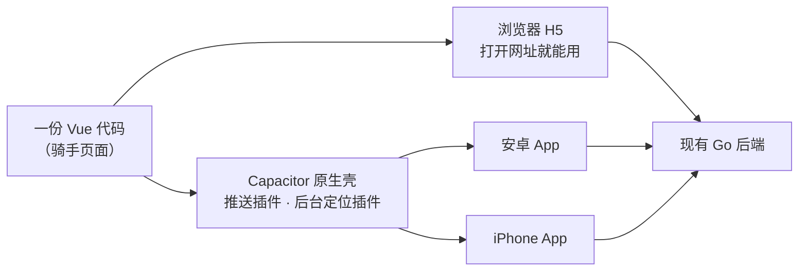
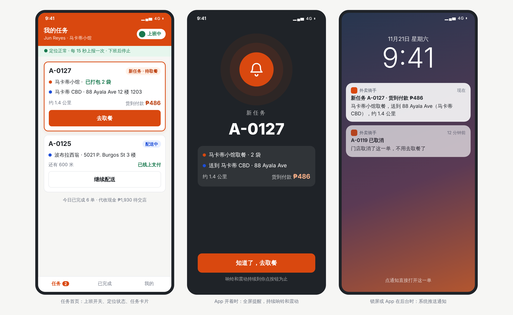

# 骑手端 · 安卓 / iOS / H5 通用 · 设计方案 v0.1

2026-11-21 · 待 brian 确认，还没写代码。

本稿是 [DESIGN.md](DESIGN.md) 的补充，回答一个问题：骑手端怎么做到安卓、iPhone、浏览器三端通用，以及通用之后要补哪些功能。

效果图在 [rider-screens/](rider-screens/)，可点开的 HTML 原型在 [rider-prototype/index.html](rider-prototype/index.html)。图里的底图是示意图，人名、地址、金额都是示意数据。

**一句话结论：继续用现在这套 Vue 页面，一份代码出三个产物。浏览器直接打开是 H5；用 Capacitor 套一层原生壳，打包成安卓 App 和 iPhone App。推送和后台定位这两件网页做不到的事交给壳里的原生插件。**

## 1. 现在的骑手端

现在的骑手端是网页里的一个页面，登录后角色是骑手就进到 `/rider`。

| 已经有的 | 位置 |
|---|---|
| 我的任务列表，分进行中和已完成 | `web/src/views/RiderView.vue`（一个文件，107 行） |
| 确认取餐，没打包好时按钮不能点 | `POST /rider/tasks/{id}/pickup` |
| 我已到达、确认送达、货到付款录实收金额 | `…/arrive`、`…/deliver` |
| 上报配送异常，必须填原因 | `…/fail` |
| 导航到顾客图钉位置（打开 Google 地图）、打电话给顾客 | 普通链接，不产生费用 |
| 页面开着时任务自动刷新，断线后改成轮询 | `GET /rider/events`（SSE） |
| 中英文切换 | `web/src/i18n.ts` |
| 改派后旧骑手不能再操作这一单 | 后端按指派版本校验 |

派单方式是门店的人在工作台上点名指派，骑手不抢单。本稿不改这一点。

**现在缺的，都和“它只是个网页”有关：**

| 缺什么 | 后果 |
|---|---|
| 没有推送 | 骑手把手机锁屏或切到别的 App，就不知道来了新任务，得靠门店打电话 |
| 不上报位置 | 门店不知道骑手在哪、谁离店近；顾客看不到餐送到哪了 |
| 没有上班、下班状态 | 门店指派时分不清谁在岗 |
| 没网时不能操作 | 电梯里、楼道里点“确认送达”会失败 |
| 没有桌面图标 | 每次要找浏览器里的网址，登录状态也容易丢 |
| 界面只有一页 | 所有任务和按钮挤在一个列表里，单多时容易点错 |

## 2. 几条跨平台路线

### 2.1 先说清楚网页的硬限制

选哪条路线，主要看下面两件事。它们是浏览器本身的限制，不是我们写得好不好的问题。

| 能力 | 浏览器 H5（含“添加到主屏幕”的 PWA） | 原生 App（含套壳 App） |
|---|---|---|
| 新单推送 | 安卓可以。iPhone 要 iOS 16.4 以上，而且骑手必须先把网页“添加到主屏幕”，从图标打开才收得到 | 都可以，锁屏也会响 |
| 后台定位（锁屏或切到别的 App 时继续上报） | **做不到**，安卓和 iPhone 都不行。只有页面开着、屏幕亮着时有位置 | 可以，要骑手授权“始终允许” |
| 持续响铃直到骑手确认 | 做不到，只有一声系统提示音 | 安卓可以；iPhone 是一段最长 30 秒的提示音 |

所以：只要想要“锁屏也能上报位置”，就必须有一层原生的东西。问题只剩下这层原生的东西怎么做最省。

### 2.2 五条路线对比

| | A. PWA 增强 | B. Capacitor 套壳 | C. uni-app | D. Flutter | E. React Native |
|---|---|---|---|---|---|
| 是什么 | 还是网页，加上桌面图标、离线缓存、网页推送 | 把现有网页装进一个原生外壳，壳里装原生插件 | 国内的跨端框架，用 Vue 语法写，能出 App、H5、小程序 | Google 的跨端框架，用 Dart 语言重写界面 | Meta 的跨端框架，用 React 重写界面 |
| 现有骑手页面能复用多少 | 全部 | 全部 | 逻辑能参考，页面要按它的组件重写 | 不能，全部重写 | 不能，全部重写 |
| H5 怎么办 | 本身就是 | 同一份代码 | 能编译出 H5，但和现在的网页工程是两套 | 另外维护现在的网页，或用 Flutter 网页版（加载慢） | 另外维护现在的网页 |
| 后台定位 | 做不到 | 可以，用原生插件 | 可以，用原生插件 | 可以，最稳 | 可以，最稳 |
| 新单推送 | 安卓可以，iPhone 有条件 | 可以（FCM 和苹果推送） | 可以，但它自带的推送通道主要服务国内，海外要另接 FCM | 可以 | 可以 |
| 上架商店 | 不上架，发网址 | 可以上架 | 可以上架 | 可以上架 | 可以上架 |
| 多出来要维护的东西 | 几乎没有 | 两个壳工程（基本是配置）加几个插件 | 一整套新工程 | 一整套新工程，新语言 | 一整套新工程，新框架 |
| 我估的工作量 | 小 | 中 | 中到大 | 大 | 大 |
| 主要风险 | 核心需求（后台定位）满足不了 | 后台定位靠第三方插件，部分安卓机省电策略会杀后台，要引导骑手设白名单 | 生态和文档以国内为主，对菲律宾这边用的 Google 地图、FCM 支持是次要路径 | 骑手端和其他四个入口从此是两套技术 | 同左 |

工作量是我按现有代码量估的相对大小，不是精确工期。

### 2.3 推荐：A 加 B，一份代码三个产物

理由：

1. **复用最多。** 骑手页面、接口封装、中英文、样式都在现有工程里。套壳不用重写界面，以后改一处三端一起变。
2. **两个硬需求都能满足。** 推送和后台定位由壳里的原生插件做，页面通过一个薄薄的适配层调用。在浏览器里同一个适配层退回到网页推送和前台定位。
3. **H5 自然保留。** 新骑手、临时帮忙的人、没装 App 的人打开网址照样能接单送餐，只是没有后台定位。见 [04-three-platforms.png](rider-screens/04-three-platforms.png)。
4. **不选 uni-app**：它最大的好处是能出微信小程序，这个项目在菲律宾用不上，却要为它重写页面并另起一套工程。
5. **不选 Flutter 和 React Native**：它们的原生体验和后台能力最好，但骑手端只有任务列表、几个按钮和一张地图，用不到那么强的界面能力，却要多养一套语言和工程。以后如果骑手端变得很重（比如自己做路线规划），再换也来得及，后端接口不用动。

## 3. 骑手端页面

从“一个长列表”改成三个标签页加任务详情，三端界面一样。

### 3.1 任务首页和新单提醒（[01-tasks-alerts.png](rider-screens/01-tasks-alerts.png)）

- 顶部是上班开关。上班中才会被指派、才采集位置。
- 开关下面一条状态栏，告诉骑手现在定位正不正常。
- 任务卡片只留最关键的：单号、取餐点、送餐地址、距离、要不要收钱。新任务卡片加粗边框排最上面。
- **新单提醒分两种情况**：App 开着时弹全屏提醒，响铃加震动，点了才停；App 在后台或锁屏时走系统推送，点通知直接进这一单。
- 除了新任务，这些情况也会推送：订单被门店取消、被改派给别人、餐打包好了可以来取。

### 3.2 取餐、配送、送达（[02-pickup-deliver.png](rider-screens/02-pickup-deliver.png)）

- 一单一页，每页只有一个主按钮，按现有状态走：确认取餐、我已到达、确认送达。
- 配送页上半部分是地图，画出店、骑手、顾客三个点。“导航”还是跳到手机上的 Google 地图，不在我们 App 里做逐向导航。
- 送达页的货到付款加快捷金额（刚好、整百、整千）并算出找零。实收和应收不一样时记差额，这是现有规则。
- 送达凭证拍照是新增的，选填。

### 3.3 定位授权、“我的”、没信号（[03-location-offline.png](rider-screens/03-location-offline.png)）

- 第一次点“开始上班”前先出一页说明，讲清楚为什么要位置、什么时候采集、给谁看，然后才弹系统授权框。苹果和 Google 审核都要求这样做，骑手也更愿意点允许。
- “我的”页放上下班、当日统计、未交店的代收现金，以及一组自检：推送开没开、后台定位是不是“始终允许”、有没有加省电白名单。
- 没信号时，取餐、到达、送达这些操作先存在手机里，联网后自动提交，时间按点按钮的时刻算。

### 3.4 门店和顾客能看到的（[05-store-customer-tracking.png](rider-screens/05-store-customer-tracking.png)）

骑手上报位置之后，另外两端才有用处：

- **门店工作台**多一张骑手地图：谁在岗、在哪、手上几单、谁失联了。指派骑手的下拉列表按“空闲优先、离店近优先”排序，仍然由店员点人。
- **顾客订单页**在“配送中”阶段显示骑手位置和预计到达时间。只在这一单配送期间显示，送达后就看不到了。

## 4. 规则

### 4.1 定位

| 项 | 做法 |
|---|---|
| 什么时候采集 | 只在“上班中”。点下班、退出登录、连续 12 小时没下班时自动停止 |
| 频率 | 手上有配送中的单时约 15 秒一次，空闲时约 60 秒一次，原地不动时不重复上报。省电也省流量 |
| 上传 | 攒几个点一起发。没网时存在手机里，联网后补发，最多补最近 10 分钟 |
| 失联 | 上班中但超过 5 分钟没有新位置，门店地图上标“失联”，不自动改派 |
| 保存多久 | 每个骑手的最新位置一直更新。历史轨迹只留 7 天，用于处理投诉，到期自动删 |
| 谁能看 | 本门店的店长和收银；顾客只能看自己那一单配送途中的位置 |
| 网页版 | 只有页面开着时上报。状态栏明确提示“屏幕关掉后不能上报位置” |

### 4.2 推送

| 项 | 做法 |
|---|---|
| 通道 | 安卓 App 和 iPhone App 用 Firebase Cloud Messaging（免费，iPhone 那边由它转给苹果推送）。浏览器用标准的网页推送 |
| 发送 | 指派、改派、取消、打包完成这几个事件提交后，放进现有的后台任务队列去发，失败自动重试。平台后台的 Worker 页面能看到发送情况 |
| 推送只是提醒 | 推送内容只有单号、地址和金额摘要。骑手点开后 App 重新向服务器拉任务，以服务器为准。推送丢了也不会丢单，打开 App 就能看到 |
| 没确认怎么办 | 指派后 2 分钟骑手没打开这一单，门店工作台把这单标成“骑手未读”，由店员决定打电话还是改派 |
| 一人多台手机 | 都能收到。退出登录时注销这台手机 |

### 4.3 登录

现在网页靠浏览器 Cookie 保持登录。App 壳里的页面和服务器不在同一个域名下，Cookie 这条路在 iPhone 上不可靠，所以 App 改用登录令牌：登录后服务器发一个令牌，存在手机的安全存储里，之后每次请求带上。网页版不变。骑手 30 天内不用重新登录，门店停用这个骑手账号后令牌立刻失效。

### 4.4 离线操作

- 取餐、到达、送达、上报异常可以离线点，按顺序排队补交。
- 每个操作带一个手机生成的唯一编号，服务器收到重复的只算一次，不会重复记代收现金。
- 补交时如果这一单已经被取消或改派，服务器拒绝，App 明确告诉骑手“这一单已被改派，你的操作没有生效”。

## 5. 数据和接口

新增三张表，现有表只给配送任务加一个照片字段：

| 表 | 内容 |
|---|---|
| `rider_devices` | 骑手的手机：平台（安卓、iOS、网页）、推送令牌、App 版本、最后活跃时间 |
| `rider_status` | 每个骑手一行：是否上班、最新位置、精度、位置时间、电量 |
| `rider_tracks` | 历史轨迹点，留 7 天 |

送达照片：系统现在还没有存图片的地方，第一批先压缩后存在服务器磁盘目录里（跟着现有备份走），`delivery_tasks` 表加一个可空的照片字段。离线操作的去重复用现有的 `idempotency_records` 表。

| 接口 | 用途 |
|---|---|
| `POST /rider/duty` | 上班、下班 |
| `POST /rider/devices`、`DELETE /rider/devices/{id}` | 登记和注销推送令牌 |
| `POST /rider/locations` | 批量上报位置点 |
| `POST /rider/tasks/{id}/proof` | 上传送达照片 |
| `POST /auth/token` | App 用的令牌登录 |
| `GET /staff/riders` | 门店看骑手状态和位置 |
| `GET /orders/{id}/tracking` | 顾客看本单骑手位置 |

现有的取餐、到达、送达、异常接口不变，只加上“操作编号”和“手机上的操作时间”两个可选参数。

## 6. 打包和上架

### 6.1 费用和账号

| 项 | 费用 | 说明 |
|---|---|---|
| 苹果开发者账号 | 每年 99 美元 | 发 iPhone App 必须有，TestFlight 也要 |
| Google Play 开发者账号 | 一次性 25 美元 | 只在上架 Google Play 时需要。直接发安装包不需要 |
| Firebase 推送 | 免费 | 用你的 Google 账号建一个项目 |
| Capacitor 和推送插件 | 免费开源 | |
| 后台定位插件 | 先用免费的社区插件 | 如果实测在某些安卓机上不稳，有一个口碑好的付费插件可换，一次性授权，我印象里是几百美元量级，要用时再核实价格 |

这些账号要用你自己的名义注册，我没法代办。金额是两家商店长期以来的标准价，注册时以官网为准。

### 6.2 怎么发给骑手

骑手是门店自己的员工，不是公众用户，所以不一定要公开上架。

| 方式 | 安卓 | iPhone |
|---|---|---|
| 最快 | 直接发安装包，骑手点开安装 | TestFlight：骑手装一个 TestFlight，点邀请链接安装。每个版本 90 天过期，要定期发新版 |
| 正式 | Google Play 上架 | App Store 上架，可以选“不公开列出”，只有拿到链接的人能装 |

要知道的审核风险：

- **苹果**对“只是把网页包一层”的 App 有可能以功能太少为由拒绝。我们的壳里有推送、后台定位、离线操作这些原生能力，属于正常情况，但我不能保证一次通过。
- **Google Play** 对后台定位要单独申报用途并录一段演示视频。个人名义的新账号，正式上架前还要先找至少 12 个人内测满 14 天。
- 两家都要求有隐私政策网页，写明采集位置的用途。我会准备一份草稿。

### 6.3 我能验证到什么程度

- 网页版、接口、推送发送逻辑、离线补交：能在云端用自动化测试验证。
- 安卓 App：能在云端打出安装包，但后台定位和锁屏推送要在真手机上试，需要你或骑手装上跑一两天。
- iPhone App：打包要用苹果电脑，我会配好 GitHub 上的自动打包。真机效果同样要靠你用 TestFlight 试。

## 7. 落地顺序

每一批单独可用，单独提交。

| 批次 | 内容 | 做完后 |
|---|---|---|
| 第一批：后端和新界面 | 上下班、位置上报接口、设备登记、令牌登录、离线操作编号；骑手端改成三个标签页加任务详情；网页推送；可添加到主屏幕 | H5 骑手端立刻变好用，安卓浏览器能收推送 |
| 第二批：安卓 App | Capacitor 壳、FCM 推送、后台定位、全屏新单提醒、省电白名单引导、安装包自动打包 | 安卓骑手装安装包即可用，满足后台定位 |
| 第三批：门店和顾客 | 门店工作台骑手地图、指派排序、“骑手未读”标记；顾客订单页看骑手位置 | 位置数据真正用起来 |
| 第四批：iPhone App 和上架 | iOS 壳、苹果推送、TestFlight；两家商店的上架材料和隐私政策 | 三端齐全 |

安卓排在 iPhone 前面，是因为安卓不需要付费账号和审核就能装到骑手手机上，可以最早拿到真机反馈。

## 8. 需要你确认的地方

每条都给了推荐做法。回复“确认”就全部按推荐做。

| # | 问题 | 推荐 |
|---|---|---|
| 1 | 走哪条路线 | 现有 Vue 页面加 Capacitor 套壳，一份代码出安卓 App、iPhone App、H5。不用 uni-app、Flutter、React Native |
| 2 | 先做哪个平台 | 先 H5 和安卓，再 iPhone。如果你的骑手主要用 iPhone，告诉我，我把顺序调过来 |
| 3 | 要不要公开上架商店 | 先不上架。安卓发安装包，iPhone 用 TestFlight，跑顺了再上架。这样你现在只需要准备一个苹果开发者账号，而且到第四批才用得上 |
| 4 | 派单方式要不要改成抢单或自动派单 | 不改，还是门店指派。只是把在岗、离店近的骑手排在前面 |
| 5 | 骑手没开定位能不能上班 | 能，但门店那边会显示“无位置”。不强制，避免骑手手机出问题时整个人没法干活 |
| 6 | 顾客要不要看到骑手位置 | 要，只在这一单配送途中显示 |
| 7 | 顾客能不能直接打电话给骑手 | 能，显示骑手的工作电话。如果你不想暴露骑手号码，可以改成只显示门店电话 |
| 8 | 轨迹保存多久 | 7 天，到期自动删除 |
| 9 | 送达要不要强制拍照 | 不强制，选填。放门口或前台代收时建议拍 |
| 10 | 推送用哪家 | Firebase Cloud Messaging，免费，由你用自己的 Google 账号建项目。我在部署教程里写步骤 |
| 11 | 骑手 2 分钟没看新任务怎么办 | 只在门店工作台标“骑手未读”，由店员处理，不自动改派 |
| 12 | App 叫什么名字、用什么图标 | 暂定“外卖骑手”，用现在的品牌橙色做图标。你有名字和图标的话发给我 |
