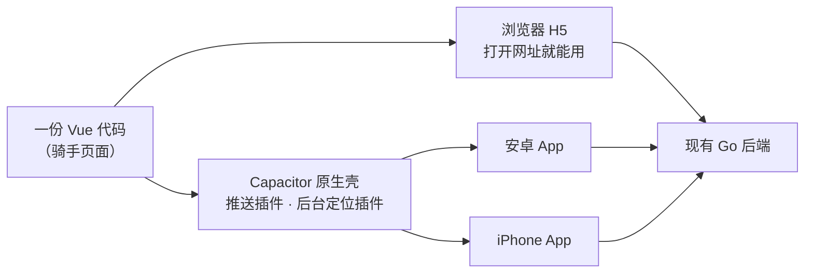
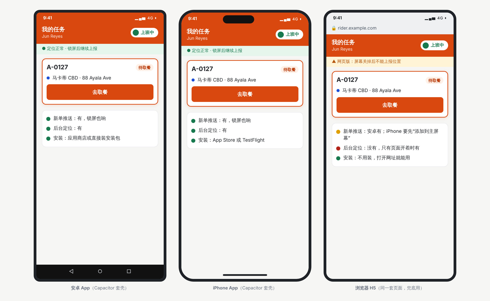
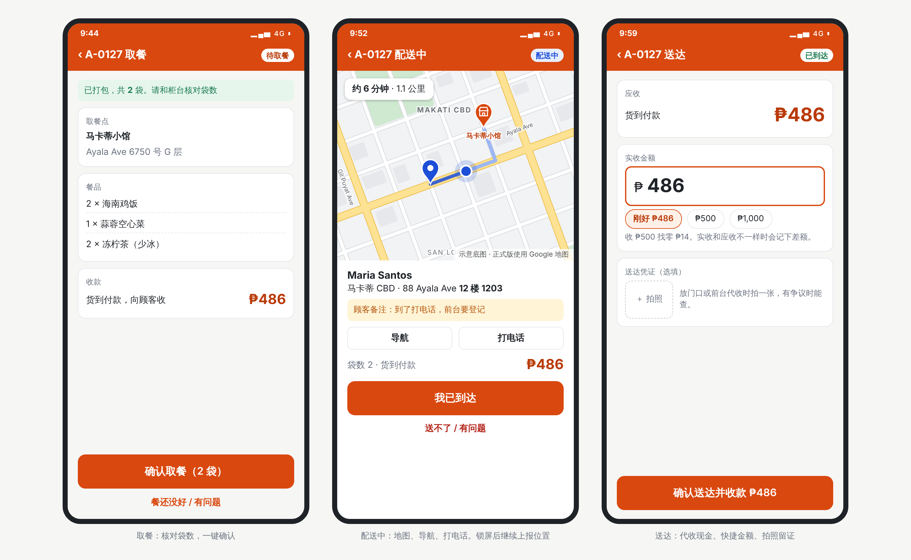
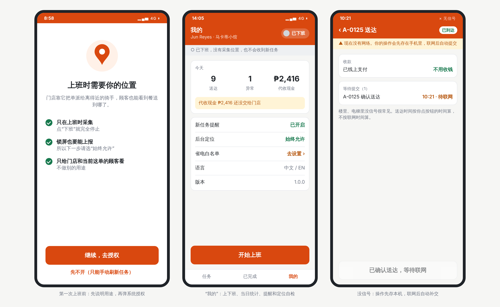
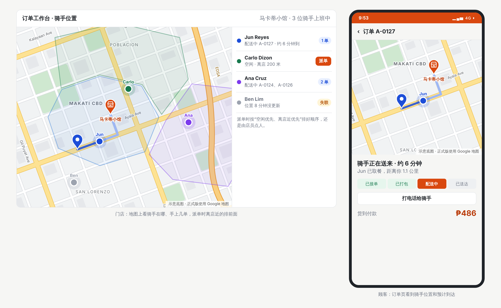
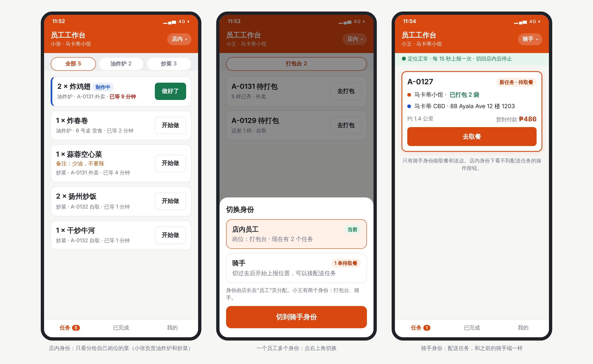
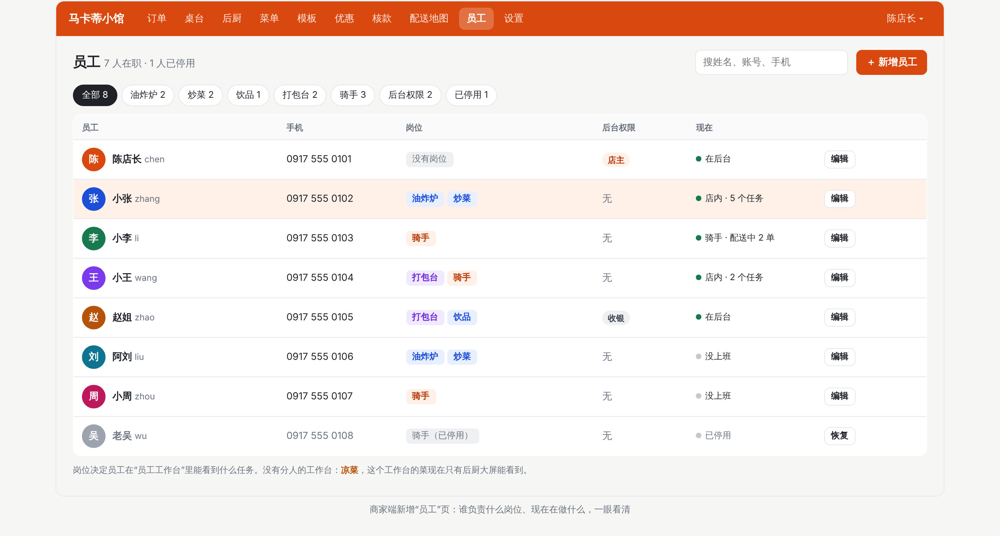
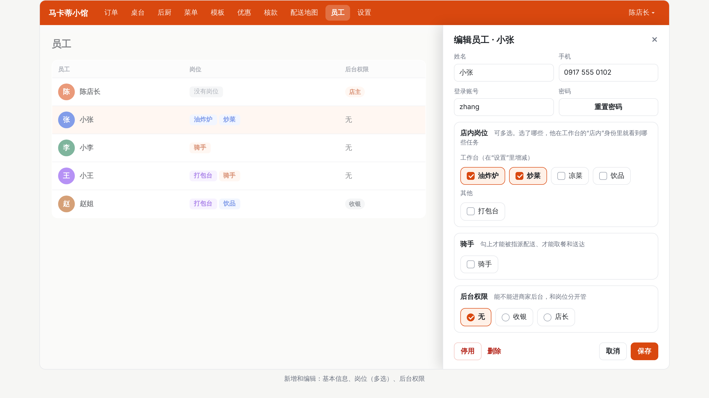

# 员工工作台（原骑手端）· 安卓 / iOS / H5 通用 · 设计方案 v0.2

2026-11-21 · brian 已确认，第 8 节 20 条全部按推荐做。代码分批落实，进度和实现时的调整记在第 10 节。

v0.2 改动（按 brian 的要求）：骑手端改名“员工工作台”，一个员工可以有多个身份，在工作台里切换“店内员工”和“骑手”；商家端新增“员工”页，增删改查员工并分配岗位。新内容集中在第 9 节，待确认问题加在第 8 节的 13 到 20 条。跨平台路线不变。第 1 到 7 节讲的“骑手端”，现在就是员工工作台里的骑手身份。

本稿是 [DESIGN.md](DESIGN.md) 的补充，回答一个问题：骑手端怎么做到安卓、iPhone、浏览器三端通用，以及通用之后要补哪些功能。

效果图在 [rider-screens/](rider-screens/)，可点开的 HTML 原型在 [rider-prototype/index.html](rider-prototype/index.html)（骑手身份）和 [rider-prototype/staff.html](rider-prototype/staff.html)（身份切换、商家员工页）。图里的底图是示意图，人名、地址、金额都是示意数据。

**一句话结论：继续用现在这套 Vue 页面，一份代码出三个产物。浏览器直接打开是 H5；用 Capacitor 套一层原生壳，打包成安卓 App 和 iPhone App。推送和后台定位这两件网页做不到的事交给壳里的原生插件。**

## 1. 现在的骑手端

现在的骑手端是网页里的一个页面，登录后角色是骑手就进到 `/rider`。

| 已经有的 | 位置 |
|---|---|
| 我的任务列表，分进行中和已完成 | `web/src/views/RiderView.vue`（一个文件，107 行） |
| 确认取餐，没打包好时按钮不能点 | `POST /rider/tasks/{id}/pickup` |
| 我已到达、确认送达、货到付款录实收金额 | `…/arrive`、`…/deliver` |
| 上报配送异常，必须填原因 | `…/fail` |
| 导航到顾客图钉位置（打开 Google 地图）、打电话给顾客 | 普通链接，不产生费用 |
| 页面开着时任务自动刷新，断线后改成轮询 | `GET /rider/events`（SSE） |
| 中英文切换 | `web/src/i18n.ts` |
| 改派后旧骑手不能再操作这一单 | 后端按指派版本校验 |

派单方式是门店的人在工作台上点名指派，骑手不抢单。本稿不改这一点。

**现在缺的，都和“它只是个网页”有关：**

| 缺什么 | 后果 |
|---|---|
| 没有推送 | 骑手把手机锁屏或切到别的 App，就不知道来了新任务，得靠门店打电话 |
| 不上报位置 | 门店不知道骑手在哪、谁离店近；顾客看不到餐送到哪了 |
| 没有上班、下班状态 | 门店指派时分不清谁在岗 |
| 没网时不能操作 | 电梯里、楼道里点“确认送达”会失败 |
| 没有桌面图标 | 每次要找浏览器里的网址，登录状态也容易丢 |
| 界面只有一页 | 所有任务和按钮挤在一个列表里，单多时容易点错 |

## 2. 几条跨平台路线

### 2.1 先说清楚网页的硬限制

选哪条路线，主要看下面两件事。它们是浏览器本身的限制，不是我们写得好不好的问题。

| 能力 | 浏览器 H5（含“添加到主屏幕”的 PWA） | 原生 App（含套壳 App） |
|---|---|---|
| 新单推送 | 安卓可以。iPhone 要 iOS 16.4 以上，而且骑手必须先把网页“添加到主屏幕”，从图标打开才收得到 | 都可以，锁屏也会响 |
| 后台定位（锁屏或切到别的 App 时继续上报） | **做不到**，安卓和 iPhone 都不行。只有页面开着、屏幕亮着时有位置 | 可以，要骑手授权“始终允许” |
| 持续响铃直到骑手确认 | 做不到，只有一声系统提示音 | 安卓可以；iPhone 是一段最长 30 秒的提示音 |

所以：只要想要“锁屏也能上报位置”，就必须有一层原生的东西。问题只剩下这层原生的东西怎么做最省。

### 2.2 五条路线对比

| | A. PWA 增强 | B. Capacitor 套壳 | C. uni-app | D. Flutter | E. React Native |
|---|---|---|---|---|---|
| 是什么 | 还是网页，加上桌面图标、离线缓存、网页推送 | 把现有网页装进一个原生外壳，壳里装原生插件 | 国内的跨端框架，用 Vue 语法写，能出 App、H5、小程序 | Google 的跨端框架，用 Dart 语言重写界面 | Meta 的跨端框架，用 React 重写界面 |
| 现有骑手页面能复用多少 | 全部 | 全部 | 逻辑能参考，页面要按它的组件重写 | 不能，全部重写 | 不能，全部重写 |
| H5 怎么办 | 本身就是 | 同一份代码 | 能编译出 H5，但和现在的网页工程是两套 | 另外维护现在的网页，或用 Flutter 网页版（加载慢） | 另外维护现在的网页 |
| 后台定位 | 做不到 | 可以，用原生插件 | 可以，用原生插件 | 可以，最稳 | 可以，最稳 |
| 新单推送 | 安卓可以，iPhone 有条件 | 可以（FCM 和苹果推送） | 可以，但它自带的推送通道主要服务国内，海外要另接 FCM | 可以 | 可以 |
| 上架商店 | 不上架，发网址 | 可以上架 | 可以上架 | 可以上架 | 可以上架 |
| 多出来要维护的东西 | 几乎没有 | 两个壳工程（基本是配置）加几个插件 | 一整套新工程 | 一整套新工程，新语言 | 一整套新工程，新框架 |
| 我估的工作量 | 小 | 中 | 中到大 | 大 | 大 |
| 主要风险 | 核心需求（后台定位）满足不了 | 后台定位靠第三方插件，部分安卓机省电策略会杀后台，要引导骑手设白名单 | 生态和文档以国内为主，对菲律宾这边用的 Google 地图、FCM 支持是次要路径 | 骑手端和其他四个入口从此是两套技术 | 同左 |

工作量是我按现有代码量估的相对大小，不是精确工期。

### 2.3 推荐：A 加 B，一份代码三个产物

理由：

1. **复用最多。** 骑手页面、接口封装、中英文、样式都在现有工程里。套壳不用重写界面，以后改一处三端一起变。
2. **两个硬需求都能满足。** 推送和后台定位由壳里的原生插件做，页面通过一个薄薄的适配层调用。在浏览器里同一个适配层退回到网页推送和前台定位。
3. **H5 自然保留。** 新骑手、临时帮忙的人、没装 App 的人打开网址照样能接单送餐，只是没有后台定位。见 [04-three-platforms.png](rider-screens/04-three-platforms.png)。
4. **不选 uni-app**：它最大的好处是能出微信小程序，这个项目在菲律宾用不上，却要为它重写页面并另起一套工程。
5. **不选 Flutter 和 React Native**：它们的原生体验和后台能力最好，但骑手端只有任务列表、几个按钮和一张地图，用不到那么强的界面能力，却要多养一套语言和工程。以后如果骑手端变得很重（比如自己做路线规划），再换也来得及，后端接口不用动。

## 3. 骑手端页面

从“一个长列表”改成三个标签页加任务详情，三端界面一样。

### 3.1 任务首页和新单提醒（[01-tasks-alerts.png](rider-screens/01-tasks-alerts.png)）

- 顶部是上班开关。上班中才会被指派、才采集位置。
- 开关下面一条状态栏，告诉骑手现在定位正不正常。
- 任务卡片只留最关键的：单号、取餐点、送餐地址、距离、要不要收钱。新任务卡片加粗边框排最上面。
- **新单提醒分两种情况**：App 开着时弹全屏提醒，响铃加震动，点了才停；App 在后台或锁屏时走系统推送，点通知直接进这一单。
- 除了新任务，这些情况也会推送：订单被门店取消、被改派给别人、餐打包好了可以来取。

### 3.2 取餐、配送、送达（[02-pickup-deliver.png](rider-screens/02-pickup-deliver.png)）

- 一单一页，每页只有一个主按钮，按现有状态走：确认取餐、我已到达、确认送达。
- 配送页上半部分是地图，画出店、骑手、顾客三个点。“导航”还是跳到手机上的 Google 地图，不在我们 App 里做逐向导航。
- 送达页的货到付款加快捷金额（刚好、整百、整千）并算出找零。实收和应收不一样时记差额，这是现有规则。
- 送达凭证拍照是新增的，选填。

### 3.3 定位授权、“我的”、没信号（[03-location-offline.png](rider-screens/03-location-offline.png)）

- 第一次点“开始上班”前先出一页说明，讲清楚为什么要位置、什么时候采集、给谁看，然后才弹系统授权框。苹果和 Google 审核都要求这样做，骑手也更愿意点允许。
- “我的”页放上下班、当日统计、未交店的代收现金，以及一组自检：推送开没开、后台定位是不是“始终允许”、有没有加省电白名单。
- 没信号时，取餐、到达、送达这些操作先存在手机里，联网后自动提交，时间按点按钮的时刻算。

### 3.4 门店和顾客能看到的（[05-store-customer-tracking.png](rider-screens/05-store-customer-tracking.png)）

骑手上报位置之后，另外两端才有用处：

- **门店工作台**多一张骑手地图：谁在岗、在哪、手上几单、谁失联了。指派骑手的下拉列表按“空闲优先、离店近优先”排序，仍然由店员点人。
- **顾客订单页**在“配送中”阶段显示骑手位置和预计到达时间。只在这一单配送期间显示，送达后就看不到了。

## 4. 规则

### 4.1 定位

| 项 | 做法 |
|---|---|
| 什么时候采集 | 只在“上班中”。点下班、退出登录、连续 12 小时没下班时自动停止 |
| 频率 | 手上有配送中的单时约 15 秒一次，空闲时约 60 秒一次，原地不动时不重复上报。省电也省流量 |
| 上传 | 攒几个点一起发。没网时存在手机里，联网后补发，最多补最近 10 分钟 |
| 失联 | 上班中但超过 5 分钟没有新位置，门店地图上标“失联”，不自动改派 |
| 保存多久 | 每个骑手的最新位置一直更新。历史轨迹只留 7 天，用于处理投诉，到期自动删 |
| 谁能看 | 本门店的店长和收银；顾客只能看自己那一单配送途中的位置 |
| 网页版 | 只有页面开着时上报。状态栏明确提示“屏幕关掉后不能上报位置” |

### 4.2 推送

| 项 | 做法 |
|---|---|
| 通道 | 安卓 App 和 iPhone App 用 Firebase Cloud Messaging（免费，iPhone 那边由它转给苹果推送）。浏览器用标准的网页推送 |
| 发送 | 指派、改派、取消、打包完成这几个事件提交后，放进现有的后台任务队列去发，失败自动重试。平台后台的 Worker 页面能看到发送情况 |
| 推送只是提醒 | 推送内容只有单号、地址和金额摘要。骑手点开后 App 重新向服务器拉任务，以服务器为准。推送丢了也不会丢单，打开 App 就能看到 |
| 没确认怎么办 | 指派后 2 分钟骑手没打开这一单，门店工作台把这单标成“骑手未读”，由店员决定打电话还是改派 |
| 一人多台手机 | 都能收到。退出登录时注销这台手机 |

### 4.3 登录

现在网页靠浏览器 Cookie 保持登录。App 壳里的页面和服务器不在同一个域名下，Cookie 这条路在 iPhone 上不可靠，所以 App 改用登录令牌：登录后服务器发一个令牌，存在手机的安全存储里，之后每次请求带上。网页版不变。骑手 30 天内不用重新登录，门店停用这个骑手账号后令牌立刻失效。

### 4.4 离线操作

- 取餐、到达、送达、上报异常可以离线点，按顺序排队补交。
- 每个操作带一个手机生成的唯一编号，服务器收到重复的只算一次，不会重复记代收现金。
- 补交时如果这一单已经被取消或改派，服务器拒绝，App 明确告诉骑手“这一单已被改派，你的操作没有生效”。

## 5. 数据和接口

新增三张表，现有表只给配送任务加一个照片字段：

| 表 | 内容 |
|---|---|
| `rider_devices` | 骑手的手机：平台（安卓、iOS、网页）、推送令牌、App 版本、最后活跃时间 |
| `rider_status` | 每个骑手一行：是否上班、最新位置、精度、位置时间、电量 |
| `rider_tracks` | 历史轨迹点，留 7 天 |

送达照片：系统现在还没有存图片的地方，第一批先压缩后存在服务器磁盘目录里（跟着现有备份走），`delivery_tasks` 表加一个可空的照片字段。离线操作的去重复用现有的 `idempotency_records` 表。

| 接口 | 用途 |
|---|---|
| `POST /rider/duty` | 上班、下班 |
| `POST /rider/devices`、`DELETE /rider/devices/{id}` | 登记和注销推送令牌 |
| `POST /rider/locations` | 批量上报位置点 |
| `POST /rider/tasks/{id}/proof` | 上传送达照片 |
| `POST /auth/token` | App 用的令牌登录 |
| `GET /staff/riders` | 门店看骑手状态和位置 |
| `GET /orders/{id}/tracking` | 顾客看本单骑手位置 |

现有的取餐、到达、送达、异常接口不变，只加上“操作编号”和“手机上的操作时间”两个可选参数。

## 6. 打包和上架

### 6.1 费用和账号

| 项 | 费用 | 说明 |
|---|---|---|
| 苹果开发者账号 | 每年 99 美元 | 发 iPhone App 必须有，TestFlight 也要 |
| Google Play 开发者账号 | 一次性 25 美元 | 只在上架 Google Play 时需要。直接发安装包不需要 |
| Firebase 推送 | 免费 | 用你的 Google 账号建一个项目 |
| Capacitor 和推送插件 | 免费开源 | |
| 后台定位插件 | 先用免费的社区插件 | 如果实测在某些安卓机上不稳，有一个口碑好的付费插件可换，一次性授权，我印象里是几百美元量级，要用时再核实价格 |

这些账号要用你自己的名义注册，我没法代办。金额是两家商店长期以来的标准价，注册时以官网为准。

### 6.2 怎么发给骑手

骑手是门店自己的员工，不是公众用户，所以不一定要公开上架。

| 方式 | 安卓 | iPhone |
|---|---|---|
| 最快 | 直接发安装包，骑手点开安装 | TestFlight：骑手装一个 TestFlight，点邀请链接安装。每个版本 90 天过期，要定期发新版 |
| 正式 | Google Play 上架 | App Store 上架，可以选“不公开列出”，只有拿到链接的人能装 |

要知道的审核风险：

- **苹果**对“只是把网页包一层”的 App 有可能以功能太少为由拒绝。我们的壳里有推送、后台定位、离线操作这些原生能力，属于正常情况，但我不能保证一次通过。
- **Google Play** 对后台定位要单独申报用途并录一段演示视频。个人名义的新账号，正式上架前还要先找至少 12 个人内测满 14 天。
- 两家都要求有隐私政策网页，写明采集位置的用途。我会准备一份草稿。

### 6.3 我能验证到什么程度

- 网页版、接口、推送发送逻辑、离线补交：能在云端用自动化测试验证。
- 安卓 App：能在云端打出安装包，但后台定位和锁屏推送要在真手机上试，需要你或骑手装上跑一两天。
- iPhone App：打包要用苹果电脑，我会配好 GitHub 上的自动打包。真机效果同样要靠你用 TestFlight 试。

## 7. 落地顺序

每一批单独可用，单独提交。

| 批次 | 内容 | 做完后 |
|---|---|---|
| 第一批：后端和新界面 | 员工多身份和岗位、商家端员工页、员工工作台的身份切换和店内任务（第 9 节）；上下班、位置上报接口、设备登记、令牌登录、离线操作编号；骑手端改成三个标签页加任务详情；网页推送；可添加到主屏幕 | 员工页和 H5 员工工作台立刻可用，安卓浏览器能收推送 |
| 第二批：安卓 App | Capacitor 壳、FCM 推送、后台定位、全屏新单提醒、省电白名单引导、安装包自动打包 | 安卓骑手装安装包即可用，满足后台定位 |
| 第三批：门店和顾客 | 门店工作台骑手地图、指派排序、“骑手未读”标记；顾客订单页看骑手位置 | 位置数据真正用起来 |
| 第四批：iPhone App 和上架 | iOS 壳、苹果推送、TestFlight；两家商店的上架材料和隐私政策 | 三端齐全 |

安卓排在 iPhone 前面，是因为安卓不需要付费账号和审核就能装到骑手手机上，可以最早拿到真机反馈。

## 8. 需要你确认的地方

每条都给了推荐做法。回复“确认”就全部按推荐做。

| # | 问题 | 推荐 |
|---|---|---|
| 1 | 走哪条路线 | 现有 Vue 页面加 Capacitor 套壳，一份代码出安卓 App、iPhone App、H5。不用 uni-app、Flutter、React Native |
| 2 | 先做哪个平台 | 先 H5 和安卓，再 iPhone。如果你的骑手主要用 iPhone，告诉我，我把顺序调过来 |
| 3 | 要不要公开上架商店 | 先不上架。安卓发安装包，iPhone 用 TestFlight，跑顺了再上架。这样你现在只需要准备一个苹果开发者账号，而且到第四批才用得上 |
| 4 | 派单方式要不要改成抢单或自动派单 | 不改，还是门店指派。只是把在岗、离店近的骑手排在前面 |
| 5 | 骑手没开定位能不能上班 | 能，但门店那边会显示“无位置”。不强制，避免骑手手机出问题时整个人没法干活 |
| 6 | 顾客要不要看到骑手位置 | 要，只在这一单配送途中显示 |
| 7 | 顾客能不能直接打电话给骑手 | 能，显示骑手的工作电话。如果你不想暴露骑手号码，可以改成只显示门店电话 |
| 8 | 轨迹保存多久 | 7 天，到期自动删除 |
| 9 | 送达要不要强制拍照 | 不强制，选填。放门口或前台代收时建议拍 |
| 10 | 推送用哪家 | Firebase Cloud Messaging，免费，由你用自己的 Google 账号建项目。我在部署教程里写步骤 |
| 11 | 骑手 2 分钟没看新任务怎么办 | 只在门店工作台标“骑手未读”，由店员处理，不自动改派 |
| 12 | App 叫什么名字、用什么图标 | 按你的要求叫“员工工作台”，用现在的品牌橙色做图标。你有图标的话发给我 |
| 13 | “店内员工的任务”按什么分 | 按岗位分，不按人分。小张负责油炸炉和炒菜，这两个工作台的菜就是他的任务。两个人负责同一个工作台时都能看到，谁点“做好了”就记谁。不做“把某一道菜指定给某个人” |
| 14 | 岗位有哪些 | 工作台（就是现在“设置”里自定义的工作台，如油炸炉、炒菜）、打包台、骑手。都可多选。收银、店长、店主算“后台权限”，和岗位分开，每人只有一种 |
| 15 | 店长、店主能不能也有岗位 | 能。小店里老板自己炒菜、自己送餐很常见 |
| 16 | 骑手手上有单时能不能切回店内身份 | 能切，单子还在他名下，顶部一直提示“你有 1 单配送中”。但取餐、送达这些按钮只在骑手身份下出现。切回店内后暂停上报位置，门店指派列表里把他排到后面 |
| 17 | 店内员工能不能操作别的工作台的菜 | 工作台手机上只看到和操作自己岗位的菜。后厨大屏不变，还是能看全部、能改派。店长和店主不受限制 |
| 18 | 删除员工是真删还是停用 | 两个都有。停用：不能登录，记录保留，随时恢复。删除：从列表里消失，账号名可以再用，但历史订单上的操作人姓名保留。还有没送完的单、或者是最后一个店主时不能删 |
| 19 | 没有任何岗位的工作台怎么办 | 允许，员工页底部提醒“这个工作台没有分人”。它的菜照常出现在后厨大屏上，不会漏单 |
| 20 | 店内员工要不要也收推送 | App 开着时有声音提醒，默认不发锁屏推送，因为后厨一忙起来推送会响个不停。员工可以在“我的”里自己打开 |

## 9. 员工工作台和员工管理（v0.2 新增）

### 9.1 现在的员工和岗位是怎么管的

| 现状 | 位置 |
|---|---|
| 每个员工在一家门店只能有一个角色：店主、店长、收银、后厨、骑手五选一 | 表 `user_branch_roles`，主键是（员工，门店） |
| 员工管理是“设置”页底部的一小块，只能新增和停用，不能改资料、改角色、重置密码、删除 | `web/src/views/SettingsView.vue` |
| 门店可以自定义工作台（如油炸炉、炒菜），菜品归到某个工作台 | 表 `kitchen_stations`，DESIGN.md 12.1 节 |
| 工作台不和人挂钩。后厨屏幕按“这块屏看哪个工作台”筛选，选择记在设备上 | `web/src/views/KitchenView.vue` |
| 登录后按角色跳到不同页面：骑手去 `/rider`，后厨去 `/kitchen`，其余去订单工作台 | `web/src/session.ts` |

所以现在做不到“小王既打包又送餐”，也做不到“小张只看油炸炉和炒菜的菜”。

### 9.2 三个概念

| 概念 | 是什么 | 例子 |
|---|---|---|
| 岗位 | 店长分给员工的工作，可多选 | 小张：油炸炉、炒菜。小李：骑手。小王：打包台、骑手 |
| 身份 | 员工在工作台里当前以哪种方式干活，由岗位自动得出 | 有任何店内岗位就有“店内员工”身份；有骑手岗位就有“骑手”身份 |
| 后台权限 | 能不能进商家后台，和岗位分开 | 无、收银、店长、店主 |

员工不用自己申请身份。店长在员工页勾了岗位，他的工作台里就出现对应的身份。只有一个身份的人看不到切换按钮。

### 9.3 员工工作台（[06-workbench-identity.png](rider-screens/06-workbench-identity.png)）

- 原来的骑手页 `/rider` 改名“员工工作台”，新地址 `/work`，旧地址自动跳转。三端的 App 名字也叫“员工工作台”。
- 右上角显示当前身份，点一下弹出切换面板，每个身份下面写着现在有几个任务。
- **店内员工身份**：看到分给自己岗位的任务。
  - 工作台岗位：这个工作台上待制作和制作中的菜，一道菜一张卡片，写明数量、备注、哪一单、等了多久。按钮是“开始做”和“做好了”，和后厨大屏上的操作是同一个，两边同步。
  - 打包台岗位：待打包的订单，点进去核对菜品和袋数。
  - 有多个岗位时顶部有筛选，默认看全部，等得最久的排最前。
- **骑手身份**：就是第 3 节的骑手界面，配送任务、取餐、送达、代收。
- **只有骑手身份能送餐**：取餐、到达、送达、上报异常这四个操作，服务器只接受有骑手岗位的员工，而且 App 只在骑手身份下显示这些按钮。门店指派骑手的列表里也只出现有骑手岗位的人。
- 上班开关和定位只跟骑手身份走。店内身份不采集位置。
- 登录后默认进上次用的身份。有后台权限的人登录后还是先进商家后台，后台菜单里有“我的工作台”入口。

### 9.4 商家端员工页（[07-merchant-staff.png](rider-screens/07-merchant-staff.png)、[08-merchant-staff-edit.png](rider-screens/08-merchant-staff-edit.png)）

商家后台顶部菜单加“员工”，地址 `/merchant/staff`。“设置”页里原来那一小块员工表移到这里。

- **查**：列表显示姓名、账号、手机、岗位、后台权限、现在在做什么（哪个身份、几个任务、没上班）。可以搜索，可以按岗位筛选。
- 列表下面提醒哪些工作台还没有分人。

- **增、改**：右侧抽屉里填姓名、手机、登录账号、密码，勾岗位，选后台权限。岗位里的工作台列表就是“设置”里自定义的那些，在那里新增一个工作台，这里马上多一个可勾的选项。
- **重置密码**：店长给员工设一个新密码，员工原来登录的手机全部退出。
- **停用、恢复、删除**：见第 8 节第 18 条。
- **谁能管**：店主和店长。店长不能改店主，不能把别人升成店主。不能停用或删除自己。每家店至少留一个店主。
- **保护**：员工还有没送完的配送单时，不能去掉他的骑手岗位、不能停用或删除，页面提示先把单改派给别人。
- 改岗位马上生效，员工的工作台自动刷新，不用重新登录。每次修改记操作记录（谁、什么时候、改了什么）。

### 9.5 数据和接口

| 改动 | 说明 |
|---|---|
| `user_branch_roles.role` 的含义改为后台权限 | 取值变成 `owner`、`manager`、`cashier`、`staff`（无后台权限） |
| 新表 `staff_posts` | 一行是一个岗位：员工、门店、类型（工作台、打包台、骑手）、工作台 id（类型是工作台时填） |
| `users` 加删除时间字段 | 删除是软删除，历史订单和操作记录上的姓名保留 |
| 老数据迁移 | 原来的“后厨”变成：无后台权限，岗位是全部工作台加打包台。原来的“骑手”变成：无后台权限，岗位是骑手。店主、店长、收银不变，默认没有岗位。迁移后每个人能做的事和以前一样 |

| 接口 | 用途 |
|---|---|
| `GET /merchant/branches/{bid}/staff` | 列表，带岗位和当前状态（已有，扩充字段） |
| `POST /merchant/branches/{bid}/staff` | 新增（已有，扩充字段） |
| `PATCH /merchant/branches/{bid}/staff/{id}` | 改资料、岗位、后台权限、停用恢复（已有，扩充字段） |
| `POST …/staff/{id}/password` | 重置密码 |
| `DELETE …/staff/{id}` | 删除 |
| `GET /work/me` | 我的身份和岗位 |
| `GET /work/tasks` | 店内身份的任务：我的工作台上的菜、待打包的单 |
| `GET /work/events` | 工作台的实时刷新 |

权限检查的变化：骑手接口从“角色是骑手”改为“有骑手岗位”；后厨的制作和打包接口从“角色是后厨”改为“有任意店内岗位，或者是店长店主”。后厨大屏 `/kitchen` 不变。

## 10. 落实进度和实现时的调整

| 批次 | 状态 |
|---|---|
| 第一批甲：员工多岗位、商家端员工页、员工工作台（身份切换、店内任务、骑手任务） | 已实现 |
| 第一批乙：上下班、位置上报、设备登记、令牌登录、离线补交、网页推送、添加到主屏幕 | 已实现 |
| 第二批：安卓 App 外壳、FCM 推送、后台定位、安装包自动打包 | 已实现，未在真手机上验证 |
| 第三批：门店骑手页和地图、派单排序、“骑手未读”、顾客看骑手位置 | 已实现 |
| 第四批：iPhone App 和上架材料 | 未开始 |

第一批甲和本稿不同的地方：

- **没有新增 `/work/me`、`/work/tasks`、`/work/events` 三个接口。** 身份和岗位直接放在登录信息里（`/auth/me` 的每家门店多了 `posts`）。店内任务读的就是后厨大屏那份数据（`/kitchen/branches/{bid}/board`），在工作台里按自己的岗位筛出来，这样工作台和大屏永远一致。实时刷新复用现有的门店和骑手两条通道。
- **“只能操作自己岗位的菜”是界面上的限制，不是服务器上的。** 后厨大屏常常就是用某个员工的账号登录的，如果服务器按人拦，大屏就不能看全部、不能改派了。服务器上拦的是：没有任何店内岗位的人进不了后厨，没有骑手岗位的人不能被指派、不能取餐送达。
- **老账号的迁移**：原来的“后厨”拿到迁移当时所有启用的工作台加打包台。之后新建的工作台不会自动分给他们，要在员工页勾。
- **平台后台新建账号**时，角色下拉里仍然有“后厨”“骑手”两项，选了会自动变成“无后台权限加对应岗位”，省得平台管理员再去商家后台勾一遍。
- **“现在”这一列**目前显示的是任务数（店内几个任务、几单在送）。“在后台”“没上班”要等第一批乙做了上下班才有。
- **“已完成”标签页**：骑手身份显示最近 12 小时送达和异常的单；店内身份显示自己岗位上已做好、还没打包或上菜的菜，不是全天的历史。
- 工作台的任务页现在没有地图（第 3.2 节图里的地图），导航仍是跳到 Google 地图。地图、定位状态栏、上班开关、拍照留证都在后面的批次。
- 一个账号在两家门店都有角色时，在其中一家“删除”只是把他从这家店移走，另一家不受影响。

第一批乙和本稿不同的地方：

- **离线操作没有用“操作编号”去重。** 取餐、到达、送达、上报异常这四个接口本来就是“重复提交只算一次”的（送达重复提交不会重复记代收现金），所以手机补交时直接重发即可。手机仍然会带上操作编号和操作时间，服务器目前不存。
- **离线时取餐也能点**，但服务器补交时如果发现这一单还没打包、已被改派或取消，会拒绝，工作台会提示“你离线时的操作没有生效”，同一单后面排队的操作一并作废。
- **下班规则**：点下班、在开始上班的那台设备上退出登录、连续 12 小时没下班（后台每 10 分钟检查一次），都会下班并清掉最新位置。在别的设备上退出登录不影响。
- **位置只在骑手身份下上报**（第 8 节第 16 条），切回店内身份就暂停。站着不动时 5 分钟报一次，有单时最快 15 秒一次，空闲时最快 60 秒一次。
- **`rider_status` 是每人一行**，不分门店。一个人在两家店都是骑手时，上班状态两家店都能看到。
- **推送**：这一批只接了浏览器推送（Web Push）。设备登记接口已经能收安卓和 iPhone 的令牌，但服务器要等第二批接上 Firebase 后才会往 App 发。发给骑手的四种提醒是：新配送单、可以取餐了、被改派、被取消。
- **店内员工的推送开关**（第 8 节第 20 条）这一批没有做：推送目前只有骑手相关的提醒，开关只在有骑手岗位的人的“我的”里出现。
- **送达拍照**（`POST /rider/tasks/{id}/proof`）挪到第二批，和 App 的相机一起做。
- **令牌登录**（`POST /auth/token`）服务器已支持，网页版仍用 Cookie，App 外壳在第二批开始使用。
- **门店看骑手位置**（`GET /staff/riders`）和地图在第三批。这一批员工页的“现在”一列已经能看到骑手“上班中 / 没上班”。
- 工作台打开一次后，页面本身会存在手机里，没有信号时也能打开，看到上次的任务列表。登录信息过期或账号被停用时，联网后会回到登录页。

第二批和本稿不同的地方：

- **App 打开的是服务器上的页面，不是把页面打进安装包。** 本稿 4.3 节原来打算把页面打进 App、用登录令牌访问接口。实际做的是让 App 直接打开这套部署的 `/work`：登录还是用 Cookie，页面更新不用重新装 App，网页和 App 永远是同一份代码。代价是每套部署要自己打一次包（打包时填服务器地址），没网时 App 显示“连不上服务器”而不是离线页面。令牌登录接口仍然保留。
- **苹果审核的风险变大了。** 纯粹打开远程网页的 App 更容易被苹果以“只是网页”为由拒绝。安卓直接发安装包不受影响。第四批做 iPhone 时要重新评估是否把页面打进包里。
- **打包在 GitHub 上完成**（`.github/workflows/android.yml`），服务器地址、Firebase 文件、签名密钥都放在仓库的变量和密钥里，步骤见 `docs/DEPLOY.md` 第 15 节。
- **推送**：服务器用 Firebase 的 HTTP v1 接口发（`FCM_SERVICE_ACCOUNT`）。App 打包时没带 Firebase 文件，或者服务器没配密钥，App 里就不出现推送开关，也不会去碰 Firebase。
- **后台定位**用免费的社区插件 `@capacitor-community/background-geolocation`。上班期间状态栏有常驻提示。后台时位置通过手机原生的网络请求上传，失败时退回页面自己的请求。
- **全屏新单提醒**没有做成锁屏全屏弹窗，用的是最高优先级的通知（横幅加声音加震动）。安卓对全屏弹窗的权限越收越紧，先看实际使用是否够用。
- **省电白名单引导**是“我的”里的一段说明加一个“打开应用设置”的按钮，不能替用户自动设置。
- **送达拍照**还没做。

第三批和本稿不同的地方：

- **门店看骑手用的是现有接口** `GET /merchant/branches/{bid}/riders`（本稿写的是 `GET /staff/riders`），它现在多返回上班状态、位置、离店距离和店铺位置。只有店主、店长、收银能看。入口是商家后台顶部的“骑手”。
- **派单排序**：上班且有位置的排最前，其次是上班但没有位置的，再是失联的，最后是没上班的。同一档里离店近的在前，相差不到 200 米时手上单少的在前。下拉框里每个骑手后面直接写着状态、距离和在送单数。没上班的骑手仍然可以指派，系统不拦。
- **离店距离是直线距离**，不是骑行路线。店铺位置没有设置时不显示距离。
- **“骑手未读”**：骑手在工作台的骑手身份下看到这一单就算已读（不需要点开详情）。指派超过 2 分钟还没读，订单列表和详情里出现红色“骑手未读”，并给出骑手电话。改派后重新计时。不自动改派。
- **顾客看骑手位置**：只在骑手取餐之后、送达之前显示。位置超过 10 分钟没更新、或骑手已下班时，只显示“骑手正在路上”，不显示旧位置。有地图密钥时显示小地图，否则只显示一行文字。顾客下单时在地图上定了点的，会显示骑手离他多远（直线）。顾客页每 15 秒刷新一次。
- **骑手页每 15 秒刷新一次**，没有做成位置一变就推送，避免门店页面频繁刷新。
- 没有地图密钥的部署，骑手页只有列表，没有地图。

