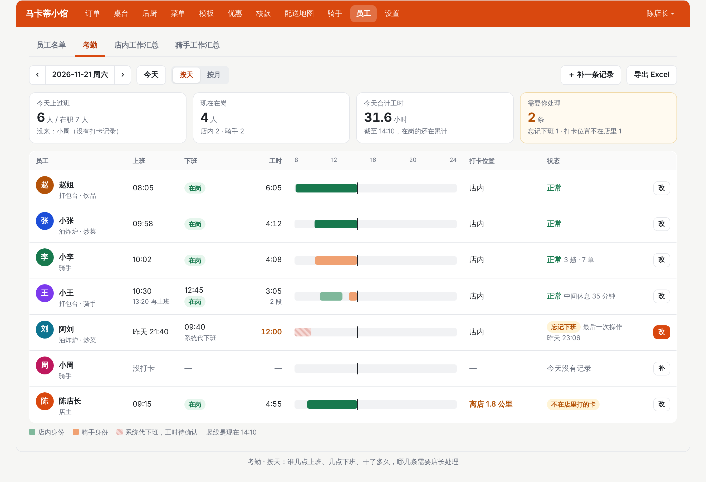
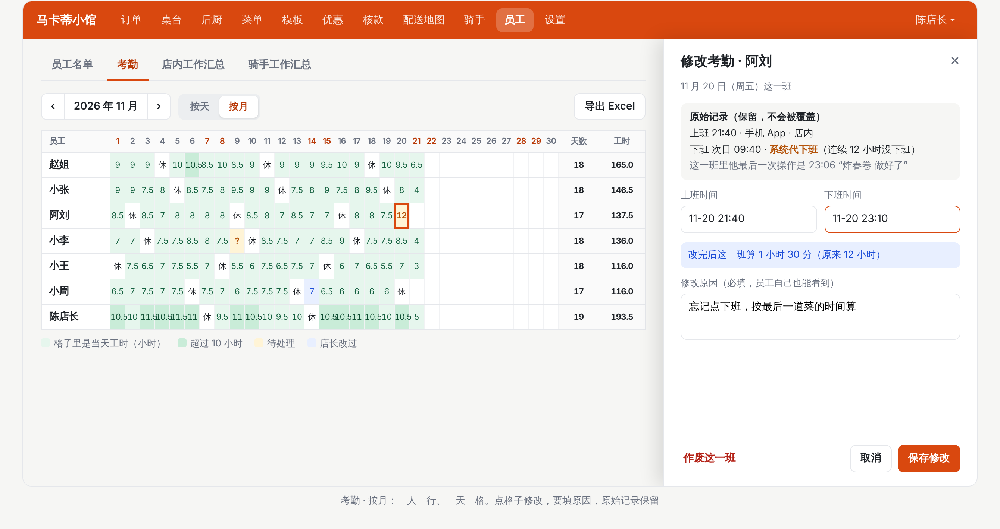
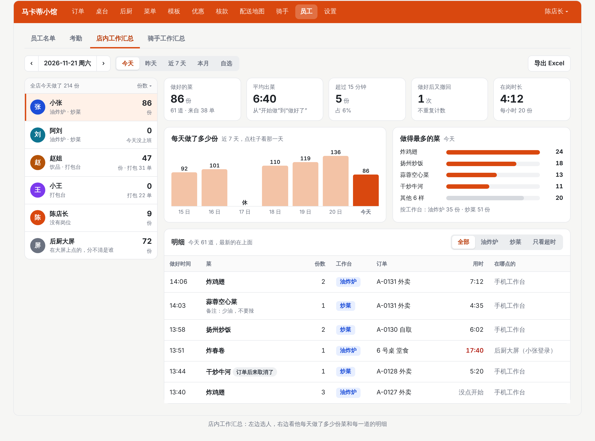
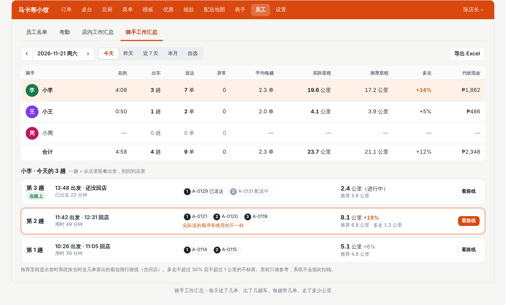
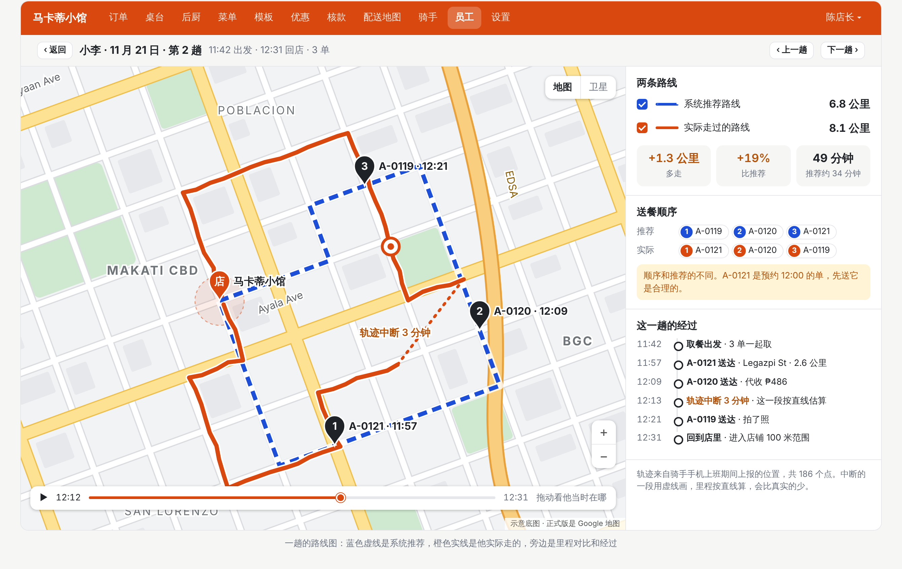

# 员工考勤和工作汇总 · 设计方案 v0.1

2026-11-22 · brian 已确认，第 9 节 16 条全部按推荐做。代码分批落实，进度和实现时的调整记在第 10 节。

本稿是 [RIDER_APP_DESIGN.md](RIDER_APP_DESIGN.md)（员工工作台）和 [MAP_ZONES_DESIGN.md](MAP_ZONES_DESIGN.md)（配送地图）的补充。讲商家后台“员工”页下面新增的三个子页面：

1. **考勤**：谁几点上班、几点下班、干了多久。
2. **店内工作汇总**：每个店内员工每天做了多少道菜，以及每一道的明细。
3. **骑手工作汇总**：每个骑手每天送了多少单、出了几趟车、每趟带几单，每一趟从出发到回店的路线图和里程。路线图有两条：系统推荐的路线，和他实际走过的路线。

效果图在 [staff-report-screens/](staff-report-screens/)，可点开的 HTML 原型在 [staff-report-prototype/index.html](staff-report-prototype/index.html)。图里的人名、订单、数字都是示意数据，地图是示意底图，不是真的 Google 地图。

**一句话结论：页面本身不难，难点是现在的系统没有把这些事记下来。所以方案分两半：先补“记录”（上下班历史、每道菜是谁做的、骑手的每一趟），再做“查看”（三个页面）。记录这一半建议尽早上线，因为没记下来的历史事后补不回来。**

## 1. 现在有什么、缺什么

| 你要看的 | 现在系统里有的 | 缺的 |
|---|---|---|
| 考勤 | 骑手有上班、下班开关，但只存“现在是不是在上班”和“这一班从几点开始”（表 `rider_status`，每人一行） | 没有历史：下班后这一班就没了。店内员工完全没有上下班 |
| 店内员工做了多少菜 | 每道菜有状态（待做、制作中、做好了）。谁点的“做好了”只写在操作记录 `audit_logs` 里 | 菜上没有“谁做的、几点开始、几点做好”。操作记录能查到人，但不适合做统计 |
| 骑手送了多少单 | 配送单 `delivery_tasks` 有骑手、取餐时间、送达时间 | 够用，能直接统计 |
| 每次出发送几单 | 没有“一趟”的概念，每一单各记各的 | 要新增“趟” |
| 实际路线和里程 | 骑手上班期间上报的位置点在 `rider_tracks`，**只保留 7 天**，没有算过里程 | 要按趟把轨迹存下来并算里程，保存时间要比 7 天长 |
| 系统推荐路线 | 没有。现在离店距离是直线距离，导航是跳到手机上的 Google 地图 | 要接 Google 的路线服务 |

## 2. 页面放在哪

商家后台顶部菜单不加新项。在现有的“员工”页里加一排子标签：

| 子标签 | 地址 | 内容 |
|---|---|---|
| 员工名单 | `/merchant/staff` | 现在的员工页，不变 |
| 考勤 | `/merchant/staff/attendance` | 第 3 节 |
| 店内工作汇总 | `/merchant/staff/kitchen` | 第 4 节 |
| 骑手工作汇总 | `/merchant/staff/riders` | 第 5 节 |

顶部菜单里已有的“骑手”页是看骑手**现在**在哪，保留不动。新的骑手工作汇总是看**过去**干了什么。

谁能看：店主和店长。收银看不到。三个页面都是中英双语，都能导出 Excel。

“一天”怎么算：按门店所在时区（现在是马尼拉时间）的 0 点到 24 点。跨过半夜的一班、一趟，算在开始的那一天。

## 3. 考勤

### 3.1 页面

**按天**（[01-attendance-day.png](staff-report-screens/01-attendance-day.png)）：

- 顶上四个数：今天上过班几人、现在在岗几人、合计工时、需要处理几条。
- 每人一行：上班时间、下班时间、工时、一条时间条（一眼看出这一天哪几段在上班，绿色是店内身份，橙色是骑手身份）、打卡时在不在店里、状态。
- 一天上了两段班（中午回去休息）会显示两段，工时相加。
- 骑手这一行后面带“几趟、几单”，点过去就是骑手工作汇总。

**按月**（[02-attendance-month.png](staff-report-screens/02-attendance-month.png)）：

- 一人一行，一天一格，格子里是当天工时。最右边是出勤天数和总工时，发工资时直接看这两列。
- 黄色格子是需要处理的，蓝色格子是店长改过的。
- 点任意一格，右边滑出修改面板。

### 3.2 怎么打卡

不加新的打卡动作，就用员工工作台顶部的“上班”开关：

- **骑手**：现在已经有这个开关，不变。只是每次上班、下班多记一条历史。
- **店内员工**：现在没有这个开关，要加上。店内身份下顶部同样出现“上班 / 下班”。
- **一个人只有一个上班状态**，不分身份。小王上班后在“打包台”和“骑手”之间切换，不用重新打卡。时间条上会用颜色区分他哪一段是骑手身份。
- 有后台权限的人（店长、收银）在商家后台右上角也有同一个上班开关，不用为了打卡专门打开工作台。

### 3.3 规则

| 情况 | 怎么处理 |
|---|---|
| 没点上班就开始干活 | 不拦。员工点了“开始做”“做好了”“去打包”，或者被指派了配送单，系统自动替他上班，时间按第一个动作算，记录上标“自动上班”。这样不会因为忘打卡而漏记工时，也不耽误出餐 |
| 忘记下班 | 沿用现在的规则：连续 12 小时没下班，系统代下班。这一班标“忘记下班”，进入“需要处理”，并列出他这一班里最后一次操作的时间，供店长参考着改 |
| 在不在店里打的卡 | 上班和下班时取一次手机位置，和店铺位置比。超过 200 米标“不在店里打的卡”。**只提示，不拦**，和现在“骑手没开定位也能上班”的做法一致。手机没给定位权限的标“无位置” |
| 退出登录 | 沿用现在的规则：在开始上班的那台设备上退出登录等于下班 |
| 店长修改 | 可以改上班时间、下班时间，可以补一整条，可以作废一条。必须填原因。原始记录保留不覆盖，谁在什么时候改的记进操作记录。员工自己能看到修改和原因 |
| 迟到、早退、排班 | **第一版不做**。只记录实际的上下班时间和工时，不判断迟到早退。原因见第 9 节第 2 条 |
| 员工自己看 | 员工在工作台“我的”里能看到自己本月的考勤，只读 |

### 3.4 数据

新表 `staff_shifts`，一行是一段班：

| 字段 | 含义 |
|---|---|
| `user_id`、`branch_id` | 谁，在哪家店 |
| `started_at`、`ended_at` | 上班、下班时间。还在岗时下班时间为空 |
| `start_source`、`end_reason` | 上班方式（手动、自动）；下班原因（手动、退出登录、系统代下班、店长代下班） |
| `start_lat/lng`、`start_distance_m`，以及下班的同样三项 | 打卡位置和离店距离，可以为空 |
| `orig_started_at`、`orig_ended_at`、`edited_by`、`edited_at`、`edit_reason` | 店长修改时保留的原始时间和修改信息 |
| `voided` | 作废标记 |

另有一张小表 `staff_shift_segments` 记录这一班里身份切换的时间段（店内、骑手），只用来画时间条的颜色。

**和正在做的员工工作台保持一致**：

- `rider_status`（骑手当前状态和最新位置）不改结构、不改含义。骑手点上班时，在同一个事务里多写一行 `staff_shifts`；下班时把它关上。现有的派单排序、顾客看骑手位置都不受影响。
- 现在的 `rider_status` 是每人一行、不分门店（一个人在两家店都是骑手时两家都看得到）。考勤要落到具体门店：在两家店都有岗位的人，上班时要选一家，默认是他当前所在的门店。
- 店内员工“现在是否在岗”就看 `staff_shifts` 里有没有没关上的行。员工名单页“现在”一列的“没上班”因此对店内员工也有意义了。

## 4. 店内工作汇总

### 4.1 页面

（[03-kitchen-summary.png](staff-report-screens/03-kitchen-summary.png)）

- 顶上选日期：今天、昨天、近 7 天、本月、自选。
- **左边是人**：每个店内员工今天做了多少份，按份数排。有打包台岗位的同时显示打包了多少单。
- **右边是选中这个人的情况**：
  - 五个数：做好的菜（份数、道数、来自几单）、平均出菜时间、超时几份、撤回几次、在岗时长和每小时产量。
  - **每天做了多少份**：柱状图，点某一天下面的明细就切到那一天。这就是你要的“每天做了多少道菜”。
  - **做得最多的菜**，以及按工作台的份数。
  - **明细**：每一道菜一行，写明几点做好、什么菜、几份、哪个工作台、哪一单、用了多久、在哪点的。可以按工作台筛选、只看超时的。

### 4.2 怎么算“他做的”

| 问题 | 做法 |
|---|---|
| 一道菜算谁的 | **谁点了“做好了”就算谁的。** 这和员工工作台方案第 8 节第 13 条定的一致（任务按岗位分，两个人负责同一个工作台时谁点“做好了”就记谁） |
| “开始做”和“做好了”不是同一个人 | 算点“做好了”的人。明细里两个人都显示 |
| 数量怎么数 | 主数字是**份数**：“2 × 炸鸡翅”算 2 份。同时显示道数（算 1 道）。两个数都导出 |
| 做好后又撤回 | 撤回后这道菜不再算任何人的，重新做好后算最后点“做好了”的人。不会重复计数。撤回次数单独显示 |
| 做好后订单取消了 | 仍然算他做的（他确实做了），明细里标“订单后来取消了” |
| 不需要制作的东西（如瓶装饮料） | 接单时系统自动标成已做好，不算任何人的 |
| 用时 | 从“开始做”到“做好了”。没点“开始做”直接点“做好了”的，用时显示“没点开始”，不参与平均 |
| 超时 | 默认超过 15 分钟算超时，门店可在设置里改 |
| 打包 | 有打包台岗位的人，同样记录打包了多少单、每单几点打包的 |
| 堂食上菜 | 第一版不统计是谁上的菜 |

### 4.3 后厨大屏的问题

这是这个页面最需要你知道的一点。员工工作台方案第 10 节记过：后厨大屏常常是用某一个员工的账号登录、大家一起点的。系统只知道是哪个**账号**点的，不知道是哪个**人**的手。

所以：

- 在**手机工作台**上点的，一定算在本人头上，准确。
- 在**后厨大屏**上点的，系统分不清是谁。这些菜单独归到一行“后厨大屏”，明细里写明是用谁的账号登录的大屏，不算到那个账号的人头上。这样全店总数对得上，也不会冤枉或者虚增某个人。
- 想让每个人的数字准，办法是让员工在自己手机的工作台上点“做好了”。页面上会显示“全店今天有百分之多少是在大屏上点的”，这个比例高说明个人数字参考价值有限。
- 以后可以给大屏加“点做好了时选一下是谁”的功能，见第 9 节第 6 条，第一版不做。

### 4.4 数据

在 `order_items`（订单里的每一道菜）上加字段：

| 字段 | 含义 |
|---|---|
| `prep_started_at`、`prep_started_by` | 几点开始做，谁点的 |
| `ready_at`、`ready_by` | 几点做好，谁点的。撤回时清空 |
| `ready_via` | 在哪点的：手机工作台、后厨大屏 |
| `undo_count` | 被撤回过几次 |

在 `orders` 上加 `packed_by`（`packed_at` 已经有了）。

这些字段在现有的“开始做 / 做好了 / 撤回 / 打包”操作里顺手写入，不改变这些操作本身的行为。“在哪点的”由页面在请求里带一个标记。

**上线之前的历史**：过去谁点了“做好了”在操作记录里有，可以一次性回填到新字段，所以上线当天就能看到以前的数据。回填的数据分不出手机还是大屏，统一标“来源不明”。

## 5. 骑手工作汇总

### 5.1 页面

**汇总页**（[04-rider-summary.png](staff-report-screens/04-rider-summary.png)）：

- 上面一张表，每个骑手一行：在岗时长、出车几趟、送达几单、异常几单、平均每趟几单、实际里程、推荐里程、多走了百分之几、代收现金。最后一行是合计。
- 点某个骑手，下面列出他这一天的**每一趟**：几点出发、几点回店、用了多久、带了哪几单（按实际送达顺序编号）、实际里程和推荐里程。
- 选的是一段日期（近 7 天、本月）时，上面的表是这段时间的合计，下面先按天列出，点某一天再展开那天的每一趟。
- 正在路上的一趟也会显示，标“在路上”。

**一趟的路线图**（[05-trip-route.png](staff-report-screens/05-trip-route.png)）：

- 左边是 Google 地图，画两条线：**蓝色虚线是系统推荐路线，橙色实线是他实际走过的路线**。店铺一个图钉，每个送餐点一个带编号的图钉（编号是实际送达顺序，旁边写单号和送达时间）。
- 右边：
  - 两条线各自的里程，可以分别勾选显示或隐藏。下面是对比：多走了多少公里、多了百分之几、实际用时和推荐用时。
  - 送餐顺序对比：推荐先送哪单后送哪单，实际是什么顺序。
  - 这一趟的经过：几点出发、每一单几点送达、哪一段轨迹中断、几点回到店里。
- 底部一个时间滑块，拖动可以看他某个时刻在哪。

### 5.2 什么叫“一趟”

**一趟 = 骑手在店里取了餐出发，到他回到店里。**

| 环节 | 怎么判定 |
|---|---|
| 开始 | 骑手手上没有进行中的一趟时，点第一单的“确认取餐”，一趟开始 |
| 这一趟带了几单 | 出发前在店里连续取的几单都算这一趟。判定“还在店里”：位置在店铺 150 米内；没有位置时，按距第一单取餐不超过 10 分钟算 |
| 出发 | 位置离开店铺 150 米。从这一刻起这一趟的订单就固定了，系统去算推荐路线 |
| 回店 | 这一趟的单都送完（送达或上报异常）之后，位置回到店铺 100 米内 |
| 没回店就结束 | 送完后直接下班、回店前切回了店内身份且超过 30 分钟没位置、或者送完后超过 60 分钟还没回店，这一趟到最后一个位置点为止，标“没回店”，回程里程不计 |
| 没回店就接了下一趟 | 正常情况下取餐必须在店里，所以取下一单本身就说明他回来了，上一趟在这时结束 |
| 中途改派、取消 | 单子从这一趟里拿掉，明细里留一条说明。推荐路线保持出发时算的那条 |
| 配送失败把餐带回店 | 照常算在这一趟里，标“异常” |

需要门店先在“配送地图”页设好店铺位置。没设的门店只能统计单数和趟数，没有回店判定、里程和路线图，页面上提示去设置。

### 5.3 实际走过的路线和里程

来源是骑手上班期间手机上报的位置点（已经在采集，站着不动 5 分钟一次，有单时最快 15 秒一次）。

- **整理**：去掉精度很差的点（误差超过 100 米）和明显飘走的点（按前后两点算出的速度超过每小时 120 公里）。站着不动时的来回抖动不计里程。
- **里程**：把整理后的点依次连起来，相邻两点的距离相加。
- **轨迹中断**：相邻两点隔了 2 分钟以上且相距超过 300 米，算中断。地图上这一段画成点状虚线，里程按直线算，并在这一趟上标“里程偏少”。中断常见原因：没装 App 只用浏览器的骑手锁屏后不上报位置；手机省电策略杀了后台；没信号。
- **保存**：一趟结束时，把这一趟的轨迹压缩成一条线存在这一趟的记录里（保留形状，去掉多余的点）。15 分钟后再整理一次，把手机离线期间补交上来的点也算进去。
- **不做“贴路”**：手机定位有十几米误差，线会略微偏出道路。Google 有把轨迹吸附到道路上的服务，要另外收费，第一版不用。

**保存多久**：原始位置点仍然只保留 7 天（现有规则不变）。每一趟压缩后的路线建议保留 90 天，里程、单数这些数字长期保留。这比现在对员工承诺的“轨迹 7 天自动删除”要长，隐私政策（`web/public/privacy.html`）和上架材料里的说明要同步改，见第 9 节第 10 条。

### 5.4 系统推荐路线

- **怎么算**：骑手出发的那一刻，服务器调用一次 Google 的路线服务（Routes API）：起点是店铺，途经这一趟的几个送餐点，终点回到店铺，让 Google 自己排出最省的送餐顺序。拿回来的是路线的形状、总里程、预计用时、建议的送餐顺序，存进这一趟的记录。
- **只算一次**：以后每次打开页面看到的都是出发时存下来的那条，不重复调用，也就不重复计费。所以推荐路线反映的是**出发那一刻**的路况。
- **交通方式**：优先按摩托车算。Google 的摩托车路线只在部分国家提供，菲律宾是否支持、以及自动排序和摩托车模式能不能同时用，我在写代码前会核对。不支持的话退回按汽车算，页面上注明。
- **只有一单的一趟**：照样算，就是“店到顾客再回店”。
- **没有经纬度的老式订单**（顾客从列表选区域、没有在地图上定点）：这一单参与不了路线计算。这一趟只显示实际路线，推荐路线标“缺少送餐位置”。
- **没配路线密钥，或者 Google 调用失败**：推荐里程退回成“店到各送餐点再回店的直线距离之和”，标“直线估算”，地图上画直线。页面其他部分照常可用。失败的会在后台重试几次。

**怎么对比**

- 多走 = 实际里程 − 推荐里程。
- 标黄的条件：多走超过 30%，**并且**多走超过 1 公里。两个条件都满足才标，避免短途的小偏差被放大。阈值门店可改。
- “没回店”的一趟，两边都只比到最后一个送餐点为止。
- 轨迹中断的一趟，实际里程偏少，对比旁边注明“轨迹不完整，仅供参考”。
- 实际送餐顺序和推荐不同时提示，但不算错。预约单要先送、顾客临时改时间，这些都是正当理由。
- **里程和对比只做展示，系统不会据此扣钱或算补贴。** 见第 9 节第 9 条。

**骑手自己能不能看到推荐路线**：这次你要的是店长事后查看。骑手出发时在工作台里也看到推荐顺序和路线，是另一个功能，本稿不做，放在第 9 节第 12 条。

### 5.5 数据

新表 `rider_trips`，一行是一趟：

| 字段 | 含义 |
|---|---|
| `branch_id`、`rider_id`、`shift_id` | 哪家店、哪个骑手、属于哪一班 |
| `started_at`、`left_store_at`、`last_drop_at`、`returned_at` | 第一单取餐、离店、最后一单送完、回店 |
| `status`、`end_reason` | 取餐中、在路上、已结束；结束原因（回店、下班、超时、接了下一趟） |
| `order_count`、`delivered_count`、`failed_count` | 带了几单、送达几单、异常几单 |
| `actual_distance_m`、`actual_path`、`track_points`、`track_gap_s` | 实际里程、压缩后的路线、点数、中断总时长 |
| `planned_distance_m`、`planned_duration_s`、`planned_path`、`planned_order`、`planned_mode`、`planned_source` | 推荐里程、预计用时、路线、建议顺序、交通方式、来源（Google、直线估算、无） |

`delivery_tasks` 加 `trip_id`（属于哪一趟）和 `drop_seq`（实际第几个送达）。

**怎么生成**：

- 趟的开始和加单，在现有的“确认取餐”操作里顺手完成，同一个事务。
- 离店、回店、结束的判定，由后台任务每分钟检查一次“在路上”的趟。不放在位置上报接口里，那个接口每 15 秒被调一次，要保持轻。
- 推荐路线的计算是一个后台任务，离店时入队，失败自动重试。用的是现有的任务队列。
- `rider_tracks` 的 7 天清理不变。

**和正在做的员工工作台保持一致**：不改位置上报接口、不改 `rider_tracks` 和 `rider_status` 的结构、不改骑手的任何操作步骤。骑手和 App 这一侧感觉不到变化。唯一的交叉点是“确认取餐”和上下班这两个服务器操作里各多写一行，我会等那边当前的改动合并后再动这两处，避免冲突。

## 6. 接口

都在现有的商家接口下，只有店主和店长能调。

| 接口 | 用途 |
|---|---|
| `GET /merchant/branches/{bid}/attendance?from=&to=` | 考勤：一段日期内每人每天的班 |
| `POST /merchant/branches/{bid}/attendance` | 补一条 |
| `PATCH /merchant/branches/{bid}/attendance/{id}` | 修改、作废（必须带原因） |
| `GET /merchant/branches/{bid}/reports/kitchen?from=&to=` | 店内汇总：每人的份数、道数、打包数、平均用时 |
| `GET /merchant/branches/{bid}/reports/kitchen/{userId}?from=&to=` | 某个人：每天的数、按菜、按工作台、明细（分页） |
| `GET /merchant/branches/{bid}/reports/riders?from=&to=` | 骑手汇总：每人的趟数、单数、里程 |
| `GET /merchant/branches/{bid}/reports/riders/{userId}?from=&to=` | 某个骑手的每一趟 |
| `GET /merchant/branches/{bid}/trips/{id}` | 一趟的详情：两条路线、送餐点、经过 |
| 以上每个列表加 `&format=xlsx` | 导出 Excel |
| `POST /work/shift`、`GET /work/attendance` | 员工在工作台里上下班、看自己的考勤。骑手现有的上下班接口保留，内部走同一套逻辑 |

统计都是直接查库汇总，不另建汇总表。一家店一天几百道菜、几十趟车，加上索引后查一个月也很快。以后数据量大了再考虑按天预先汇总。

## 7. Google 地图

| 用途 | 服务 | 密钥 | 说明 |
|---|---|---|---|
| 页面上显示地图、画两条线和图钉 | Maps JavaScript API | 现有的 `GOOGLE_MAPS_API_KEY`（浏览器用） | 配送地图页已经在用，不新增。画线画点用的是配送地图那套自己的图层，测试时可以换成不联网的测试底图 |
| 算推荐路线 | Routes API | **新增** `GOOGLE_ROUTES_API_KEY`（只在服务器上用） | 这个密钥不能出现在浏览器里，在 Google 后台要限制成“只允许你的服务器 IP、只允许 Routes API” |

- 费用：Routes API 按次收费，每月有免费额度。我们每一趟只调一次，一家店一天几十趟，用量很小。带“自动排送餐顺序”的调用比普通路线贵一档。具体单价和免费额度 Google 调整过几次，我在写代码前按当时的价目表核对，并写进部署教程。
- 两个密钥都没配时：三个页面照样能用。骑手汇总只有列表和数字，路线图的位置显示一句说明；推荐里程是直线估算。
- 自动化测试不调用真实的 Google 服务。路线计算封装成一层接口，测试时换成一个假的。

## 8. 分几批做

| 批次 | 内容 | 为什么这个顺序 |
|---|---|---|
| 第一批 | **先把事情记下来**：上下班历史、店内员工的上班开关、每道菜谁做的、骑手的趟和实际里程。回填过去“谁做的菜”。同时交付**考勤页** | 记录越早开始，以后能看的历史越长。考勤页最简单，顺带做完 |
| 第二批 | **店内工作汇总页** | 数据第一批已经在记 |
| 第三批 | **骑手工作汇总页**和路线图，先只有实际路线和里程。推荐里程暂时是直线估算 | 不依赖新的 Google 密钥，可以先上 |
| 第四批 | **Google 推荐路线**和两条线的对比。导出 Excel。员工在工作台里看自己的考勤。隐私政策和部署教程更新 | 需要你先开通 Routes API |

每一批都带自动化测试和浏览器端到端测试，检查通过后合并。

**我能验证到什么程度**：记录、统计、趟的判定、里程计算、页面，都能用模拟数据在测试里完整验证。真实骑手在真实路上的轨迹质量（漂移、中断有多常见）和真实 Google 路线，要等上线后用实际数据看，阈值（150 米、100 米、2 分钟、30%）很可能需要按实际情况调一次。

## 9. 需要你确认的地方

每条都给了推荐做法。回复“确认”就全部按推荐做，有不同意见的单独说那一条。

| # | 问题 | 推荐 |
|---|---|---|
| 1 | 店内员工要不要也打卡 | 要。你要的是全体员工的考勤，而现在只有骑手有上下班。在工作台顶部给店内身份加同一个“上班”开关，一个人只有一个上班状态，不分身份 |
| 2 | 要不要排班、判断迟到早退 | 第一版不做。只记实际上下班时间和工时。排班是另一块不小的功能（每人每天排几点到几点、换班、请假），等考勤用顺了再加。如果你只需要一个简单版本，比如“全店统一 10 点上班，晚于 10 点标迟到”，告诉我，这个可以加进第一批 |
| 3 | 忘记打卡就开始干活怎么办 | 系统自动替他上班，标“自动上班”，不拦出餐 |
| 4 | 不在店里打卡拦不拦 | 不拦，只标出来（离店超过 200 米）。骑手有时在外面直接开工，手机定位偶尔也会不准 |
| 5 | 店长改考勤要不要留痕 | 要。必须填原因，原始记录保留，员工自己能看到 |
| 6 | 后厨大屏上点的菜算谁的 | 第一版单独归到“后厨大屏”一行，不算到个人。想要个人数字准，让员工用手机工作台点。以后如果需要，可以给大屏加“点做好了时选一下是谁” |
| 7 | 菜的数量按什么数 | 主数字按份数（2 × 炸鸡翅算 2 份），同时显示道数 |
| 8 | 超时的标准 | 一道菜从开始做到做好超过 15 分钟算超时，门店可改 |
| 9 | 里程要不要和工资、补贴挂钩 | 不挂钩，只展示和导出。手机定位有误差、会中断，直接拿来算钱容易起纠纷。你可以导出 Excel 后自己参考 |
| 10 | 每一趟的路线图保存多久 | 90 天，数字（里程、单数）长期保留。原始位置点仍然 7 天。这比现在告诉员工的“轨迹 7 天删除”长，隐私政策要改，并且建议你上线前告诉骑手一声。如果你想保持 7 天，那么路线图只能回看最近一周，里程数字不受影响 |
| 11 | 推荐路线按什么交通工具算 | 摩托车优先，Google 在菲律宾不支持的话按汽车。如果你的骑手主要骑自行车或电动车，告诉我 |
| 12 | 骑手出发时要不要在工作台里看到推荐路线和顺序 | 这次不做，只给店长事后看。这是个有用的功能，但会改动骑手端，建议等另一边的 App 稳定后单独做 |
| 13 | 谁能看这三个页面 | 店主和店长。收银不能看。员工只能在工作台里看自己的考勤 |
| 14 | 多走多少算偏离 | 多走超过 30% 并且超过 1 公里才标黄，门店可改 |
| 15 | Routes API 密钥谁出 | 和地图密钥一样，由你用自己的 Google Cloud 账号开通 Routes API，另建一个只给服务器用的密钥。我在部署教程里写步骤。没开通之前先用直线估算 |
| 16 | 平台管理员后台要不要也能看 | 第一版不做。平台管理员可以用现有的“只读进入门店”看到这三个页面 |

## 10. 落实进度和实现时的调整

| 批次 | 状态 |
|---|---|
| 第一批甲：上下班历史、店内员工的上班开关、自动上班、每道菜是谁做的（含历史回填）、考勤页 | 已实现 |
| 第一批乙：骑手的趟、实际里程 | 未开始 |
| 第二批：店内工作汇总页 | 未开始 |
| 第三批：骑手工作汇总页和路线图 | 未开始 |
| 第四批：Google 推荐路线、导出 Excel、员工看自己的考勤 | 未开始 |

第一批拆成了甲、乙两个 PR，方便检查。

第一批甲和本稿不同的地方：

- **自动上班只认“自己手机工作台上的操作”。** 在工作台里点“开始做”“做好了”“确认打包”，或者骑手自己点“确认取餐”，系统才替他上班。在后厨大屏上点的不算，因为大屏是公用的，不知道是谁。本稿 3.3 节原来写“被指派了配送单就自动上班”，实际改成骑手取餐时才算：被指派时人不一定在店里，替他上班会让门店以为他在岗。
- **到达、送达不会自动上班。** 骑手下班后把手上最后一单送完，不会被重新算成上班。
- **时间条暂时只有一种颜色**，没有区分店内身份和骑手身份，也没有建 `staff_shift_segments` 表。等第一批乙有了“趟”，用出车的时间段来标橙色，比记录身份切换更准。
- **按月的格子点一下是跳到那一天**，在那一天的列表里修改，没有直接弹出修改面板。一天可能有两段班，在列表里改更清楚。没有记录的格子留空，不写“休”，因为系统不知道那天是休息还是没打卡。
- **时间轴是 0 点到 24 点**，效果图里画的是 8 点到 24 点。
- **商家后台右上角的上班开关不取位置**（多半是店里的电脑），考勤里显示“无位置”。手机工作台上的开关会取一次位置，取不到也照常上班。
- **在两家店都有角色的人**，在哪家店的页面上点上班，就记在哪家店。一个人同时只能有一段没结束的班。
- **“在哪点的”** 由页面在请求地址上带一个标记（`?via=work` 或 `?via=board`）。没有带标记的（比如手机上缓存的旧页面）记为来源不明，不会自动上班。
- **店长在考勤页结束一段还在进行的班**，等于替他下班，骑手同时变成不在岗。
- **员工名单页“现在”一列**：有岗位的人都显示“上班中 / 没上班”，以前只有骑手显示。
- 新增接口和本稿第 6 节一致，另有 `GET /work/shift`（我现在是否在上班）。骑手原来的 `/rider/duty` 保留，和新开关是同一段班。
- 历史回填在数据迁移里一次完成：过去谁点的“开始做”“做好了”“确认打包”都从操作记录里补到了新字段上。我在测试库上做过核对：把新字段删掉再回填，结果和实时记录的一致。
- **隐私政策**（`web/public/privacy.html`）加了“考勤”一行：上下班时间、打卡那一刻的位置、做了哪些菜。轨迹保存期的修改仍在第四批。
- 浏览器测试 `e2e/attendance.cjs`，截图在 [staff-report-screens/impl/](staff-report-screens/impl/)。`e2e/duty.cjs` 里“骑手一开始没上班”的断言改了：小王先在店内身份打包，这时已经自动上班。
