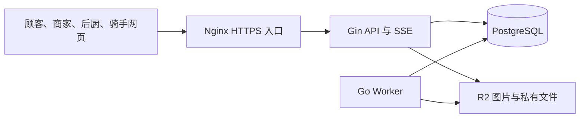

# 海外餐饮外卖系统 · Gin 开发设计方案 v1.0

2026-11-21 · 开发评审稿

产品依据为 [33 页功能设计方案](Restaurant_Functional_Design_v1.0.md) 与 [技术选型 v1.0](reference/Restaurant_Technology_Selection_v1.0.md)。本稿确定 Go 后端架构、数据模型、交易规则、接口边界和试点验收口径。

## 1. 首版范围和架构

**Go + Gin + PostgreSQL，按业务模块组织一个后端项目，分别运行 API 和 Worker。Docker Compose 管理应用进程，Nginx 提供 HTTPS 和静态站点，生产优先使用托管 PostgreSQL。** 顾客、商家、后厨和骑手通过网页访问。后端统一计算菜单价格、费用、优惠、订单状态与操作权限。

| 层 | 首版实现 |
|---|---|
| 前端 | Vue 3、TypeScript、Vite。顾客手机和 iPad 复用菜单、购物车和结账能力。商家后台用 Element Plus，后厨和骑手使用各自的界面。 |
| API | Gin 提供 JSON REST API、SSE、认证中间件和统一错误响应。用 OpenAPI 管理接口契约。字段格式由 HTTP 层校验，门店权限与业务条件在用例内核对。 |
| 存储 | PostgreSQL 17 的受支持补丁版本，`pgx/v5`、`sqlc`、Goose。生产与开发使用相同数据库主版本。菜单图片和导入原件存 Cloudflare R2。 |
| Worker | 与 API 共用 Go 模块和镜像。负责 Excel 解析、外部事件处理、限次重试和对账任务。任务状态保存在 PostgreSQL。 |
| 实时 | 顾客、店员、后厨和骑手通过 HTTPS 执行操作。SSE 发送刷新提示，页面重新读取其有权查看的状态。 |

试点默认联网营业、堂食柜台收款、外卖货到付款与门店自派骑手。自取可走独立打包台，由门店配置。线上支付和 GrabFood、foodpanda 作为可独立开通的能力。界面默认简体中文。营业时段、价格与展示币种按门店配置，首店在菲律宾时可配置 `Asia/Manila` 和 `PHP`。

### 应用职责

| 模块 | 权威数据和职责 |
|---|---|
| 商户与门店 | 门店配置、员工角色、设备配对、配送区、营业时段。 |
| 菜单与模板 | 菜品、规格、套餐子项、渠道价格、发布版本、临时售罄、三个入口的样式配置。 |
| 报价与活动 | 校验可售和配送范围，计算费用、满减与活动名额，生成可确认报价。 |
| 桌次与订单 | 开关台、订单、批次、加减菜、接拒单、状态和操作审计。 |
| 后厨与交付 | 工作台配置、制作任务、打包核对、送桌与物理交接。 |
| 配送与收款 | 骑手指派、到达与送达、柜台收款、到付记录、门店核款和退款。 |
| 平台与后台任务 | 外部门店映射、渠道能力、回调验签、事件去重、任务执行与失败补偿。 |

HTTP 层负责认证、参数绑定和返回 DTO。应用层执行用例、权限与事务。业务规则以普通 Go 类型写在各模块，API 和 Worker 共用用例。`gin.Context` 留在 HTTP 层，调用应用层和 `pgx` 时传入 `context.Context`。模块目录对应业务职责，API 和 Worker 各有一个启动入口，数据库迁移与 sqlc 源查询单独维护。

## 2. 业务链路和关键约束

| 页面 | 实现能力 |
|---|---|
| C01–C08 外卖与自取 | 分享链接打开门店。浏览菜单、规格和套餐，校验地址、营业时段与配送区，确认报价后下单。通过受限凭证查看本单进度。 |
| C09–C13 扫码堂食与 iPad | 固定桌码识别桌位，店员配对 iPad。手机与 iPad 各自保留购物车，共看本桌已提交菜品。新加菜形成独立批次，结账关台后撤销本次访问。 |
| M01–M04 订单后台 | 多渠道搜索、接拒单、开台、手工开单、送厨、加菜、改菜和实收记录。以来源、门店权限和当前状态控制动作。 |
| M05–M08 菜单、Excel、模板 | 批量导入预览和草稿，发布菜单和各入口模板，按渠道控制售罄与价格。 |
| M09–M11 活动 | 新建、预览、发布、暂停与使用统计，优惠规则复用结算计算。 |
| M12–M13、K01–K04 后厨 | 创建工作台、分配菜品、按台制作、跨台总览、整单打包、独立交接。 |
| R01–R03 自营骑手 | 只看指派给自己的配送，确认实际取餐、到达、送达、代收及异常。门店另行核款。 |

### 2.1 堂食扫码与 iPad

1. 店员开台，生成一条有效桌次。同桌位同一时间只允许一条有效桌次。固定桌码定位桌位，经服务端校验后才签发绑定当前桌次的短期访问凭证。通过店员配对的 iPad 绑定桌位，换桌时重新配对。
2. 顾客和店员的已送厨菜品汇入同一桌次的一张主单。每次有效送厨新增批次。服务端按批次保存菜品、规格、数量、价格、备注和工作台归属，当次重试返回原批次。堂食按批次汇总备好情况，已备好的菜可以分批上桌。
3. 柜台按最新账单记录实际收款并关台。关台与加菜锁定同一桌次并重新校验状态。加菜先成功时，柜台拿到新账单后再确认。关台先成功时，已过期的加菜请求返回桌次已结束。iPad 重连、唤醒与换客时先拿当前桌次，过期内容从界面清除。

### 2.2 自营外卖、自取与店员开单

1. 顾客填写地址后按门店配置的配送区匹配费率，超范围保留购物车并提示自取选项。自取校验门店开放时段。服务端报价包含菜品、规格、渠道、配送方式、参与优惠的明细、费用及币种，绑定当前下单主体和门店。
2. 提交时重新核对价格、售罄、区域、营业时段和活动名额。结果变动时返回新报价或不可售项，顾客确认后再提交。报价在创建订单的事务内标记已使用，同一份报价只关联一张订单。顾客外卖默认待接单。接单动作在一个数据库事务中写入接单状态、首批制作任务、打包记录初始状态和审计记录。自取按门店配置决定是否经过打包台。
3. 店员手工开单复用同一报价与送厨用例，可先保存草稿。未送厨可以替换菜品。已送厨的增加项只生成新批次，撤销项保留取消记录并通知相关岗位。外卖加菜在交接前按权限开放，已打包的单变更后重新核对，已交接单走售后处理。

### 2.3 自定义工作台与独立打包

- **工作台按门店管理。** 例如一份套餐含鸡排、薯条与饮料，实际制作子项分别落到炸台和饮品台。每个制作项首版分配一个工作台。无需制作的商品仍保留在装袋清单。有制作要求而未分台的菜进入后厨总览的异常队列，负责人补分或在总览处理，处理前阻止整单齐菜。
- **送厨时保存工作台归属。** 后续改菜单或停用工位影响新分派。已有任务保留并可继续处理，有权限的员工可明确改派，保存原台、新台、操作者和原因。工位页只接收当前归属的制作项，总览按订单汇集各工位。
- **打包按整单和版本核对。** 打包员在菜未齐时可以查看缺项。齐菜后核对规格、顾客备注、无需制作商品与袋数，提交时再次检查所有有效制作任务和清单版本。改单或撤回更新清单版本，使旧核对失效。堂食送桌由出餐岗位单独确认。
- **取餐以实际交付为准。** 外卖需要打包的单，先完成装袋核对，再由授权的门店人员或当前指派骑手确认实际交付。首次有效确认产生唯一交接记录，另一侧确认作为同一记录的补充。自取由门店确认交给顾客。已打包的餐可以提前准备，顾客在实际交接后才看到配送中。

### 2.4 订单、制作、打包和收款的状态

| 维度 | 首版状态与推进条件 |
|---|---|
| 受理 | 草稿、待接单、已接单、已拒单、已取消。已拒单或已取消的订单停止正常后续操作，退款或异常处理仍可继续。 |
| 单项制作 | 未分台、待制作、制作中、已备好、已取消。堂食按有效批次汇总，外卖按整单有效制作项汇总。 |
| 打包 | 待齐菜、待打包、已打包、取消。重新核对回到待齐菜或待打包，取决于当前制作和清单。普通堂食无打包记录。 |
| 履约 | 堂食待上桌、已上桌按送餐项记录。自取待取、已取。外卖待交接、配送中、已到达、已送达或配送异常。 |
| 收款与退款 | 未收、已收、部分退款、已退款。支付尝试有自己的待确认、成功或失败结果，退款单独记录。到付少收或拒付进入异常，实际已收与应收差额分别留账。 |
| 骑手代收核款 | 待核款、已核款、差异待处理。骑手录入实际到账金额，门店确认实际交回现金。每笔代收都可追溯到配送任务和订单。 |

店员确认送厨、打包员确认装袋、骑手确认送达等都调用各自的业务命令。顾客进度文字由这些状态组合生成。取消在制外卖时记录原因，通知相关工位和打包台。已交付后的退款或投诉保留既有履约记录。

### 2.5 菜单发布、模板与优惠

| 能力 | 首版规则 |
|---|---|
| 菜单发布 | 草稿与生效版本分离，一次事务切换线上版本。临时售罄即时生效，提交时以最新可售状态核对。历史订单保留已确认的菜名、规格、价格、数量和活动。 |
| Excel 导入 | `.xlsx` 上传至私有 R2。Worker 读取允许的栏目，限制文件大小、解压体积和行数，输出行级错误及新增／更新预览。管理员确认后只把通过的行应用到草稿。更新用稳定的商家菜品编码定位，预览后草稿已变动时要求重做预览。 |
| 页面模板 | 以外卖／自取、手机扫码、iPad 三个入口分别管理草稿和发布，每个入口可选既有的三种布局。后端保存模板键、主题色、图片和展示配置。所有模板共用菜单、购物车、报价和下单规则。 |
| 活动 | 首版自动选一个收益最高的可用活动，优惠相同时按配置优先级和稳定 ID 判定。满减以符合条件的菜品小计为门槛。活动校验采用门店时区。有限名额的活动在确认订单时原子扣占，取消是否返还按配置规则（试点默认取消后返还，整笔退款则在退款确认后返还一次）。已确认的价格与活动保留快照。 |

## 3. 数据与事务设计

### 3.1 主要实体

表名是建模建议，字段列出影响前后端契约与数据库约束的部分。

| 数据域 | 实体 | 关键字段和约束 |
|---|---|---|
| 门店与权限 | `merchants`、`branches`、`staff_branch_roles`、`devices` | 商户与门店关系、门店时区和币种、对应门店权限、设备绑定与撤销。 |
| 桌位与桌次 | `dining_tables`、`dining_sessions` | 桌码映射、桌次开始与结束时间。部分唯一索引约束每桌仅一条有效桌次。一个桌次最多一个堂食主单。 |
| 菜单与模板 | `menu_revisions`、`menu_items`、`item_variants`、`combo_components`、`template_revisions` | 业务菜品 ID 与发布版本分离，渠道价格与可售状态，按门店及入口保存生效模板。 |
| 工作台 | `kitchen_stations`、`menu_station_assignments` | 门店内启用工位名称唯一，菜单版本和对应制作项的工位归属。 |
| 报价与活动 | `quotes`、`promotions`、`promotion_usages` | 客户、门店、渠道、报价快照、有效期和确认订单引用。活动限额与每单用量唯一约束。 |
| 订单 | `orders`、`order_batches`、`order_items` | 客源、渠道、桌次、货币与金额快照、外送地址快照、状态和版本。批次在单内编号唯一。公开订单号独立于访问凭证。 |
| 制作与打包 | `kitchen_tasks`、`packing_records`、`packing_checks` | 每个实际制作项有稳定 ID 和任务状态。制作项与有效任务对应，改派保留审计。打包记录以订单唯一，核对记录保存清单版本、袋数和核对人。 |
| 交付和配送 | `handoffs`、`delivery_tasks`、`delivery_assignments` | 物理交接作用域唯一（外卖或自取按单，堂食按出餐批次或确认的送餐项）。指派版本约束改派后旧骑手的写入。 |
| 金额记录 | `payments`、`refunds`、`cash_collections`、`cash_reconciliations` | 实收、应收、退款、代收和门店核款分别保存。供应商流水号、代收记录唯一。 |
| 异步与审计 | `idempotency_records`、`jobs`、`platform_accounts`、`webhook_inbox`、`audit_logs` | 幂等键与请求摘要、任务租约和尝试次数、外部门店关联、回调唯一键、操作者和动作记录。 |

核心业务表携带商户和门店范围，并用联合外键或等价数据库约束阻止跨门店关联。金额用币种与整数最小货币单位保存，报价层统一舍入及优惠分摊口径。写入时间用 `timestamptz`，营业日和活动时段按门店时区解释。查询索引以实际页面为主，包括门店待接单、指定工位未完成任务、待打包订单、当前骑手任务及待执行任务。

### 3.2 写入、并发和重试

| 情景 | 写入规则 |
|---|---|
| 顾客双击或刚下单就掉线 | 下单、加菜、取餐、送达及实收等命令携带 `Idempotency-Key`。用主体、门店、动作和目标范围定位记录，同事务保存请求摘要及已提交结果。相同键和摘要返回原结果，相同键、不同摘要返回冲突。超时重试使用原键。 |
| 两个店员同时接单或改单 | 事务锁定目标订单并校验状态和 `expected_version`。过期版本返回冲突及可刷新提示。涉及桌次时先锁桌次，再锁订单。涉及同单的制作、打包和交接，统一先锁订单、再锁对应任务，防止在撤菜并发时错误确认打包。 |
| 接单写到一半失败 | 受理、批次、必需的制作任务、打包初始记录、审计及需要异步执行的待办在同一 PostgreSQL 事务。提交成功以后响应客户端，外部网络请求交给 Worker。 |
| 工作台变动与在制单 | 保存派发时的归属。改派、取消和打包回退修改订单相关版本，并在同一事务写入受影响记录及审计。旧打包版本无法推进交接。 |
| 回调重送或乱序 | 外部订单唯一键按平台、外部门店和外部订单号确定。回调入箱按供应商事件 ID 或已定义的渠道去重规则处理。状态变更按渠道允许的转换校验，落入冲突时查单核对或进入人工处理。 |

Worker 用短事务领取任务并记录租约和尝试令牌。队列领取可用 `FOR UPDATE SKIP LOCKED` 跳过其他 Worker 已锁定的任务。外部调用在事务之外执行。完成、续租和失败更新核对当前尝试令牌，进程退出后由到期任务恢复。外呼携带稳定业务幂等键，供应商无法确认是否已执行时先查询结果或转人工，尤其是扣款、退款与平台接单。重试按退避和最大次数执行，失败项保留原因、可重试状态和操作者记录。

## 4. API 契约与权限

前端和后端按 OpenAPI 3.1 约定请求与响应。下面列出关键路由，均以 `/api/v1` 为前缀。列表使用稳定排序的游标分页。订单、菜单发布版本、工位和骑手任务等资源都从权限作用域查询，路由参数里的门店 ID 仍需服务端核对。

| 调用方 | 代表性接口 | 权限与用途 |
|---|---|---|
| 顾客 | `GET /stores/{slug}/menu` · `POST /stores/{slug}/quotes` · `POST /stores/{slug}/orders` · `GET /customer/orders/{id}` | 门店公开信息可匿名浏览。报价、下单和进度使用当前顾客会话及订单访问权限。 |
| 堂食终端 | `POST /table-sessions/exchange` · `GET /table-sessions/current` · `POST /table-sessions/current/batches` | 固定桌码或有效 iPad 绑定换取当前桌次权限。仅操作当前桌次的账单和加菜。 |
| 商家订单 | `GET /merchant/branches/{branchId}/orders` · `POST /merchant/orders/{id}/accept` · `POST /merchant/orders/{id}/batches` · `POST /merchant/table-sessions/{id}/settle-and-close` | 店员在授权门店开单、接拒单、加菜、查看异常和结账。制作、支付和交付状态由对应岗位动作推进。 |
| 商家配置 | `POST /merchant/branches/{branchId}/menu-imports` · `POST /merchant/menu-imports/{id}/apply` · `POST /merchant/branches/{branchId}/menu/publish` · `PUT /merchant/branches/{branchId}/menu-station-assignments` | 菜单编辑、工作台分配、导入和发布分别授权。模板和活动同样使用门店级草稿、发布和暂停命令。 |
| 后厨和打包 | `GET /kitchen/branches/{branchId}/board` · `POST /kitchen/tasks/{id}/ready` · `POST /kitchen/packing/{orderId}/confirm` · `POST /kitchen/orders/{id}/handoff` | 总览、指定工位、打包和交接按角色授权。包含清单版本和袋数等业务字段的动作提交时重新校验。 |
| 自营骑手 | `GET /rider/tasks` · `POST /rider/tasks/{id}/pickup` · `POST /rider/tasks/{id}/arrive` · `POST /rider/tasks/{id}/deliver` | 只访问有效指派任务。取餐、送达和代收提交携带幂等键。地址、联系方式和实收额仅按履约需要展示。 |
| 实时与回调 | `GET /kitchen/branches/{branchId}/events` · `GET /customer/orders/{id}/events` · `POST /webhooks/{provider}/{connectionId}` | SSE 与对应快照使用同一权限。外部回调按连接找到对应验签配置，验签和去重后持久化入箱。 |

写接口返回资源当前状态及版本。字段错误包含稳定错误码、字段路径和请求追踪 ID。典型状态为 `422`（字段或业务输入校验）、`409`（价格、版本、桌次或幂等冲突）、`401/403`（未登录或权限不足）。跨商户资源按不可访问处理。前端根据错误码提示，例如 `QUOTE_CHANGED` 展示新费用、`TABLE_SESSION_CLOSED` 提示重新扫码、`PACKING_ITEMS_NOT_READY` 刷新缺项、`VERSION_CONFLICT` 提示加载最新状态。

员工和骑手通过账号身份授权。顾客订单和桌次使用相应范围的短期凭证。站点采用同源 API，浏览器会话使用 `HttpOnly` 和 `Secure` Cookie，写操作校验来源及 CSRF 防护。外部回调走对应渠道的签名校验。工作台、打包和骑手 API 按岗输出最少字段，生产日志屏蔽手机号、完整地址、会话密钥和支付凭证。

员工的门店与岗位范围由服务端读取，配对 iPad 也只能代表绑定的桌位。顾客跟单使用当前会话的订单授权，订单号用来展示和检索。柜台关台、iPad 解绑、员工调岗和骑手改派后，相关读取及写入按最新授权检查。SSE 在凭证到期或权限撤销时关闭，前端清除已失效的画面。菜品图片可公开缓存。订单、账单、配送地址和后台接口使用私有响应，导入文件和导出报表用有时限的授权链接。

## 5. 后厨实时更新与恢复

1. **写入后通知。** Gin API 或 Worker 提交订单、制作或打包事务后，通过 PostgreSQL `LISTEN/NOTIFY` 提示 API 刷新。通知只载门店或可见范围的标识。发送失败时记录监控，客户端仍可通过快照核对状态。API 过滤订阅权限，向相应屏幕发送刷新提示。监听使用独立数据库会话，重新连接后重新注册并触发订阅刷新。
2. **首次进入和重连取快照。** 页面先建立 SSE，再拉取当前订单或工位快照。拉取期间收到新通知时标记需要再取一次，避免首次连接与读取之间漏掉更新。连续通知可合并刷新。同一资源按版本判断新旧，避免较慢的旧响应覆盖新状态。
3. **断线显示与补偿。** Nginx 对 SSE 关闭响应缓冲，读超时大于心跳间隔。正常时用低频快照核对状态，长连断开时切换到短轮询，重连后恢复正常频率。断网期间保留最后确认的列表并标明同步时间。提交结果未知时显示待确认，联网后读取结果或用原幂等键重试。
4. **验收从真机开始。** 让后厨总览、炸台、打包台同时挂屏，在两台终端接单、出餐和改单。重启 API、断开数据库监听、断开 iPad Wi‑Fi、切后台再唤醒，检查重连能恢复待做、待打包和当前桌次。

刷新提示可能随连接断开而错过，业务以快照和数据库中的制作任务为准。导入、外呼、重试和补偿使用持久化任务表。生产入口通过目标代理实测流式响应、心跳和最长连接，不同页面共享一条页内订阅。参考 [PostgreSQL LISTEN](https://www.postgresql.org/docs/current/sql-listen.html)、[PostgreSQL NOTIFY](https://www.postgresql.org/docs/current/sql-notify.html)、[Nginx 代理模块](https://nginx.org/en/docs/http/ngx_http_proxy_module.html) 和 [浏览器 SSE](https://developer.mozilla.org/en-US/docs/Web/API/Server-sent_events/Using_server-sent_events)。

## 6. 配送、线上支付与外部渠道

| 能力 | 开发边界 |
|---|---|
| 门店自配送 | 门店配置配送区、起送价和配送费。顾客填写地址和门牌；骑手打开外部地图导航。商家指派与改派，骑手确认取餐、到达和送达。拒收、无法联系或少收进入异常，由门店处理并保留记录。 |
| 柜台收款与 COD | 柜台记录实收和方式。到付单的送达和实收可在一个命令内核对，分别落履约记录和代收记录。门店收回现金时核款，争议和差额单独记录。 |
| 线上支付 | 由渠道配置选择支付服务。创建支付尝试，按实际启用的渠道决定接单时机。签名验证后的回调或主动查单核对金额、币种、商户与支付单。取消后收到支付成功走异常审核或按规则退款，付款页返回只用于展示。 |
| GrabFood 与 foodpanda | 独立适配器与外部门店映射，按门店开通能力。首轮优先验证平台已接订单同步、取消通知和查单补偿。内部制作、打包、交接与平台确认状态分别读取和展示。需要回传时通过持久化任务执行，并记录供应商响应。 |

外部回调在验签后将事件保存到入箱，并在同一事务登记后续处理任务。写入成功后才按渠道约定应答。未能匹配门店、已取消后收到迟到状态或金额不符时，留运营异常记录，供人工核对。仅有查询或同步权限时，商家端只展示已获开通的动作。第三方配送订单按实际责任方流转，只有自配送单允许指派给门店骑手。

## 7. Docker Compose 部署与运维

| 项目 | 开发、测试和试点做法 |
|---|---|
| 应用服务 | `nginx` 托管前端静态文件并代理 HTTPS API，`api` 与 `worker` 从同一版本镜像启动。开发环境用 Compose 启动 PostgreSQL，生产优先托管数据库，使用私有网络或受控连接和 TLS。 |
| 发布 | 锁定 Go、模块和镜像版本。CI 构建、跑测试并校验 sqlc 生成结果与 OpenAPI 契约。发布时由独立一次性进程执行 Goose 迁移，通过检查后更新 API 和 Worker。先做兼容旧版本的结构变更，再更新应用与回填。回滚应用用已验证的上一镜像。 |
| 进程退出 | API 停止接收新请求并完成可完成的事务，结束 SSE 让客户端重连。Worker 停止领取新任务，未完成任务由租约到期恢复。部署验证可重复执行，同一迁移不由每个进程争抢。 |
| 环境隔离 | 开发、测试与生产分库，R2 文件范围、员工账号和平台凭证分别管理。生产密钥运行时注入。公开入口只暴露 HTTPS，后台数据库与 Worker 不直接对公网提供服务。 |
| 数据恢复 | 为数据库启用自动备份和时间点恢复，菜单对象按恢复需求管理。上线前把备份恢复到隔离库，核对订单、桌次、制作和未核款记录，再确定可接受的数据恢复点与恢复时长。 |
| 监控 | 结构化记录请求 ID、门店、订单和任务 ID。监控下单成功率、接单等待、送厨可见延迟、未分台积压、SSE 重连、Worker 租约超时和最旧待办、平台错误及 COD 差异。通过真实营业高峰量校准指标。 |

单台试点应用服务器重启或发布时会有短时连接中断，安排在低峰时段并验证重连。试点首要观测的是门店能否判定订单已确认，以及后厨和打包能否恢复到正确状态。联网营业是当前设计的前提。要求断网接新单或接本地打印时，需要用目标设备和门店网络单独验证业务方案。

## 8. 开发顺序与试点验收

| 阶段 | 可交付内容 | 进入下一阶段前验收 |
|---|---|---|
| 0 · 项目骨架与真机 | 权限骨架、测试库迁移、接口契约、前端入口、Compose 环境、后厨 SSE 骨架。 | 两门店鉴权隔离，iPad 扫码与配对，后厨真机长连重启后能恢复。 |
| 1 · 堂食闭环 | 菜单与首套布局、开关台、扫码与 iPad、店员开单加菜、工作台、出餐、柜台收款。 | 同桌多终端加菜，套餐跨台，未分台异常，取消和改派。关台与加菜并发得到唯一有效结果。 |
| 2 · 自营外卖与自取闭环 | 分享链接、收餐地址、报价、商家接单、独立打包、自取、骑手、代收与核款。 | 地址改价后重新确认，高峰两屏收单，打包前缺项、打包后改单回退、骑手改派、实际交接和代收重复提交。 |
| 3 · 商家运营 | 完整三入口模板、Excel 导入、菜单发布、活动创建与用量、试点运营报表。 | Excel 有效行生成草稿，发布前公开菜单不变。换模板后订单流程继续。促销覆盖跨当地午夜、暂停、限额并发和历史订单金额。 |
| 4 · 渠道与线上收款 | 按已获权限逐门店开通线上支付与平台订单，支持事件补偿与对账。 | 用合作方测试单覆盖重复、乱序、取消、回调迟到、支付退款和漏单补查。通过生产开通条件后逐店启用。 |

### 必测回归

- **事务和幂等**。用 `go test` 覆盖报价和状态规则，再用真实 PostgreSQL 并发发同一请求，确认订单或加菜批次、制作任务、交接和代收各只产生一次。模拟事务中断后验证订单和任务一同提交或回滚。
- **跨台与打包**。炸台和饮品台分别显示所属制作项。饮品未备好时只允许查看缺项。打包后撤回一个制作项，旧清单无法交接。
- **权限**。用两个商户、至少三个门店验证订单查询、工作台任务、批量导入、R2 文件和 SSE 的读写隔离。测试已关桌次、撤销设备和改派前的骑手凭证。
- **浏览器与设备**。用 Playwright 覆盖顾客、商家、骑手主链路，另用目标 iPad Safari、手机和门店后厨屏验证扫描、挂屏、断网、唤醒与触控操作。
- **恢复**。模拟接单后断开网络、API 退出、Worker 外呼结果未知和数据库恢复，验证能重查已确认结果和处理未完成记录。

试点前由项目方确认首发门店及设备、销售和配送区域、收款方式，以及断网接单或自动打印是否属于营业硬要求。建议用真实门店午晚高峰测每家门店的同时在线屏数、峰值下单量和可接受的送厨延迟，再据此给出容量指标与验收阈值。

## 参考资料

- Gin 请求绑定与字段校验。[官方文档](https://gin-gonic.com/en/docs/binding/binding-and-validation/)
- PostgreSQL 事务队列读取与跳锁语义。[官方文档](https://www.postgresql.org/docs/current/sql-select.html)
- Go SQL 类型生成与事务绑定。[sqlc 文档](https://docs.sqlc.dev/en/v1.29.0/howto/transactions.html)
- Goose 数据库迁移及命令。[官方文档](https://pressly.github.io/goose/documentation/cli-commands/)
- `.xlsx` 读取与 R2 的 S3 兼容接口。[Excelize](https://github.com/qax-os/excelize) · [Cloudflare R2](https://developers.cloudflare.com/r2/get-started/s3/)
- Compose 环境区分和生产部署。[Docker 官方文档](https://docs.docker.com/compose/how-tos/production/)
